# a8dev

End-to-end development of Atari 8-bit programs (400/800, XL/XE, 128K 130XE)
on macOS, Linux and Windows (WSL2): C and assembly built with
[cc65](https://cc65.github.io/) (and MADS) in Docker, run in a patched
[Atari800](https://atari800.github.io/) that scripts, agents and
[Claude Code](https://claude.com/claude-code) can drive deterministically
(MCP server, web DevBench, REST).

In the spirit of the sibling projects for the ZX Spectrum, the Amiga, the
Atari ST and the 3DO.

```sh
./a8 setup                 # toolchain image, emulator, Python env (idempotent)
./a8 new mygame            # a project from sdk/template
./a8 build hello           # -> projects/hello/build/hello.xex (+ .map, .lbl)
./a8 test hello            # headless, deterministic
./a8 shot hello -o hello.png
./a8 run hello             # in a window
./a8 devbench              # web UI + REST + MCP over HTTP on :3680
```

## Games

Ports of the Amiga originals (`amiga_mcp/examples`), each with its README (what's kept, what's left out, memory, speed), a headless play-through test and a place on the arcade disk (`./a8 arcade`). Frame rates are PAL, measured in the emulator; see each README for how.

| | Game | What it is | Machine | Speed |
|---|---|---|---|---|
| 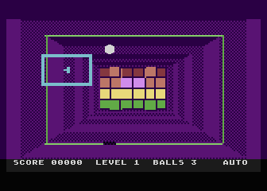 | [Block Breaker 3D](projects/block_breaker_3d/README.md) | Breakout down a tunnel: steer the ball with a paddle frame into a block of bricks at the far end. | 64K 800XL | 40-50 fps |
| 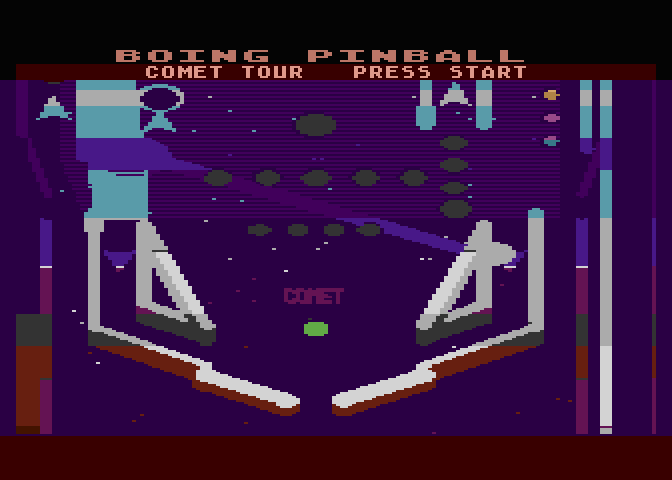 | [Boing Pinball](projects/boing_pinball/README.md) | The Comet Tour table with the Boing ball: bumpers, drop targets, a ramp, missions and multiball. | 130XE | physics ~18 of 25 steps/s |
| 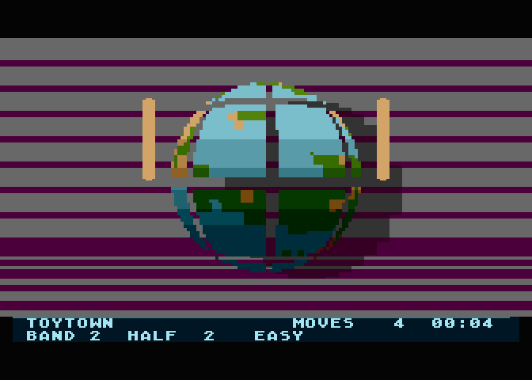 | [Boing Twist](projects/boing_twist/README.md) | A twisty puzzle on the Boing ball: twist its bands and flip its halves until the picture is whole. | 130XE | 15-17 pictures/s while moving |
| 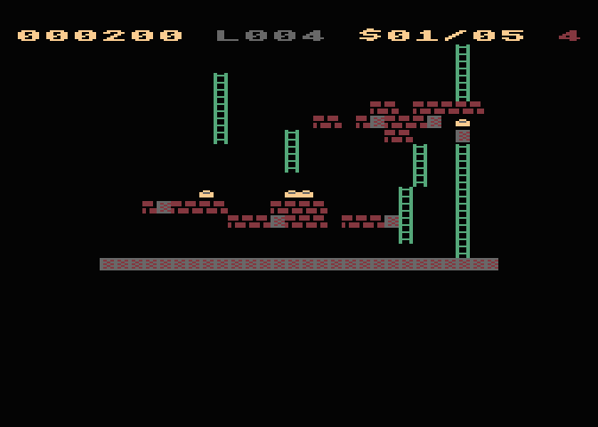 | [Bullion Dash](projects/bullion_dash/README.md) | Grab all the gold, dig holes to trap the guards, then climb out: 150 levels and an editor. | 48K / 64K | 37-41 fps |
| 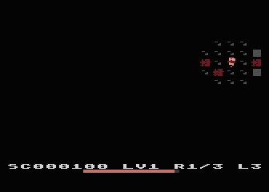 | [Emberkeep](projects/emberkeep/README.md) | Four chambers by a lantern's light: take the runes, keep the oil burning, mind the dark's things. | 48K / 64K (uses 130XE banks if there) | 39 fps avg, rules 50 Hz |
| 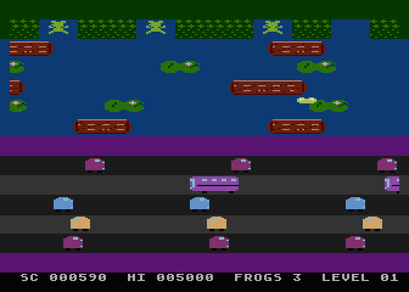 | [Frank the Frog](projects/frank_the_frog/README.md) | Hop Frank over five lanes of traffic and a river of logs and lily pads into the four ponds. | 48K / 64K | 50 fps |
| 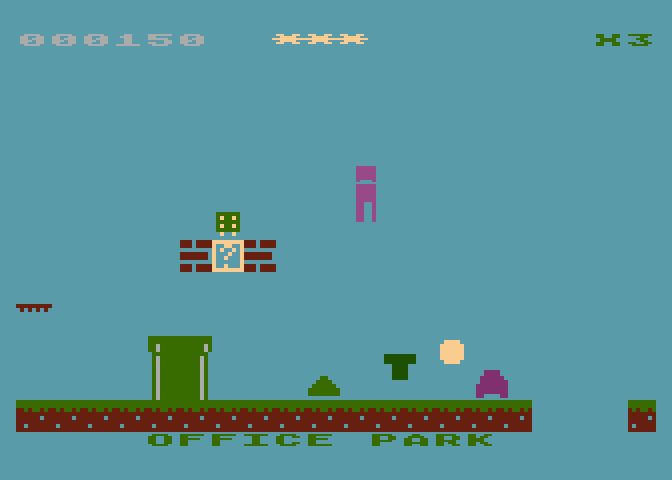 | [Jump Quest](projects/jump_quest/README.md) | RJ and Dale's scrolling platformer: stomp the bugs, grab the goodies, reach the flag in three levels. | 48K / 64K | 27-35 fps |
| 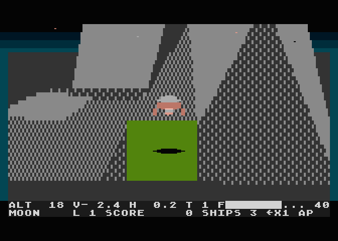 | [Lander 3D](projects/lander_3d/README.md) | Land on a pad in the Moon's craters, Mars's wind or an asteroid's low gravity, with a tank of fuel. | 64K 800XL | 3-7.5 fps (avg 5.5) |
| 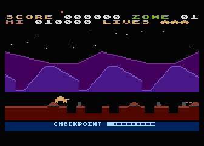 | [Lunar Rider](projects/lunar_rider/README.md) | Drive a moon buggy over craters, rocks and mines; shoot UFOs and meteors. 26 zones a loop. | 48K / 64K | 49.8 fps |
| 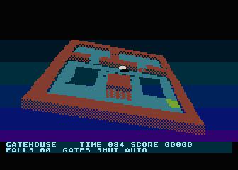 | [Marble Tilt](projects/marble_tilt/README.md) | Tilt a floating maze to roll a marble to the exit past holes, gates, bumpers and sand, against the clock. | 64K 800XL | 18-43 fps |
| 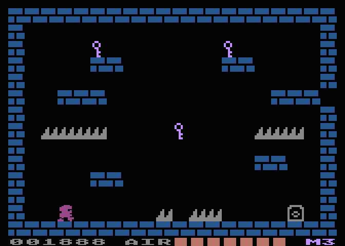 | [Miner Meteor](projects/miner_meteor/README.md) | Six caverns of keys, spikes, belts and crumbling floors: get every key out before the air runs out. | 48K / 64K | 50 fps |
| 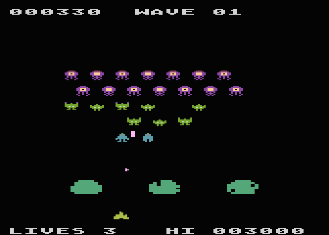 | [Nova Defense](projects/nova_defense/README.md) | Hold off a marching swarm of 48 aliens from behind three crystal shields; shoot the comet for a bonus. | 48K / 64K | 48-50 fps (30-50 in the swarm) |
| 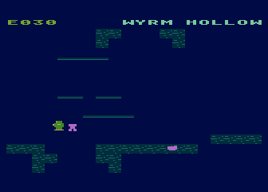 | [Orb Hunter](projects/orb_hunter/README.md) | Explore 48 caverns of rock, magma and metal, shoot their creatures, find nine power-ups. | 48K / 64K | 41 fps avg, rules 50 Hz |
| 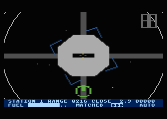 | [Orbit Docking](projects/orbit_docking/README.md) | Dock with a spinning space station: roll to match its slot and close in gently, with limited fuel. | 64K 800XL | 4.2-6.4 fps |
| 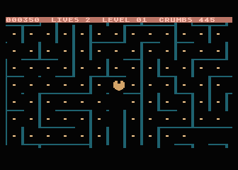 | [Planet Chomp](projects/planet_chomp/README.md) | A maze chase round a tiny planet: eat every crumb, dodge four spooks, grab a key to turn the tables. | 64K 800XL | 23-25 of 25 steps/s |
| 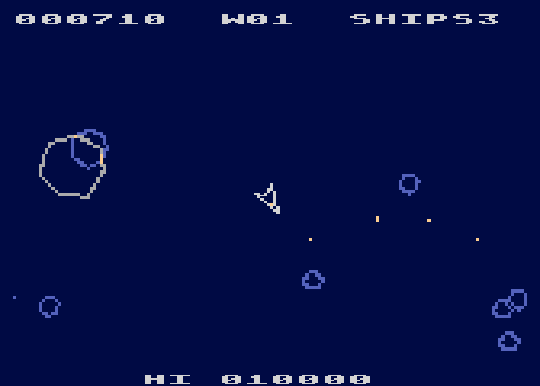 | [Rock Blaster](projects/rock_blaster/README.md) | Vector rock shooter: turn, thrust and fire; big rocks split in two, clear the wave for more. | 48K / 64K | 36-50 fps |
| 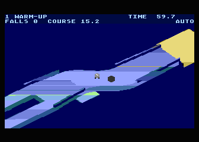 | [Rolling Steel](projects/rolling_steel/README.md) | Roll a steel marble down six floating courses against one clock: ice, sand, acid, chasers. | 130XE | 13-24 fps, physics 46-49 of 50 steps/s |
| 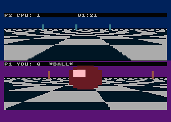 | [Rotoball](projects/rotoball/README.md) | Split-screen ball sport: carry the ball over the other goal line. 1 player v the CPU, or 2. | 48K / 64K | 26 fps, rules 50 Hz |
| 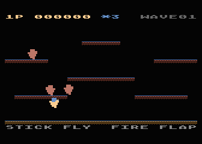 | [Sky Knights](projects/sky_knights/README.md) | Joust on flying mounts: strike from above, catch the pods before they hatch. One or two players. | 48K / 64K | 35-48 fps (26 with two knights) |
| 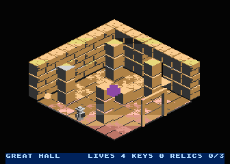 | [Spectral Keep](projects/spectral_keep/README.md) | An isometric flip-screen adventure: three keeps, relics to carry to the throne, guards and ghosts. | 130XE | 50 fps, logic 5-12.5 steps/s by room |
| 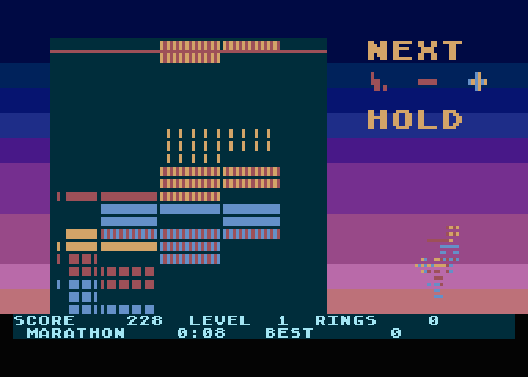 | [Stack Tower](projects/stack_tower/README.md) | Falling pieces wrap round a 16-column tower: turn it under them and fill whole rings to clear them. | 64K 800XL | 24-48 fps |
| 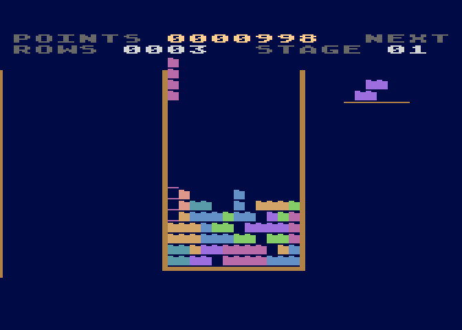 | [StakAttack](projects/stakattack/README.md) | Seven gems in seven colours fall into the well: turn and slide them to fill rows before it overflows. | 48K / 64K (GTIA) | 50 fps |
| 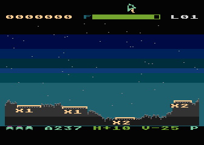 | [Uranus Lander](projects/uranus_lander/README.md) | Land on the pads of Uranus: rotate, thrust gently, touch down upright. OPTION: autopilot. | 48K / 64K | 49.7 fps |
| 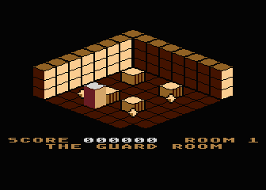 | [Warden Keep](projects/warden_keep/README.md) | An isometric keep in the Knight Lore manner: push the barrels, take the jewels before the clock runs out. | 64K 800XL | 50 fps |

## Playing in the window

`./a8 run <project>` and `./a8 arcade` open Atari800 in a window:

| Key | Atari |
|---|---|
| arrow keys | joystick 1 (keypad 8 / 5 / 4 / 6 also work) |
| Option (Mac) / Left Alt | fire (Right Ctrl also works) |
| F4 / F3 / F2 | START / SELECT / OPTION |
| F5 | RESET (the arcade: back to the menu) |
| F1 | Atari800's menu (a second keyboard joystick, W A S D + Left Ctrl, can be enabled there) |
| F9 | quit |
| other keys | the Atari keyboard |

The arrow keys are the joystick, so they aren't the Atari's cursor keys in a
window; programs read the joystick (the SDK's `input_read()` does both).
Holding Option and pressing a letter is an Atari800 shortcut (e.g.
Option+F fullscreen), not fire + that key.

- `sdk/` – the C library and headers for games (frame timer, display lists,
  player/missile graphics, POKEY sound and music, input, fixed point,
  130XE banks, the harness log). See [docs/sdk.md](docs/sdk.md).
- `docs/` – getting started, SDK reference, the harness and MCP tools,
  Atari 8-bit gotchas.
- `projects/` – programs and games.

The Atari OS used is AltirraOS, the free replacement built into Atari800; no
copyrighted ROMs are needed or downloaded.

MIT licensed (see LICENSE). Atari800 is GPL-2.0; it is fetched into
`third_party/` and patched at build time, not distributed here.
