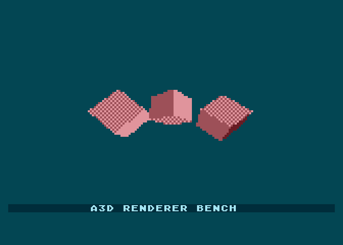

# a8_3d: a 3D renderer for the Atari 8-bit

A small flat-shaded and wireframe 3D renderer for 6502 Atari XL/XE (and 48K
400/800) machines, shared by the ports of the amiga3d-engine games
(stack_tower, lander_3d, marble_tilt, block_breaker_3d, orbit_docking,
tank_duel). `lib/` is the renderer; `src/main.c` is its bench, self-check
and demo (three spinning shaded cubes, wireframe on FIRE).



## What it does

| Part | How | Where |
|---|---|---|
| Display | ANTIC mode D, 160 x up to 96 in 4 colours + up to 3 ANTIC 2 text rows | `a3d_init.c` |
| Double buffering | two display lists, switched by the high byte of `SDLSTL` (one store: atomic for the VBI); `a3d_sync` waits for a VBI *after* the switch before the other buffer is drawn | `a3d_init.c` |
| HUD colours | a DLI on the last 3D line sets the text rows' colours, so COLOR0-2 stay free for the 3D | `a3d_zp.s` |
| Multiply | quarter squares, one 768-entry table pair for signed and unsigned 8 x 8 (exact, 26 cycles a product) | `a3d_math.s` |
| Transform | Q7 rotation matrix (int8, 127 = 1.0) x int8 model vertices + int16 origin, rounded | `a3d_math.s` |
| Projection | z normalised to 128..255, one reciprocal table `f*256/z` for both axes; the pixel aspect lives in the camera matrix's y row | `a3d_math.s` |
| Matrices | yaw/pitch/roll from a Q7 sine table, 3 x 3 multiply in asm, 16-bit vector rotate | `a3d_mat.c`, `a3d_math.s` |
| Polygons | convex, clockwise; edges walked from the top into left/right tables (16.8 fixed point, slope = dx * 65536/dy), down edges are the right side, so anticlockwise polygons fill nothing | `a3d_poly.s` |
| Spans | masked edge bytes from tables by x, whole bytes by an unrolled `sta (p),y / iny` entered at the right point | `a3d_span.s`, `a3d_span.inc` |
| Shading | two alternating patterns (even/odd lines): 7 shades from 4 colours (`a3d_shade_set`) | `a3d_poly.s`, `a3d_sin.c` |
| Culling | the screen winding of the first three vertices (8 x 8 cross product, deltas shrunk to fit) | `a3d_poly.s` |
| Clipping | x by clamping each edge per line (exact for convex polygons); top/bottom by Sutherland-Hodgman in C; the near plane in camera space (C) | `a3d_poly.s`, `a3d_clip.c` |
| Lines | Bresenham with incremental pointer and mask; Cohen-Sutherland clip in C | `a3d_line.s`, `a3d_line.c` |
| Clearing | rows: one pass of X over all pages with a store per page (5 cycles a byte); or the "dirty" rectangle each buffer recorded | `a3d_span.s` |
| Maths helpers | `a3d_muldiv` (16 x 16 / 16 in asm), `a3d_mulf` (16 x 16 >> 8) | `a3d_math.s` |

## Using it

```make
NAME   := mygame
A8_SDK ?= ../../sdk
include ../a8_3d/a3d.mk          # builds build/obj/a3d/a3d.lib: only what you call is linked
include $(A8_SDK)/project.mk
```

```c
#include "a3d.h"
a3d_init(88, 1);                       /* 88 lines of 3D + 1 text row */
a3d_view(80, 44, 80);                  /* centre, focal length (before a3d_xform) */
a3d_print(0, 0, "SCORE");
for (;;) {
    a3d_clear_dirty(A3D_C0);           /* what this buffer drew last time */
    a3d_cam_ypr(&cam, yaw, pitch, 0);  /* camera: yaw, pitch, roll (256 a turn) */
    a3d_rot16(&cam, obj_x - cx, obj_y - cy, obj_z - cz, rel);   /* object origin */
    a3d_mat_ypr(&rot, a, b, 0);
    a3d_mat_mul(&a3d_om, &cam, &rot);  /* object -> camera */
    a3d_ox = rel[0]; a3d_oy = rel[1]; a3d_oz = rel[2]; a3d_oshift = 0;
    a3d_xform(0, 8, cube_verts);       /* int8 x,y,z triples -> a3d_sx/sy */
    a3d_shade_set(4);
    a3d_face(4, face_idx);             /* clipped, culled, filled */
    a3d_flip();                        /* show it, wait for the VBI */
}
```

Coordinates: camera space x right, y up, z forward; screen y down.
`a3d_oshift` scales a model (vertex unit = 2^shift camera units). Polygons
must be clockwise as seen from the front.

## Memory

Everything lives in the a8dev map (sdk/cfg/a8.cfg), no 130XE bank needed:
it runs on a 64K 800XL (the test runs it there too).

| | |
|---|---|
| `$A010-$AF0F` | buffer 0 (96 x 40 bytes) |
| `$AF10-$AF7F` | display list 0 |
| `$AF80-$AFF7` | text rows (3 x 40), shared |
| `$B010-$BF0F` | buffer 1 (= buffer 0 + $1000: a line's address in the back buffer is one `ORA` of its high byte) |
| `$BF10-$BF7F` | display list 1 |
| zero page | 35 bytes |

The whole library is about 10K of code, 2.9K of tables and 1.9K of BSS
(64 transformed vertices, the projection table, edge tables). It is an
ar65 library of small modules, so a game links only what it calls:
stack_tower, which draws with its own row compositor and `a3d_span`,
takes about 3K of it (display, spans, text) and none of the maths.

## Speed

Measured by the bench in the emulator (PAL 130XE; wall-clock cycles with
ANTIC's DMA included, about 26% of the CPU in mode D; `./a8 test a8_3d`
keeps each one inside a budget):

| | cycles |
|---|---|
| clear all 96 lines | 26,500 |
| clear 40 lines | 13,300 |
| fill a 40 x 30 rectangle | 12,900 |
| a 60 x 40 triangle through `a3d_poly` | 17,400 |
| a big triangle clipped at the top and sides | 61,900 |
| a 140-pixel line | 16,500 |
| transform + project 8 vertices | 16,300 (2,000 a vertex) |
| `a3d_mat_ypr` (C) | 10,500 |
| `a3d_mat_mul` (asm) | 5,300 |
| a cube's 6 faces (3 drawn, ~21 x 18 pixels each) | 43,000 |

A PAL frame is 35,568 cycles. The demo (three shaded cubes, each with
its own matrix, dirty-rectangle clears) runs at **7 frames a second**.
Where the time goes (`tools/profile.py`, PC sampling): edge walking 8%,
the transform 8%, multiplier set-up 7%, projection 6%, span loop 5%, face
gather/cull 7%, cc65 call overhead about 10%, `sound_tick` 3%.

The lesson from the Spectrum Next ports (28 MHz Z80s that drew 8-50 fps)
applies 16 times over here: the 6502 can afford a few hundred
transformed vertices a second and some tens of thousands of filled
pixels. So the games draw as little 3D as they can:

| Game | Frame-rate target | How |
|---|---|---|
| stack_tower | measured 48 fps falling, 12-13 turning | rings redrawn only when they change, the core in players (see its README) |
| lander_3d | 12-17 fps | a coarse terrain grid, the lander a sprite |
| marble_tilt | 17-25 fps | the maze redrawn only when the tilt changes, the marble a 50 Hz sprite |
| block_breaker_3d | 50 Hz ball, 25 fps scene | the tunnel drawn once into both buffers, bricks redrawn when hit, ball/shadow/paddle as sprites |
| orbit_docking | 10-15 fps | wireframe station |
| tank_duel | 6-10 fps | few, large flat polygons |

Input in a 6-frame iteration: a short tap can fall between two reads, so
games latch presses (the demo's test holds FIRE for 15 frames).

## Profiling

```sh
.venv/bin/python projects/a8_3d/tools/profile.py projects/a8_3d/build/a8_3d.xex \
    --until "a8_3d: ready" --frames 60 --every 503 [--fine]
```

stops the emulator at evenly spaced cycles (`run_to(frame, cycle)`), reads
PC and counts samples per symbol. `a3d_ticks()` / `a3d_since()` time code
from inside the program (2 scan lines = 228 cycles a tick).

## Not done yet

- Polygons with more than 16 vertices after clipping, and models with more
  than 64 vertices in one `a3d_xform` batch.
- Mode E (160 x 192) double buffering would need a 130XE bank for the
  second 7.5K buffer; mode D was enough so far.
- Sorting: the games order their faces themselves (painter's order from
  their known geometry).
