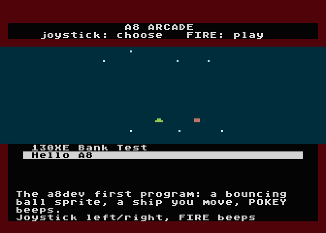

# A8 Arcade

Every game in the repo on one bootable ATR disk, with a menu: no DOS, no
copyrighted ROMs (sdk/boot/boot.s is our own boot loader; Atari800 runs
AltirraOS).

```sh
./a8 arcade                  # build every game + the menu + build/arcade/arcade.atr, open it in a window
./a8 arcade --no-build       # use what's built
./a8 arcade --image-only     # just the disk
./a8 arcade --list           # the registered games
./a8 test arcade             # boots the disk, picks a game, RESET back to the menu
```



## Joining

`projects/<p>/arcade.json`:

```json
{"title": "Planet Chomp", "ready": "chomp: ready",
 "description": "up to ~110 characters (3 lines of 38)",
 "controls": "joystick, FIRE (38 characters)",
 "picture": "screenshots/play.png", "picture_frames": 100, "picture_press": "START"}
```

`ready` is the game's log line once it's running (the test and
`arcade_play` wait for it). `picture` is optional: without it the game is
booted headless and captured `picture_frames` frames after `ready` (after
pressing `picture_press`, if given). Pictures are 80x48 in the game's four
most common colours, cached in build/arcade/pics.

## Keys

Joystick or W/S/arrow keys choose, FIRE / START / RETURN plays, RESET (in
the emulator: `emu_reset(hard=False)`) comes back to the menu.

## How it works

```
power on -> OS boots sector 1 -> boot.s at $0700 (claims DOSINI/DOSVEC: RESET = menu)
         -> loads directory entry 0 (the menu XEX) segment by segment (INITAD, RUNAD)
menu     -> reads game pictures (sectors 17-264, 8 per game) with boot.s's read_sector
         -> FIRE: JMP $0709 with A = game + 1 -> boot.s loads that XEX and runs it
```

The menu's display list has a title, an ANTIC D picture band whose colours
are set by a display-list interrupt (src/dli.s), and text below. Disk
layout: tools/a8dev/src/a8dev/atr.py. One disk holds 31 games (the
directory has 32 entries); the image grows past 720 sectors as needed
(Atari800, Altirra, SIO2SD and FujiNet read large ATRs).
