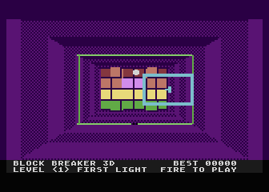
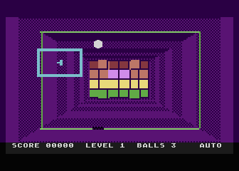
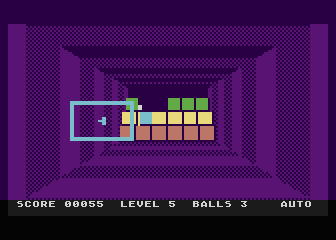
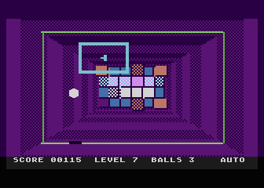
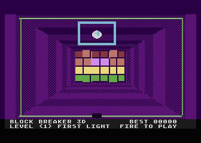

# Block Breaker 3D (Atari 8-bit)

Port of `amiga_mcp/examples/block_breaker_3d` (the Amiga original on the
amiga3d engine): breakout down a tunnel. The paddle is a frame across the
tunnel's near opening that moves up, down, left and right. The ball flies
down the tunnel to a block of bricks at the far end (6 across, 4 high, 3
deep) and back again. Where the ball meets the paddle steers it. A green
ring round the tunnel walls and a shadow on the floor show how far away the
ball is.

 
 

## Controls

| Joystick / keys | |
|---|---|
| stick (W A S D, arrows) | move the paddle |
| FIRE (SPACE) | serve |
| START (P, RETURN) | pause |
| B | the autopilot on / off |
| ESC | back to the title |

On the title the autopilot plays the demo; left / right (or up / down)
choose the level to start on, FIRE or START plays. The title shows the best
score.

Coloured bricks break in one hit, silver (tough) ones take 2 hits (3 from
level 5) and steel never breaks. Pink bricks drop a capsule that drifts
towards you; catch it with the paddle: **W** wider paddle, **S** slower
ball, **L** an extra life, **P** the ball ploughs straight through bricks
for a while. The ball speeds up the longer a rally lasts. Scoring: 10 a
brick, 30 a tough one, 50 a bonus one, +5 for each layer deeper, 5 for
hitting a tough brick, 100 a capsule, 250 x the level for clearing it.

## What's kept, what changed

Kept: the 8 levels exactly (First Light, Chequers, The Window, Pillars,
Stairway, The Vault, Crossfire, The Core), the rules (`src/bb_core.c` is
the original's `bb_core.c`: the ball moving a quarter of a tick and one axis
at a time, bounces that undo the move, the paddle steering by where it's
hit, the speed-up as a rally goes on, tough and steel bricks, the plough,
capsules and their timers, scoring, lives), the original's camera
(z = -320, its focal length scaled to the Atari's pixels), the striped
tunnel, only the brick faces you can see (the front with a rim, and the
sides that face the camera with no brick against them), the ring and the
shadow, the paddle's frame and cross (red flashing while ploughing), the
ball (red while ploughing), the original's 25 ticks a second, and its
autopilot (playing the title's demo and on B).

Changed (marked `port:` in the source):

- **16-bit rules.** Positions and speeds are in 1/32 units in 16 bits (the
  original: 1/256 in 32), so it doesn't play the same game as the Amiga
  for a seed; 32-bit maths only where the original multiplies two of them
  (the steering, the ball's speed, the autopilot). Cells by subtraction,
  not division; the autopilot decides every second tick, its hashes are
  worked out only when what they hash changes, and its aim is folded in
  1/2 units.
- **A fixed camera.** The original leans the camera a fifth of the
  paddle's offset, which moves every pixel. Here the tunnel never changes:
  `tools/gen_view.py` casts a ray per pixel into the original's tunnel, and
  every line of it turns out to be the side walls' row (the same on every
  line) with one run of floor, ceiling or back wall in the middle, so the
  whole tunnel is 80 bytes and three a line.
- **Bricks as rectangles.** From a fixed camera every brick's front is a
  rectangle and its sides 1-2 pixel strips, so the bricks are drawn with a
  rectangle fill (asm) into a clean box (13 bytes x 31 lines), and only
  round the brick that changed (its column and row at every depth, clipped
  to that window), then copied into each screen buffer.
- **Colours by band.** Mode D has four colours a line. The bricks' rows are
  bands of lines, and a DLI gives each band its own two brick colours
  (COLPF1/COLPF2) for the level; `gen_view.py` picks them for the bricks in
  that row (the ones you see first count most), and a third or fourth kind
  of brick in a row is a checker of two colours. Steel is the tunnel's
  light purple, a cracked tough brick is dithered darker.
- **The ball is always in front of the bricks** (it's a player); the
  original hides it behind a brick in front of it.
- **The title, help and messages** are in the two text rows under the
  picture, not drawn over it. Not ported: the help pages (the controls are
  here), the bits of broken bricks flying off, the capsules' letter in a
  second colour (it's cut out of the capsule: W S L P), the original's
  bridge hooks and in-game self-test (the Atari test is `test.py`).
- **Sound**: POKEY effects (the SDK's `snd_sfx`) for walls, the paddle,
  breaks, hits, steel, serves, capsules, a lost ball, a cleared level and
  the end; the original synthesises its samples.

## Atari hardware used

- ANTIC mode D (160 x 88, 4 colours) double-buffered by the a3d renderer
  (`projects/a8_3d`: its display lists and flips, text rows and multiply
  tables), two text rows (mode 2) for the score line and messages.
- DLIs (`src/dli.s`): each brick row's band gets its own COLPF1/COLPF2,
  then the rest of the tunnel's (the ring, the shadow), then the text
  rows'.
- Players 0 and 1: the paddle's frame (double width, quadruple when wide);
  player 2 the ball (16 sizes by depth, double width when near); player 3
  a capsule (sizes by depth, its letter cut out; two or more take turns).
  Missiles 0 and 1 as the fifth player (COLOR3): the ring's sides on the
  walls. Its floor and ceiling lines and the shadow are spans in the
  bitmap.
- The sprites are placed by the vertical blank (`src/sprites.s`): the main
  loop works out two frames at a time (halfway between the last two ticks,
  then the tick) and the VBI shows one a frame, so the ball and paddle move
  at 50 Hz while the main loop runs at 25.
- POKEY sound effects; input latched in the deferred VBI (`src/vbi.s`).

## Frame rate (PAL, measured in the emulator)

The log prints `bb: ticks5s= frames5s= bricks= work=` every 5 seconds.

- The rules: **25 ticks a second** (the original's), 120-126 in 5 s while
  playing.
- The main loop (the bitmap: ring, shadow, bricks): **20-25 a second**
  (frames5s 100-125), so the ball, paddle, capsules and ring move at
  **40-50 frames a second** (two VBI frames per loop).
- A brick broken: 15-45K cycles to redraw round it (`bricks=` 130-400 scan
  lines), so a loop with a break can take a third frame.

Where the time goes in the demo (`projects/a8_3d/tools/profile.py`): 38%
waiting for the VBI, rectangle fills (ring, shadow, tunnel repairs) 9%,
working out the sprites' slots and projecting (asm, a3d's quarter-square
tables) 13%, the DLIs 3%, the VBI's sprite updates 2%.

Profiling moved, in turn: the autopilot's 32-bit maths (25% of the CPU in
`udiv32`) to cached hashes and a fold in 16 bits; the sprites into the VBI
(two frames from each main loop: from 16 to 22-25 loops a second); the
projection to asm with table multiplies; restoring a line from the clean
copy to the tunnel's row + middle run (and the clean copy, 3.5K, went); the
bricks from a full redraw (2000 scan lines) to a clipped redraw round the
changed brick in asm (130-400).

## Memory

It runs on a 64K 800XL (the test boots it on one): no 130XE banks. The
game state, the clean box, the 1/z tables (made at start-up) and a3d's
tables live in the SDK's `LOWRAM` ($0C00-$1FFF, only for programs loaded
without DOS: the harness and the arcade disk). `-Cl` keeps C locals static,
`-Ors` (no inlining) keeps the code small.

| | debug build | `RELEASE=1` |
|---|---|---|
| program `$2000-` | `$8DAD` | `$89B5` |
| free below the C stack (`$9000`) | 0.6K | 1.6K |
| LOWRAM `$0C00-` | `$1C08` (4.0K of 5K) | the same |
| zero page | `$82-$C2` | the same |
| screen | two buffers `$A010` / `$B010`, display lists `$AF10` / `$BF10`, text rows `$AF80`; PMG `$9800` | |

## Testing

`./a8 test block_breaker_3d` (`test.py`): the title (the demo plays on the
autopilot); RIGHT / LEFT choose the level, FIRE starts level 1 with the
ball on the paddle and level 1's bricks on the screen; RIGHT and UP move
the paddle; FIRE serves and the ball flies down the tunnel; START pauses
(the ball stops) and starts again; B: the autopilot breaks bricks (the
score, the screen matches the clean box), catches a capsule and clears
level 1; level 2 (Chequers) with its bricks; autopilot off, the paddle
moved away: a ball lost, a life gone, the ball back on the paddle; the last
life lost: game over, FIRE, the title. And the 800XL.

## Not done yet

- The bits of broken bricks, the help pages, music.
- The brick colours are chosen per level; as bricks break, a row could get
  better colours for what's left.
- NTSC: the ticks count 17 ms frames, so the speed is right; the VBI
  shows 60 frames a second there, the colours are PAL's.
