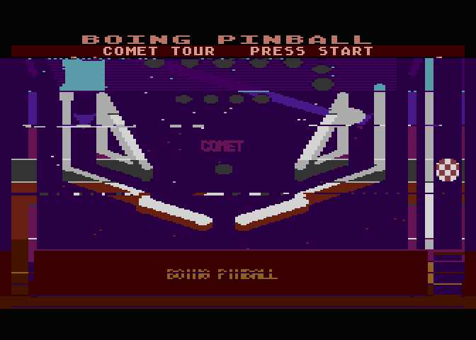
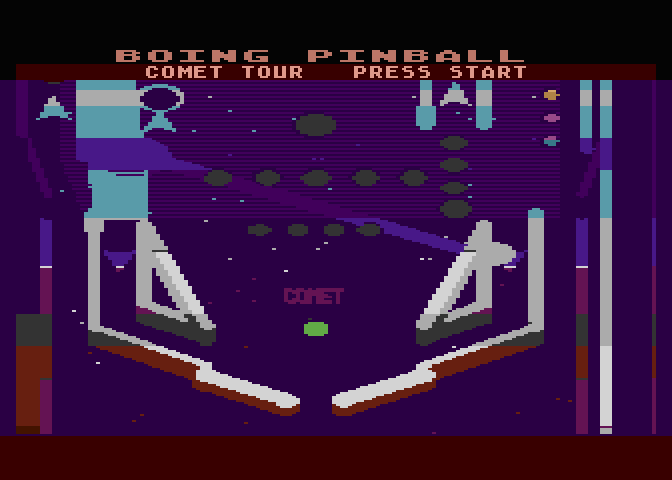
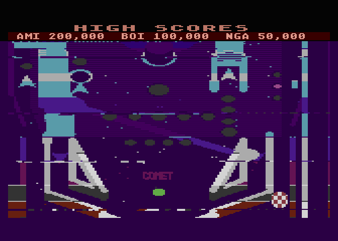
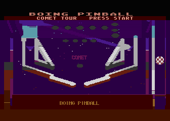

# Boing Pinball (Atari 130XE)

Port of `amiga_mcp/examples/boing_pinball` (itself a port of the browser
game), after the Spectrum Next port: the Comet Tour table with the Boing
ball. Three pop bumpers, the drop-target bank, the ramp, the left orbit
with its spinner, the mission saucer, slingshots, inlanes and outlanes,
top lanes, the plunger. The original's rules: skill shot, lane sets and the
bonus multiplier, ramp locks and multiball with jackpots, five missions
leading to Supernova, ball save, tilt, the end-of-ball bonus. Three balls.

**It needs a 130XE** (the physics and the rules run from its banks). On a
64K machine it says so.

  



```sh
./a8 build boing_pinball            # RELEASE=1: no harness log
./a8 run boing_pinball
./a8 test boing_pinball             # a bot plays a game with the joystick (test.py)
```

## Controls

| | |
|---|---|
| flippers | joystick left / right (FIRE: both); keys Z / M, or SHIFT for the left |
| plunger | joystick down held (or SPACE), let go to launch |
| nudge | joystick up (or N); too often and the table tilts |
| start | START (the attract mode is the original's demo player) |
| initials | type them, or up / down and left / right, FIRE when done |

POKEY reads one key at a time, so both flippers from the keyboard is
SHIFT + M. PAL first; on NTSC the simulation steps 30 times a second
instead of 25 (it counts frames).

## What's kept, what changed

Kept from the original (through the Spectrum port, which converted it to
16-bit units: 1/16 mm, 1/4 mm/s, Q14 unit vectors):

- **The rules**, unchanged (`src/pb_rules.c`, the display text, the lamps
  and the demo player in `src/pb_rules2.c`): every mission, lock, jackpot,
  bonus, ball save and tilt.
- **The physics, function for function** (`src/pb_phys.c`, `pb_phys2.c`):
  capsule walls and gates, posts and pop bumpers with their kick, the
  tapered flippers with the surface velocity w x r at the contact, sling
  kicks, drop targets, the spinner, the saucer, the ramp as a rail, balls
  against each other, the speed cap. The table's geometry is the
  original's (`table_0.c`, made from its `pb_tables.c`).
- The table's picture: the original's render.c drawing (its pens, walls,
  posts, bumpers, ramp, lamps and decoration in its oblique view), via the
  Spectrum port's drawing code, at the Atari's scale (`tools/gen_gfx.py`).

Changed (marked `port:` in the code):

- **The step: 25 a second, not 120**, every per-step constant converted
  from the original's per-second value, with substeps so no substep moves
  a ball further than its radius (the original: a quarter). On a wall's
  straight part the contact normal is the wall's own (no square root or
  division; the same up to rounding); the substeps' count takes |v| from
  above without a square root (max + min / 2).
- **The speed**: the simulation needs more than the 6502's time: it runs
  **about 18 of the 25 steps a second** (the attract mode over 20,000
  frames: 18.4), so the ball moves at about three quarters of the
  original's speed. The
  display is drawn every frame (50 a second). See Not done.
- Rules: the plunger's pull and the tilt meter's decay per step converted;
  timers in milliseconds instead of floating-point seconds (cc65 has none).
- The table is foreshortened more than the original's view (0.33 vs 0.44
  rows a mm), so half of it is on screen at once; the screen scrolls with
  the lowest ball.
- High scores (five, with initials) are new; the MOD music and the other
  two tables (Deep Dive, Robot Foundry) aren't ported.

## How it is drawn

- **ANTIC mode 4** characters (4 colours, + the inverse bit's fifth): the
  table is 40 x 48 characters, 22 rows on screen, **scrolled finely**
  (VSCROL) and coarsely (the first row's LMS) to follow the ball.
- **A DLI on every row** sets its four colours and its **font** (CHBASE):
  `gen_gfx.py` quantises each row of the picture to its own palette and
  packs the rows' tiles into 7 fonts of up to 128 characters.
- **Lamps** are drawn in colour 3: setting a character's inverse bit turns
  PF2 (the lamp off) into PF3 (the lamp's colour). **Drop targets** swap
  characters.
- **The flippers** are characters of their own: 8 frames each (made on the
  host with the table behind them), copied from bank 3 into the font as a
  flipper moves.
- **The Boing ball** is players 0 and 1 (its red and its white squares, 8
  frames of spin), 8 pixels by 16 lines (round on screen); in multiball the
  other balls are players 2 and 3.
- **The dot-matrix display**: a mode 6 row (the big text) and a mode 2 row.
- **POKEY**: the bumpers, slings, flippers, drop targets, the spinner, the
  plunger, the drain, the saucer, jackpots.

## Memory

The game switches the **OS ROM off** (`src/os.s`: its own NMI, IRQ, VBI
shadows and latched joystick, as in Boing Twist) and uses all four banks.
Code in a bank runs in the window `$4000-$7FFF`; each banked function the
rest calls has a 6-byte trampoline (`src/banks.s`) that maps its bank and
maps the old one back. Everything banked code touches is outside the
window.

| | |
|---|---|
| `$2000-$3FFF` | start-up, the trampolines, `os_off`, the C runtime and the SDK |
| `$4000-$7FFF` | the front end (main memory; never runs with a bank mapped) |
| `$8000-$8BFF` | the table's map (40 x 48), the ROM font's copy |
| `$9000-$9FFF` | C stack, players |
| `$A000-$BFFF` | the 7 table fonts, the display list, the text rows |
| `$C000-$CFFF` (under the ROM) | the game (`Game`, the physics' variables) |
| `$D800-$EFFF` (under the ROM) | the table's data (copied from bank 2) |
| `$F000-$F7FF` (under the ROM) | quarter-square tables for the multiply |
| `$F800-$FFF9` (under the ROM) | the maths, the display interrupts, the number format (copied from bank 2) |
| bank 0 | the physics' hot parts: collisions, substeps (`pb_phys.c`, `physasm.s`) |
| bank 1 | the rules (`pb_rules.c`) |
| bank 2 | the physics' cold parts (`pb_phys2.c`), the load images of the table and the maths |
| bank 3 | the fonts and the map (copied out), the flippers' frames |

## Speed work (measured with `tools/profile.py`)

`tools/profile.py [frames] [skip]` samples the PC every 1/32 frame of
machine cycles and names it from the linker's debug file, by bank;
`tools/profile.py trace FUNC` counts every instruction of one call.

From 1.2 steps a second (cc65's C as it was) to ~14:
- the SDK's C multiply did a 32 x 32 multiply: `src/maths.s` has 16 x 16
  by quarter squares with zero-page pointers (~100 cycles), a 32 / 16
  divide, an integer square root;
- `move_ball`'s fast path is asm (`src/physasm.s`): x += v dt, the grid
  cell, the box test of each wall, post and sensor, the flippers' reach,
  the saucer / plunger / drain regions; the C runs only for what passes;
- a wall contact's straight part is asm (`seg_fast`), checked against the
  C it follows (`make SEGCHECK=1` runs both and logs any difference);
- no divisions per step (tables per substep count), pointers instead of
  struct indexing in the hot loops, a moving flipper adds substeps only
  when a ball could reach it.

From ~13 to ~16 (the attract mode over 20,000 frames: 13.0 -> 16.3; the
physics' results unchanged: the attract mode's log is the same event for
event as before):
- the ball against a flipper is asm (`flip_fast`, step for step the C:
  `make FLIPCHECK=1` runs both and logs any difference), and the flipper's
  sine (`sin_q14`);
- the substep loop is asm (`substeps`), and steps only the flippers that
  are moving when the step starts (one at rest stays so);
- past a wall's end, `seg_fast` says "no contact" itself when the ball's
  box misses the end point by its reach and 2 P (the C took the end's
  circle every time);
- the 32 / 16 division takes 16 steps when the quotient fits 16 bits;
  `div625` is asm; the score's digits are made by subtraction (cc65's
  32-bit division was ~1,500 cycles a digit);
- the display interrupts: the NMI goes straight to the DLI, and a table
  row with the same font and colours as the row above gets no DLI (the
  VBI sets the display list's DLI bits when the scroll row changes);
- the ball and flippers are drawn only on frames where the physics stepped.

From ~16 to ~18 (16.3 -> 18.4, the log still the same event for event):
- the step's setup is asm too (`b0_world_step`: the rolling resistance,
  the speeds, the moving flippers and their reach, the substeps' count and
  constants, the balls on a ramp, in the saucer and the lane; the spinners
  stay C, called when one turns);
- `move_ball` calls `seg_fast` itself: a wall the ball misses costs no C
  (`mb_seg_end` for an end, `mb_seg_hit` for a contact);
- the front end's `(a * b) >> 12` is asm (`fmath.s`), each ball's table
  line is worked out once a frame; the lamps without struct-index
  multiplies or modulos; the attract mode's high-score line made once.

## Not done

- **Full speed.** What's left is spread thin: the display interrupts on
  every changing row (about a sixth of the machine), the multiplies (a
  tenth, already quarter squares), and C here and there (the rules' tick,
  a flipper moving, a wall's end, the posts), each worth under 2% in asm.
- The other two tables, the MOD music, the bumpers' and slings' flashes,
  the plunger's drawing.

## Test

`./a8 test boing_pinball` (`test.py`): the attract mode scores; START; a
Python bot reads the ball from the game's probe and plays the joystick
like the original's `pb_bot` (the plunger by holding down, the flippers
when a ball comes down near one), scores on the first ball, then lets the
balls drain: three balls, game over, the initials BOT, back to the
attract mode; the steps a second (at least 8); a 64K 800XL is refused.
