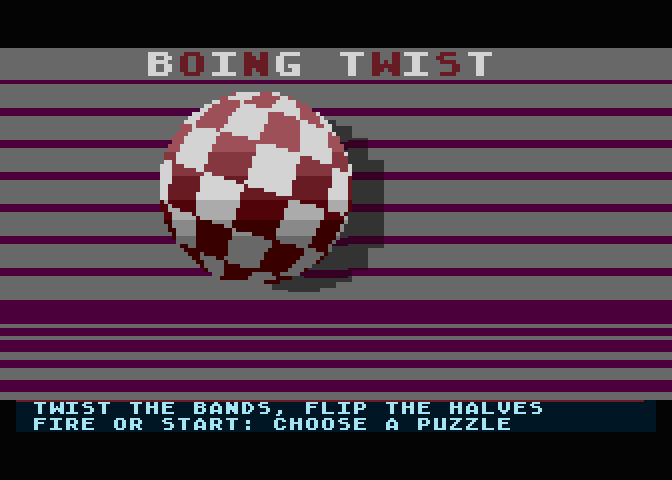
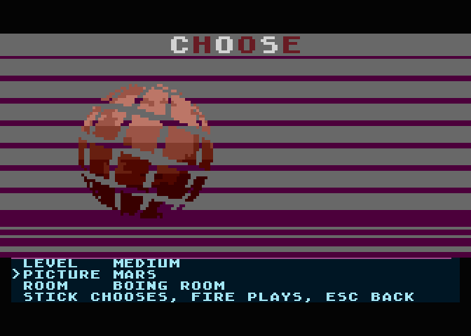
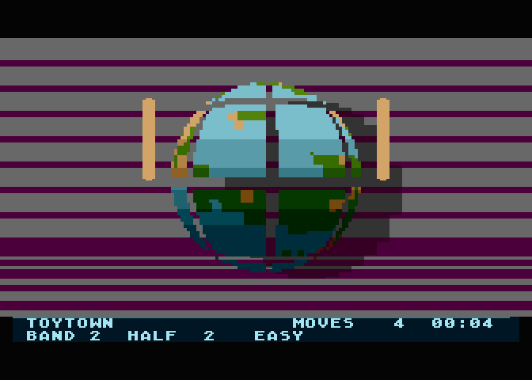
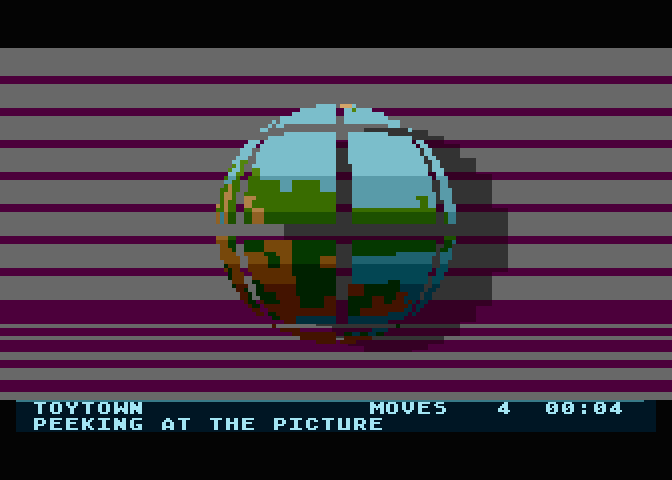
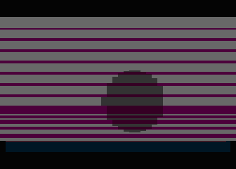

# Boing Twist (Atari 130XE)

Port of `amiga_mcp/examples/boing_twist` (AmigaOS 4), after the Spectrum
Next port (`spectrum_dev/projects/boing_twist`). A picture is wrapped round
the Boing ball, the ball is cut into tiles along lines of latitude and
longitude, and the tiles are jumbled. Twist bands of tiles round the ball
and flip halves of it over until the picture is whole again. The ball sits
in a room, the first the 1984 Boing demo's grey room with its purple grid;
on the title the Boing ball bounces round it, spinning, its shadow on the
back wall.

**It needs a 130XE** (128K): the ball's views are 6502 code in the extended
banks. On a 64K machine it says so.

 
 



```sh
./a8 build boing_twist            # RELEASE=1: no harness log
./a8 run boing_twist
./a8 test boing_twist             # a bot solves a game (test.py)
```

## Controls

| | |
|---|---|
| choose the band (yellow bars) | joystick up / down (W / S, arrow keys) |
| twist it one tile | joystick left / right (A / D, arrow keys) |
| choose the half | fire held + left / right, or Z / X (the ball turns to face it) |
| flip the half | a tap of fire (or SPACE) |
| turn the ball to look | K / L |
| undo | SELECT (or U) |
| peek at the picture | OPTION held (or H) |
| pause | START (or P) |
| give up (it solves itself, move by move) | R |
| new scramble | N |
| room | T |
| back to the title | ESC |
| title | fire or START: choose a puzzle; T room |
| select | up / down: level, picture, room; left / right change it; fire plays |
| initials | type them, or up / down and left / right, fire when done |

PAL first (50 Hz ticks); on NTSC the game runs 20% faster (the ticks are
frames) and the screen's bottom text rows are near the edge.

## The puzzle

As the original: the ball is cut into B bands by S segments: Easy 4 x 8
scrambled by 8 moves, Medium 6 x 12 by 20, Hard 8 x 16 by 40, Expert 8 x 16
by 80. A twist turns a band one tile east or west; a flip turns the S/2
segments either side of a meridian 180 degrees about the horizontal axis
through the middle of that half. The ball is solved when every tile shows
the picture that belongs there, allowing for the whole ball spun round;
tiles that look the same count as the same, so the Easy Boing ball is "make
a checkerboard again". A level offers the pictures that suit it or an
easier one, the checkerboard on Easy only.

Scoring (new, as on the Spectrum: the original keeps best moves and times
in a file): a solve scores (500 + 25 for each move under three times the
scramble + 2 for each second under five minutes) times the level (1-4),
less 100 a peek; given up, nothing. The top five go in the high-score table
with initials; the best moves and time per picture and level are kept until
the machine is switched off.

## What's kept, what changed

Kept from the original:

- **The rules, unchanged.** `src/bt_core.c` is the original's file with four
  `port:` changes for cc65 (`tools/bt_core.port.diff`): its big local
  arrays are static (cc65's locals are limited to 256 bytes), two struct
  initialisations from an expression are split, and three statics are
  placed in segments (the memory map below). With SELECT held at start-up
  the 6502 runs the original's self-test, `bt_vector_hash()` (scrambles on
  five sizes, 15,000 moves and undos, the solved test along the way: about
  83 minutes of 6502 time, 8 seconds headless), and gets the original's
  `tests/vectors.h` value, **3B792758**; the test checks it.
- The game around it: the move queue, each move animated and applied when
  it ends (a twist 240 ms, a flip 420 ms; the scramble and a give-up
  faster), undo, peek, pause, give up, a new scramble, the turn to face the
  chosen half, the timer from the first move, all on 50 Hz ticks (fixed
  timestep).
- The original's camera (45 degrees, the ball 3.6 away; the title's 4.4
  away, leaning -17 degrees, spinning 70 degrees a second), its light fixed
  to the eye (diffuse + highlight), the ten rooms' colours and grid lines
  drawn from the original's box (back wall 6.5 away, floor 1.5 down, grids
  of 0.5), the shadow on the back wall or the floor as each room has it,
  the bounce and its thud; all 17 pictures and the Boing checkerboard, each
  choosing its room.
- The sounds after the original's: the thud, the click of a band, the
  whoosh of a flip, the solved chord; a title tune (new).

Changed (marked `port:` in the source):

- **The picture** is 64 x 32 texels round the ball in 3 colours
  (`tools/gen_data.py` quantises each and picks Atari colours), shaded a
  row at a time; the grooves between tiles show the room through them (not
  on Hard's 4-texel tiles). The original's is 1024 x 512, 24-bit, lit per
  pixel.
- **The selection** is shown by players: yellow bars either side of the
  chosen band; the chosen half is the one facing you (the ball turns to it).
  The original draws rings and lines on the ball.
- No tilting or zoom (the original allows -60 to 60 degrees). Select and
  the title share one view (the leaning ball).
- A flip turns the ball to face the half first (as on the Spectrum).
- The rooms have their horizontal grid lines and colours (one colour a row,
  set by the DLI), not the vertical lines or the wall textures.
- The tiles' "look alike" signatures are made from 4 x 4 samples of each
  tile of the 64 x 32 picture.
- The original's mouse, window and file options are gone; high scores and
  initials are new.

## How it is drawn

- **ANTIC mode D** (160 x 96, 4 colours, each row two scan lines) for the
  room and the ball, 88 rows, and two text rows (mode 2) under it; on the
  title and select screens the name is one row of **mode 7** big letters.
- **The ball** is drawn by 6502 code made on the host (`tools/gen_data.py`):
  for every pixel of the ball at turn 0 it knows which texel of the texture
  the pixel shows, and the code is a run of `lda T+o,y : lsr : lsr : ora
  ...` building each byte of four pixels from four texels, `sta` into the
  ball's 64 x 40-byte buffer. Y is the ball's turn, so turning costs
  nothing; a texture row is 96 bytes (64 texels + the first 32 again). About
  8.5 cycles a pixel: the play view's 2,828 pixels in under a frame. The
  play view's code (15K) is bank 0, the flip's bank 1, the title's bank 2.
- **A twist** turns the band's texture rows (`band_rotate`, from a copy).
  **A flip** is, seen from the front, a turn of the picture about its
  middle: at its start the texture is resampled round that axis into a
  64-angle x 16-radius texture through a host-made table (`flip_build`),
  and the flip view's code reads that with Y = the angle turned.
- **The texture** is rebuilt from the state after each move
  (`src/texture.s`: slot by slot, a turned tile read backwards).
- **The display list** places the ball: each row's LMS points at a row of
  the ball's buffer or at a row of zeros, so the title's bounce is the
  display list (and a byte offset sideways), never a redraw of the room.
- **DLIs** set each row's colours: the room's background (walls, floor,
  grid lines), the ball's three colours lit for that row (the original's
  light, averaged along the row), the shadow players' colour. A DLI waits
  for the end of a line (WSYNC), which costs a line of CPU time, so only
  rows whose colours change get one (about 30 of 88). The display list and
  the tables are double-buffered and swapped in the vertical blank.
- **Players**: 2 and 3 at quadruple width side by side are the shadow (an
  ellipse, behind the playfield so the ball covers it); 0 and 1 mark the
  band.
- **POKEY**: the effects on channels 2-3, the title tune on 0-1.

## Memory

It switches the **OS ROM off** at start-up (XL/XE `PORTB` bit 0) for the 14K
of RAM under it; `src/os.s` stands in for what the game used of the OS: the
NMI (DLIs, the vertical blank: the clock, the shadow registers, the
joysticks), the keyboard IRQ, and the ROM font copied to RAM. Presses of the
joystick and console keys are latched in the vertical blank, so a press
during a busy moment (a texture being rebuilt) is never lost.

| | |
|---|---|
| `$2000-$8DFF` | the program (code 20.8K, data 3.5K, BSS 2.2K) |
| `$9000-$97FF` | C stack; `$9800-$9FFF` players |
| `$A000-$BFFF` | the screen area: zeros, the ball's buffer, the packed picture, the DLI tables (two sets), the flip's texture, the second display list, the font, the display list, text, a twisting band's copy |
| `$C000-$CFFF` (under the ROM) | the puzzle and the move queue |
| `$D800-$E3FF` (under the ROM) | the ball's texture |
| `$E400-$FCF0` (under the ROM) | the rules' code (`bt_core.c`, 6.3K), loaded into bank 2 and copied up |
| bank 0 | the play view's code (15.1K) |
| bank 1 | the flip view's code (15.1K) |
| bank 2 | the title view's code (9.8K) + the rules' code |
| bank 3 | the flip's table (2K) and the 17 pictures (512 bytes each) |

The XEX loads the banks itself: each bank's chunk follows a chunk that sets
`INITAD` to a few bytes at `$0600` selecting that bank (`src/xbanks.s`).

## Frame rate (measured in the emulator, PAL)

- While moves animate (twists and flips): **15-17 pictures a second**
  (`test.py` measures it: ball pictures drawn / frames they took).
- The title's bounce: **17 pictures a second**.
- A ball standing still isn't redrawn. After a flip the texture is rebuilt
  (about 4 frames).

`tools/profile.py [frames] [title|scramble|play]` samples where the time
goes (a sample in a bank is charged to that bank's view code). What's left:
the SDK's `sound_tick` (C, ~15% of the CPU: proposed to a8-core as asm), the
texture rebuild, the view code itself.

## Not done

- Tilting the ball (W / S in the original) and the vertical grid lines and
  textures of the rooms.
- The best moves and times aren't shown (they are kept per picture and level).
- `sound_tick`'s cost (above).

## Test

`./a8 test boing_twist` (`test.py`): the original's self-test hash on the
6502; the title, the select screen, an Easy game: the scramble, a twist and
its undo, a peek and a pause, then a bot reads the scramble from memory
(`P.hist`) and plays it backwards through the controls (the band by up /
down, the half by X and by fire + right, twists and flips) until it's
solved; the score, the initials, the title; a Medium game with a picture
from bank 3, given up: it solves itself; the frame rate; a 64K 800XL says it
needs a 130XE. `tools/make_gif.py` makes the screenshots and the GIF.

The pictures are NASA's and USGS's (public domain) and the original's
artwork (see the original's README); the code is MIT.
