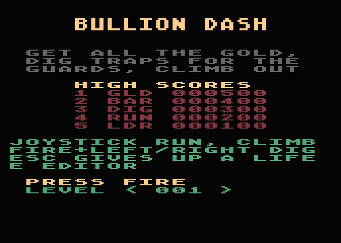
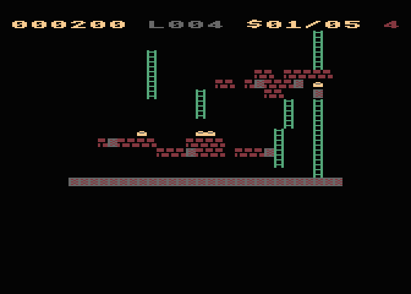
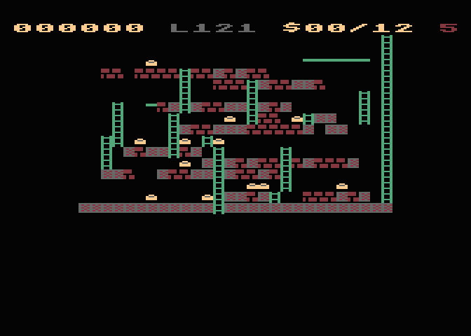

# Bullion Dash (Atari 8-bit)

Port of `amiga_mcp/examples/bullion_dash` (by way of the ZX Spectrum port):
collect all the gold on the screen, dig holes in the brick floors to trap
the guards, then climb to the top row. 150 levels and the original's level
editor.

  


```sh
./a8 build bullion_dash            # RELEASE=1: no harness log
./a8 run bullion_dash
./a8 test bullion_dash             # editor, a cleared level, a game (test.py)
```

## Controls

| | |
|---|---|
| run, climb, hang | joystick (or W/A/S/D, arrow keys) |
| dig | FIRE (or SPACE) held + left / right: the brick below-left / below-right |
| give up a life | ESC (some levels can't be finished, see below) |
| title | LEFT / RIGHT or SELECT choose the first level, FIRE / START starts, E opens the editor |
| editor | joystick moves, FIRE puts the tile, Z / X choose it, RETURN test-plays, S / L keep / get the level, ESC ends |
| initials | type three letters, or UP/DOWN + FIRE, after a high score |

## What is the original's

`src/player.c`, `src/enemy.c`, `src/level.c` and `src/play.c` are the
original's `player.c`, `enemy.c`, `level.c` and `main.c` rules, statement for
statement, as the ZX Spectrum port has them: movement 2 pixels a frame on a
grid of 10 x 14 pixel tiles, gravity, bars, ladders, digging (10 frames),
bricks growing back after 150 frames, guards that take a step every third
frame along a breadth-first path to the player, fall into holes, steal gold
(30%) and drop it, die in a regrown brick and come back on the top row,
hidden ladders shown when all the gold is in, 100 a gold, 1000 a level,
five lives. The 150 levels are the original's (`src/levels.txt`). Changes
are marked `port:` in the source; the Spectrum port's (see its README) and:

- the guards' random moves use the SDK's xorshift instead of the original's
  32-bit LCG (its multiply took a twentieth of the frame where guards
  wander)
- speed-only rewrites with the same results: `tile_at` and the guards'
  breadth-first search loop in 6502 (`src/tiles.s`, `src/gridbfs_run.s`),
  the level decoder's arithmetic-decoding step in 6502 (`src/gpdecode.s`),
  the pathfinding flags of a whole level from tables
- a high-score table (the original has none)

The original's levels can't be won (the Spectrum port's
[ORIGINAL_BUGS.md](ORIGINAL_BUGS.md) has the evidence: on 149 of 150 a route
search can't reach all the gold, or row 0). This port keeps them as they
are, so the test clears a level built in the editor.

## The Atari version

- **One character a tile.** The 28 x 16 grid is ANTIC 4 characters (4
  colour clocks x 8 lines, four colours) in columns 6..33: brick, solid,
  ladders and bars, gold (COLPF3, inverse characters). A tile change is one
  byte. The character set keeps the ROM font's letters and digits for the
  ANTIC 6 status and message lines.
- **The runner and five guards are players and missiles.** The runner is
  player 0, guards 1-3 players 1-3 (a guard carrying gold turns yellow),
  the fourth guard missiles 2+3 side by side (their colours are players 2
  and 3's), the fifth (on the few levels that have one) missile 1 at
  double width. Positions are the original's pixels scaled by 4/10 across
  and 8/14 down; no sprite is ever drawn into the playfield.
- **150 levels in 7.9 KB** with the Spectrum SDK's `gridpack` (a binary
  arithmetic coder with fixed probabilities by the tile before and above;
  `tools/gridpack.py`), unpacked at the start of a level.
- **Memory.** `bullion.cfg`: the XEX first runs a tiny segment that switches
  BASIC (and the screen) off, then loads the levels into `$A000-$BED3`, then
  the program `$2000-$8E7C`. The screen's lines and display lists are at
  `$9000`, the C stack (512 bytes; the locals are static) at `$9600`, the
  character set's 84 characters at `$9800` under the players (`$9B00`).
  No 130XE banks: it runs on a 64K 800XL (the test boots it there) and on a
  48K 400/800.
- **POKEY**: dig, gold, trap, death, level and game-over effects (the
  original builds samples for these but never plays them). No music.

## Speed

The rules run at 50 Hz (`frame_wait()` ticks; up to three a screen). In the
emulator (PAL, release build): 37-41 screens a second on levels with one or
two guards, ~23 on level 121 with five (each guard's step asks the
pathfinder). Starting a level (unpacking it, the pathfinding flags, the
screen) takes about 0.6 s.

## Test

`./a8 test bullion_dash`: the editor (cursor taps, tiles, a ladder, a gold,
the runner), a test play that takes the gold and climbs out (LEVEL
COMPLETE, back to the editor), a game from level 4 where the runner takes
the gold beside him each life until the guard catches him (five lives, game
over, initials BOT, the table), level 121's five guards, the session
recorded and replayed twice (every frame hash), and the XEX on a 64K 800XL.
`.venv/bin/python projects/bullion_dash/test.py --shots`
rewrites the screenshots and the GIF.

## Not done

- the original's MOD tune
- the editor's files (the original saved `level_NNN.txt`; here S / L keep one
  level in memory)
