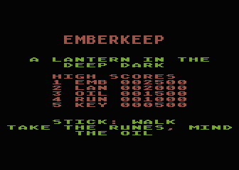
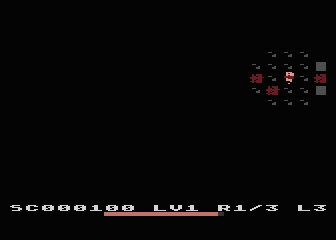
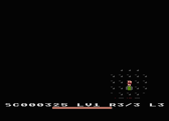

# Emberkeep (Atari 8-bit)

Port of `amiga_mcp/examples/emberkeep`: explore four stone chambers by the
light of a small lantern; everything outside its light is pitch black.
Take the runes to open the portal, keep the lantern burning with oil
flasks, and don't blunder into the spikes or the things that patrol the
dark. The ZX Spectrum Next port (`spectrum_dev/projects/emberkeep`) was the
reference.

  


```sh
./a8 build emberkeep                # build/emberkeep.xex
./a8 run emberkeep                  # play it in a window
./a8 test emberkeep                 # the bot plays (test.py)
./a8 build emberkeep RELEASE=1      # no harness log
.venv/bin/python projects/emberkeep/tools/make_gif.py   # the pictures and the GIF
```

## Controls

| | |
|---|---|
| walk (4 directions) | joystick, or W / A / S / D |
| begin; leave the end screens | FIRE (SPACE, START, RETURN) |
| initials (a high score) | type the letters, or up / down a letter and FIRE |

## What was kept, what changed

`src/game.c` and `src/levels.c` are the original's `game.cpp` and
`levels.cpp`, its rules in its order: walking 2 pixels a frame against the
walls (X then Y), runes 100, oil 25 and 400 units of fuel, a chamber 500
plus half the lantern; the lantern burns a unit every 4 frames out of 1000
and its light square shrinks from 40 to 8 pixels as it does (the corners
cut by a third); an empty lantern, a spike or a touching patroller costs
one of three lives and restarts the chamber; the four chambers and their
patrols, with the original's own fix for chamber 1's walled-in rune
(FIX_SEALED_RUNE). The art is its tile sheet (`art/tilesheet.png`),
nearest-neighbour to 16 x 16 as the original bakes it, then to the Atari's
8 x 12 and colours (`tools/gen_gfx.py`).

Changed (marked `port:` in the code):

- C, 16-bit fields where the original has 32-bit ones (the score is 32
  bits); the enemies as arrays of fields.
- the rules run at a fixed 50 Hz; drawing a chamber when it's entered or
  restarted (a few frames) is a pause, as the original's instant load.
- the screen: the original redraws every tile and paints black around the
  light every frame; here the chamber is drawn once into an image and only
  the light's changed edges are copied (see below).
- colours: four a line (black, grey stone, brick, and each tile row's
  accent: the rune's yellow, the oil's orange, the open portal's green).
- sound: the original's `audio.cpp` only logs; here POKEY effects for the
  runes, oil, deaths, the portal opening and going through, and a tick
  while the lantern is low.
- added: high scores with initials; the chamber's name in the HUD as it's
  entered. The HUD fits a 20-column row (SC 000000, LV, R n/n, L n) with
  the fuel bar under it.

## How it uses the Atari

| | |
|---|---|
| **ANTIC E** | the chamber, 160 x 180 (the original's 320 x 240 at x / 2, y * 3 / 4) |
| **130XE banks** | the chamber's image (7.2K) is drawn into a bank, two chambers a bank (`lamp.s`); the screen shows only the lit part of it. A frame compares each line's lit pixels with the last frame's (worked out from the square, a run of lines at a time) and copies only the edge bytes that changed from the bank, masked, or blacks them out: 300-20,000 cycles where the original repaints 77,000 pixels. On a **64K** machine the image is in main memory, the same code. |
| **DLIs** | each tile row's accent colour, then the HUD's |
| **players** | the player: players 0 + 1 (its red, its skin, hair and boots); the patrollers in the light players 2 and 3, clipped to it line by line and bit by bit (as the original's black mask over them) |
| **POKEY** | the effects |

While a bank is mapped at `$4000-$7FFF` main memory there is out of sight,
so the copy code, its tables, the tile shapes and the interrupts' code are
below it (LOWCODE, LOWDATA, LOWBSS); the grid is read a row at a time
before mapping.

## Memory

| | |
|---|---|
| `$2000-$2785` | the bank code: the lantern (`lamp.s`), the interrupts, the tiles |
| `$2786-$81F9` | program: code 12.5K, data 2.5K, BSS 7.7K (the 64K machine's chamber image 7.2K) |
| `$9000-$97FF` | C stack |
| `$9B00-$9FFF` | players and missiles |
| `$A010-$BC2F` | the chamber (180 x 40); the title's rows while it shows |
| `$BC40`, `$BD00` | the HUD, the display list |
| 130XE banks 0-1 | the chamber's image (two chambers a bank) |

It runs on a **64K 800XL** and a 48K 800 with the image in main memory
(the test plays the first chamber on an 800XL).

## Speed

The rules run once for every frame that passed (the original's 50 Hz), the
picture is made once a loop. Over the test's game (chambers 1-3, three
deaths): **39 fps on average, the rules at 50 Hz**; 49 in the first two
chambers, 35 in the fourth (four patrollers).

Profiled with breakpoints and cycle counts: the first version took 60,000
cycles to move the light sideways (each line's edges worked out on its
own), 580,000 when the portal flickered (C loops over the grid) and 27
frames to draw a chamber. Now in 6502: the lantern's copy (a list of edge
bytes worked out once for a run of lines), the chamber's drawing, the
patrols and the touch test (`rules.s`).

## PAL and NTSC

PAL first. On NTSC the rules run 20% faster (per frame, as the original)
and the colours shift.

## Test

`./a8 test emberkeep`: boots, FIRE begins chamber 1; the lantern is checked
byte for byte (the lit lines are the image in the bank, the rest black),
standing and walking. The bot (`tools/bot.py`) walks the shortest way to
the runes, an oil flask when the lantern is low, the open portal (and
waits for patrollers to pass): chambers 1 and 2; in chamber 3 it walks
into the spikes until its lives are gone. Checks the runes (100), oil, the
portal, the chambers, the lives, GAME OVER, BOT in the high scores, the
title, the frame rate and the rules' rate; then chamber 1 on a 64K 800XL
(the image in main memory, the lantern checked the same way).

## Not done

- the high scores are not saved.
- the walk animation (the original keeps a frame count but draws the pose
  by facing only; so does this port).
