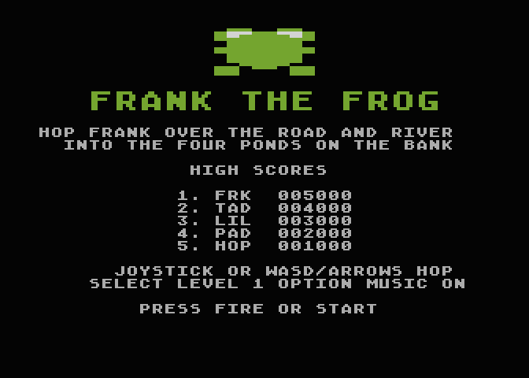
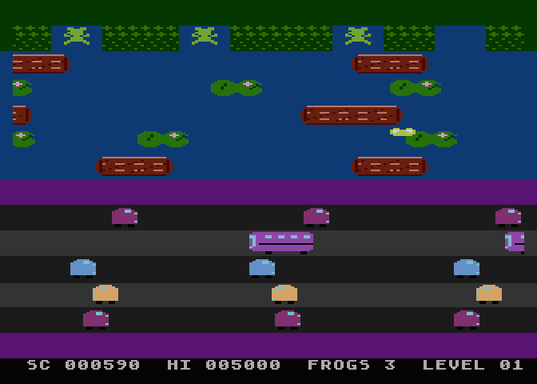
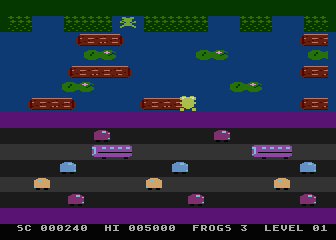

# Frank the Frog (Atari 8-bit)

Port of `amiga_mcp/examples/frank_the_frog`: hop Frank across five lanes of
traffic and five lanes of river (logs and lily-pad rafts) into the four
ponds on the far bank. 10 points for each new row, 50 for a pond, 1000 for
each level; every level the traffic speeds up. Three lives.

 



```sh
./a8 build frank_the_frog            # RELEASE=1: no harness log
./a8 run frank_the_frog
./a8 test frank_the_frog             # the bot plays a game (test.py)
```

## Controls

| | |
|---|---|
| hop | joystick (one hop per push), or W/A/S/D, or the arrow keys |
| start | FIRE, SPACE, START or RETURN on the title screen |
| SELECT (title) | starting level 1-4 |
| OPTION (title) | music on/off |
| initials | type three letters, or joystick UP/DOWN + FIRE, after a high score |

## The Atari version

- **Lanes scrolled by ANTIC.** Each of the ten lanes is a circular strip of
  ANTIC 4 characters in memory (its track, then its first 48 bytes again),
  shown by two display-list lines with LMS and horizontal fine scroll.
  Moving a lane costs two address bytes and a fine-scroll value a frame;
  nothing is redrawn while playing.
- **A display-list interrupt per row** (`src/display.s`) loads the next
  row's fine scroll and its five colours, so every lane has its own palette
  (red, yellow, blue cars, a magenta bus, brown logs, green pads on blue
  water, alternating road greys). The deferred vertical-blank interrupt
  copies the lanes' new positions (and Frank's x) into the display list in
  one go, so the picture never tears and Frank moves with his log.
- **Frank is two players** (body and eyes); the title's big Frank is the
  same players at four times the width.
- **One character set** holds the ROM font's letters and digits (codes
  0-63, for the ANTIC 2 text lines: median, start strip, status line) and
  49 tiles (codes 64+, from `tools/mkfont.py`).
- **POKEY**: hop, splat, splash, pond, level and game-over effects; the
  original's E-F chromatic riff as a bass line during the game.

## What was kept, what changed

`src/lanes.c`, `src/frank.c` and `src/score.c` are the original's logic, in
the original's 320-pixel coordinates (the Atari shows them at half width:
20 columns of 8 colour clocks, rows of 16 scan lines), and `game_tick()` in
`src/main.c` is the original main loop's state machine: lane layout and
speeds per level, the forgiving collision insets, riding logs, being carried
off screen, pond landing zones, scoring, lives, levels. Changes are marked
`port:` in the source:

- a lane is a circular track: an object leaving one side comes back exactly
  a lane-length later (the original reset it to minus its width, dropping 0
  to speed-1 pixels of overshoot). Object start positions are rounded to
  multiples of 8 (whole characters at half width); the bus is 40 wide
  (36).
- the original didn't let Frank stand on a log or raft that was partly off
  screen (it didn't draw those); here ANTIC scrolls them in, so what you see
  holds you.
- the lanes are arrays, the per-frame lane work (`lanes_tick`,
  `render_scroll`) is in 6502 assembly (`src/lanes_asm.s`), the C kept
  beside it; numbers are drawn by subtraction instead of 32-bit division.
- added: a high-score table with initials, starting level and music on the
  title screen.

## Memory and speed

- Program, data and variables: `$2000-$68EA` (18.7K; the XEX is 18K in a
  release build). Screen area: character set `$A000`, lane strips
  `$A400-$ABCF`, text lines `$AC00-$AD17`, title `$B000`, display lists
  `$BE00`/`$BF00`; players at `$9800`.
- No 130XE banks: it runs on a 64K 800XL (the test boots it there) and
  should on any 48K machine with BASIC off.
- 50 frames a second in the emulator (PAL), every frame (release build,
  no late frames): the game loop takes about 4,500 cycles a frame
  (profiled with breakpoints in the emulator; in C, before the lane work
  moved to assembly, it took 40,000 and ran at ~30 fps). With the harness log compiled in the
  test measures 48.5 fps (a log line costs a frame now and then).
- NTSC: the game runs per frame, so it is 20% faster at 60 Hz (as the
  Amiga original on NTSC). The 216-line screen fits both.

## Test

`./a8 test frank_the_frog`: a bot reads the lanes from memory
(`lane_shift`, `lane_base`..., `frank_probe`, `home_filled`), crosses the
road, rides the logs and fills all four ponds (level 2), then plays
carelessly until the game is over; it enters BOT in the high-score table
and returns to the title. The game is recorded and replayed twice with
every frame hash checked, and the XEX boots on a 64K 800XL. `--debug`
prints the bot's last moves before each death. The test writes the
screenshots and the GIF in `screenshots/`.

## Not done

- the original's MOD music (the riff is a single POKEY channel)
- a demo mode on the title screen
