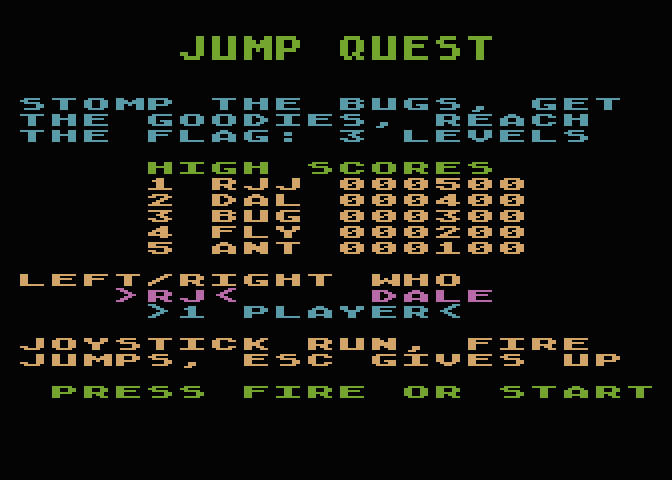
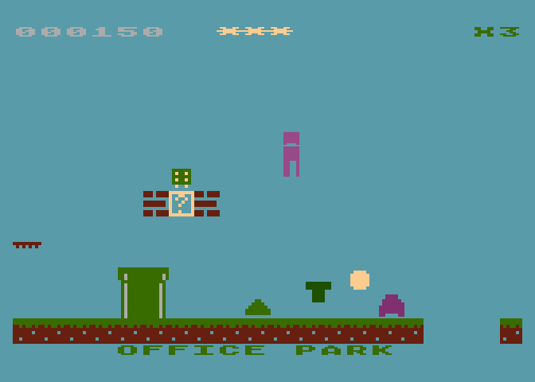
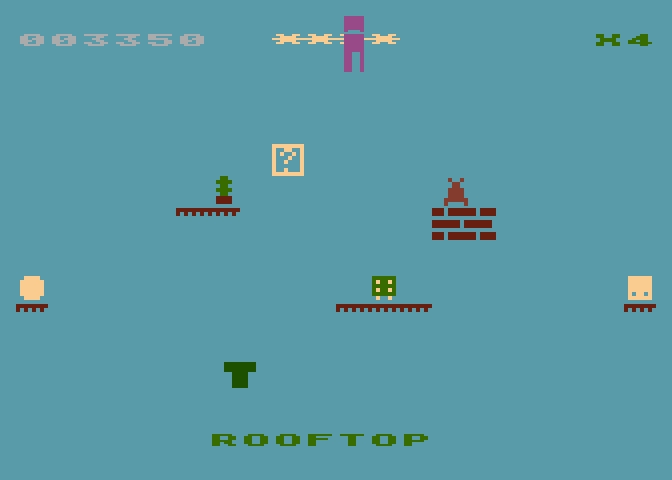
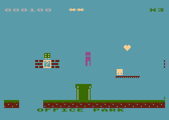

# Jump Quest (Atari 8-bit)

Port of `amiga_mcp/examples/jump_quest` (by way of the ZX Spectrum port), RJ
and Dale's side-scrolling platformer: three levels (the Office Park, the
Server Room, the Rooftop) of beetles, flies, spiders and ants. Stomp them for
200 points, collect circuit boards, diskettes, balls, pillows and plants for
points, ? blocks for 100, and finish a level for a 500 bonus. A briefcase
makes you invulnerable for 3 s, a heart heals, a pillow with ZZ gives a life,
beer or wine is a speed boost. Five hearts of health, three lives; one or two
players taking turns.

  



```sh
./a8 build jump_quest              # RELEASE=1: no harness log
./a8 run jump_quest
./a8 test jump_quest               # the bot, the demo (test.py)
```

## Controls

| | |
|---|---|
| run | joystick left / right (or A / D, arrow keys) |
| jump | FIRE (or SPACE) |
| title | LEFT / RIGHT pick RJ or Dale, UP / DOWN one or two players, FIRE or START starts |
| OPTION | music on/off |
| give up | ESC during a game |
| initials | type three letters, or UP/DOWN + FIRE, after a high score |

Left alone, the title starts a demo that plays all three levels (START or
FIRE stops it).

## What was kept, what changed

`src/jq.c` is the Spectrum port's `jq.c`: the original's `player.c`,
`enemy.c`, `items.c`, `level.c` and `main.c`'s state machine, line for line
where it could be (10.6 fixed point, gravity, collision probes and snaps,
one-way platforms, ? blocks, the patrols, sine flight and spider drops,
items, health, invulnerability, speed boost, lives, two-player turns, the
level-complete and game-over timers). The levels are the original's files
(`tools/levels/`), packed. The logic runs at 50 ticks a second, as on the
Amiga. The proof: the demo (`src/demo.h`, routes found by the Spectrum
port's solver, `tools/solve.c`, over the same `jq_tick`) clears all three
levels here, with the same score (4200) as on the Spectrum. The Spectrum
port's changes stay (marked `port:`; details in its README and
`ORIGINAL_BUGS.md`): the jump force that makes the levels finishable, score
and lives kept from level to level, items that don't bob, title, demo, high
scores.

What the Atari changes back or adds:

- **The whole view, scrolling smoothly.** The Spectrum shows 16 tiles and
  flips the view in halves; here it is the original's 20 tiles across and
  scrolls a pixel at a time (two original pixels: a colour clock), following
  the hero (port: smoothly, where the original's `cam_x` snaps to whole
  tiles; `cam_x` is still computed).
- ESC gives up a game (the Spectrum's BREAK).

## The Atari version

- **12 scrolling ANTIC 5 rows.** Tile rows 1-12 (row 0 is clouds or a
  ceiling, row 13 the earth under the grass) are ANTIC 5 character rows, two
  characters a tile: 8 colour clocks x 16 scan lines, the original's 16 x 16.
  Each row is a strip of the whole level in memory (`$A000`, 512 bytes a
  row): the vertical blank sets HSCROL and the 12 LMS addresses
  (`src/display.s`), so scrolling costs nothing per frame. Items are
  characters in the strips (restored to sky when taken); ? blocks are
  redrawn when hit. Colours: sky, brown earth and brick, green grass,
  bushes and pipes, grey stone and clouds, yellow (inverse characters)
  ? blocks, flag and items.
- **Player 0 is the hero** (RJ or Dale, 2 frames x 3 poses, 28 lines), the
  **enemies share players 1-3** by bands of 16 scan lines: a display-list
  interrupt at each row moves the three players to that band's enemies and
  sets their colours (`src/foes.s` picks a player for each enemy, the first
  free from its top band down). Up to three enemies side by side in a band;
  a fourth isn't drawn that frame (rare in these levels).
- **HUD**: two ANTIC 6 lines: score, health (stars), lives; the level's name,
  then LEVEL COMPLETE / GAME OVER / CONGRATULATIONS.
- **POKEY**: jump, stomp, collect, power-up, hurt, death, level done; the
  original's two-channel tune (melody and bass, `tools/mkmusic.py`) on the
  title and during the game.
- **Speed, in asm**: `tile_px` (the tile under a pixel: 1.6k cycles in C),
  `enemies_update` (with each walker's rows and the result of its last wall
  and floor test kept, so a walker only looks at tiles when it enters a new
  column), the box tests (`src/checks.s`) and the enemy sprites
  (`src/foes.s`).

## Memory and speed

- Program, data and variables `$2000-$7885` (22K; the XEX is 21.6K in a
  release build). The game state (the level's tiles, enemies, items:
  2.7K) is in LOWRAM at `$0C00`, so it loads without DOS (the harness, `./a8
  run`, the arcade disk), not from DOS. Players at `$9800`, level strips
  `$A000-$B7FF`, character set `$B800`, HUD, display lists and title from
  `$BC00`.
- No 130XE banks: it runs on a 64K 800XL (the test plays the demo through
  level 1 there) and on a 48K machine.
- Frame rate in the emulator (PAL), release build, over the demo: **29 fps**
  (level 1: 35, level 2: 29, level 3: 27); with the harness log 24 fps. The
  logic keeps 50 ticks a second: when drawing falls behind, it runs two
  ticks before the next frame. The time goes to the logic: 16 enemies a
  tick and the hero's collision code (C), on a CPU that ANTIC 5 with
  horizontal scrolling leaves about 21k cycles a frame.
- NTSC: the logic is tied to the 50 Hz frame count (`frame_wait`), so it
  runs at the original's speed on PAL; on NTSC it runs 20% fast.

## Not done

- Particles (the original's stomp and death sparks) are computed but not
  drawn.
- The hero is one colour (a player): the original's sprites have skin,
  shirt and trousers.
- `player_update()` is still C; moving it to asm is the next step towards
  50 fps.

## Test

`./a8 test jump_quest`: from reset the title starts the demo, which must
clear level 1 without losing a life while the view scrolls; START stops it,
FIRE starts a real game that walks right into the first beetle and the
first pit until the game is over (300 points: the diskette each life),
enters BOT in the high scores and is back on the title (recorded, then
replayed twice with every frame hash checked). Then the demo plays all
three levels to CONGRATULATIONS (score 4200), the logic is checked at 50
ticks a second, two players with Dale start, and a 64K 800XL plays level 1.
`.venv/bin/python projects/jump_quest/test.py --shots` rewrites the
screenshots and the GIF.
