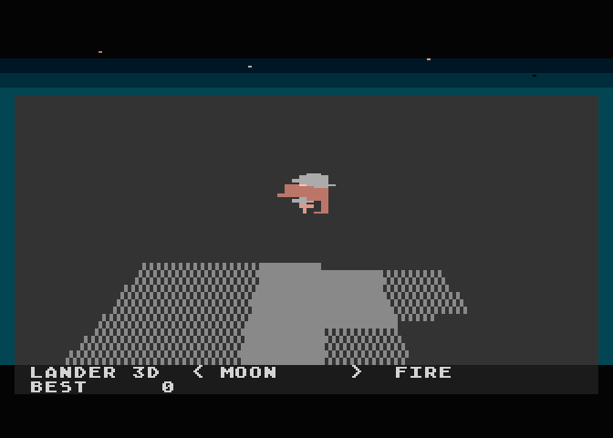
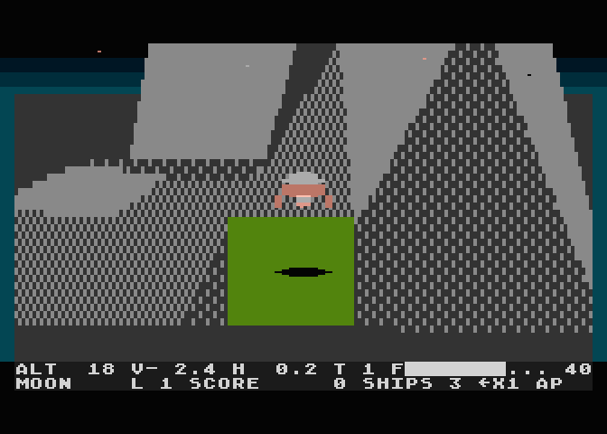
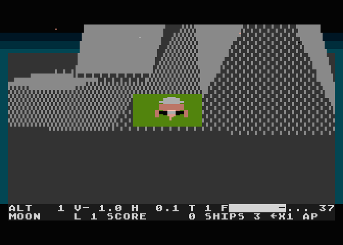
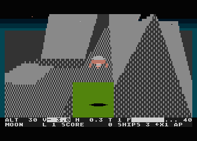

# Lander 3D (Atari 8-bit)

Port of `amiga_mcp/examples/lander_3d` (the Amiga original on the amiga3d
engine, itself the browser game in C): the lunar-lander idea in three
dimensions. You start high above the ground, moving, with a fixed amount of
fuel. The main engine pushes along the craft's own up: tip it to move
sideways, level it to stop, and keep enough thrust on to stop gravity
winning. Three pads are somewhere below: a big x1, a middle x2 and a small
x5.

  

## Controls

| Joystick / keys | |
|---|---|
| up / down (W / S, arrows) | tip forward / back |
| left / right (A / D, arrows) | tip left / right (letting go holds the angle) |
| FIRE (SPACE) | full thrust |
| SELECT / OPTION (E / Q) | steady throttle up / down, 10 % steps |
| START (P) | pause |
| B | the autopilot (the original's autopilot hook) |
| ESC | back to the title |

On the title the autopilot flies the demo; left / right choose Moon, Mars,
Asteroid or Tour, FIRE or START plays.

Touch down falling no faster than the world's limit (2.5 m/s on the Moon, 3
on Mars, 1.5 on the asteroid), sliding no faster than 1.5, 1.8 or 1.0 m/s,
tilted no more than 10 degrees (12 on the asteroid). The HUD shows each
reading in inverse video past its limit, and an arrow to the nearest pad
with its multiplier. A landing scores (100 + softness + fuel left) x the
pad; a safe landing off the pads 25; anything else costs a ship (three).
Each level starts higher, faster and farther out, with smaller pads and
less fuel; **Tour** takes the worlds in turn.

## What's kept, what changed

Kept from the original: the worlds (gravity, engine, the landing limits,
the fuel), the levels' growth (start height, speed, distance, pad size,
fuel), the touchdown rules and the scoring formula, Mars's gusting wind,
the asteroid's curving ground, the autopilot's plan (cruise at a clearance,
then come down over the pad slowly, faster when high), the camera behind
and above, the shadow, the HUD's readings, the title's demo.

Changed (marked `port:` in the code):

- **12.5 steps a second** of 16.16 position and velocity (`src/ld_phys.s`)
  and 8.8 accelerations (the original: 100 steps with sub-steps, all
  16.16). The attitude is a binary angle the stick turns at the original's
  rate (its assisted mode); the thrust direction uses an interpolated sine.
- **The terrain** is made at the level's start from its seed, on a 31 x 31
  grid of whole-metre heights (32 m cells; 16 m on the asteroid): value
  noise in three octaves, craters with raised rims, the asteroid's curve,
  three flattened pads at random cells well apart (the original: 97 x 97,
  four octaves, pads ranked by roughness). The world is 960 m across (480 m
  the asteroid; the original 1200 and 640).
- **The camera never turns** and looks level, with the picture shifted up
  (the horizon on line 7: a lens shift instead of a pitch), so a grid point
  projects with one multiply (`src/proj.s`) and the craft stays at the same
  place on the screen.
- **The ground** is a 5 x 4-cell window round the craft drawn far to near
  with the a3d renderer, shaded by slope, the plain beyond it; the pads are
  flat squares over it.
- **The touchdown** tests the craft's middle (the original: four feet and
  the bell) and the off-pad slope from the grid cell.
- **The autopilot** is a PD controller on the same plan, deciding 6 times a
  second, setting the angles and the throttle.
- The HUD shows the readings in inverse video past their limits (the
  original: green / amber / red); no help pages; no music.

## Atari hardware used

| | for |
|---|---|
| ANTIC mode D, every line shown twice (a3d's `a3d_double`), two display lists | the view at 160 x 44 to fill, 160 x 88 on the screen, double buffered |
| players 0 + 1, multicolour (`PRIOR` $21) | the lander: gold descent stage and grey ascent stage, a third colour where they overlap, 5 frames for the roll |
| player 2 | the flame, longer with the throttle, flickering |
| player 3 | the shadow on the ground under the craft |
| missiles | four stars |
| DLIs (by `VCOUNT`) | the sky in bands above the horizon, the text rows' colours |
| ANTIC 2 text rows | the HUD |
| deferred VBI | the stick, console keys and held keys latched every frame |
| POKEY | the engine and the thrusters (noise), the landing chime, the crash |

## Frame rate (PAL, measured in the emulator)

The rules run 12.5 steps a second in real time (catching up up to three
steps a frame). The picture: **3 to 7.5 frames a second, about 5.5 on
average** (`ld: fps10=` in the log; the test prints them). A frame is the
ground's grid projected (~45K cycles), 20 cells filled (~80K), the pads,
the clear, the sprites and the HUD.

The controls don't wait for the picture: between the ground's rows (7
times a frame) the game reads the stick, runs the physics steps that are
due and redraws the craft's sprites (its lean and the flame), so the craft
answers the stick at about 25 updates a second while the ground follows at
5. FIRE to a flame on the screen: 4-7 frames (80-140 ms), from 8-18 before
(measured in the emulator, 8 presses).

Profiling (projects/a8_3d/tools/profile.py and breakpoint timing of each
function) moved, in turn: the ground's height to asm (4.5K -> 1.6K cycles a
call), the 32-bit integration to asm, the grid's projection to asm, the
32-bit divides of the projection to `a3d_muldiv`, the physics to 12.5 Hz,
the autopilot to 6 decisions a second, and made a3d clip polygons at the
top and bottom inside its edge walker (the near cells always cross the
bottom of the view). It started at 2 frames a second.

## Memory

It runs on a 64K 800XL (the test boots it on one): no 130XE banks. It uses
the SDK's `LOWRAM` ($0C00-$1FFF, uninitialised; only for programs loaded
without DOS: the harness and the arcade disk) for the terrain, its
generator's tables and the work arrays, and its own linker config
(`lander.cfg`: the SDK's with a 512-byte C stack; with `-Cl` the C keeps its
locals static, so the stack only holds call arguments).

| | debug build | `RELEASE=1` |
|---|---|---|
| program `$2000-` | `$9245` | `$8D6E` |
| free below the stack (`$9600`) | 0.9K | 2.1K |
| LOWRAM `$0C00-` | `$1E41` (4.6K of 5K) | |
| screen | `$A010-$A6EF` / `$B010-$B6EF` (44 lines each), display lists at `$A800` / `$B800`, text rows `$AF80` | |

## Testing

`./a8 test lander_3d` (`test.py`): the title (the demo flies); world choice
and FIRE starts the Moon; on the joystick FIRE thrusts against the fall, UP
and RIGHT tip the craft, SELECT sets a steady throttle; B turns on the
autopilot, which lands on a pad (score), the next level; then three
crashes without thrust (a ship each), game over, the title. And the 800XL.

## Not done yet

- The frame rate: a band renderer (each grid edge walked once for both its
  cells) or larger cells far away would help most.
- The original's four-foot touchdown, its roughness-ranked pads, help pages
  and music. NTSC: the steps count 17 ms frames, the colours are PAL's.
