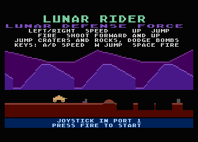
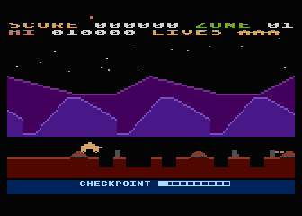
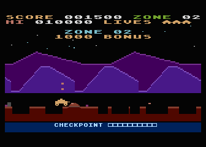
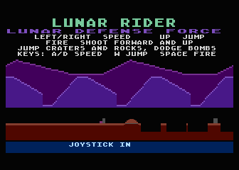

# Lunar Rider (Atari 8-bit)

Port of `amiga_mcp/examples/lunar_rider`: drive a moon buggy along a
scrolling lunar surface, jumping craters and rocks, avoiding mines, and
shooting forward and upwards at UFOs, their bombs and meteors. Every 500
pixels is a checkpoint (+1000); after zone 26 the course starts again,
harder. The ZX Spectrum port (`spectrum_dev/projects/lunar_rider`) was the
reference for what to keep on a small machine.

  



```sh
./a8 build lunar_rider               # build/lunar_rider.xex
./a8 run lunar_rider                 # play it in a window
./a8 test lunar_rider                # the bot plays a game (test.py)
./a8 build lunar_rider RELEASE=1     # no harness log
```

## Controls

| | joystick (port 1) | keys |
|---|---|---|
| speed up / slow down | right / left | D / A |
| jump | up | W |
| shoot (forward and up) | FIRE | SPACE |
| start | FIRE or up on the title | START, RETURN |
| initials (high score) | up / down a letter, FIRE next | type the letters |

As the original: left and right are the speed, up jumps, fire shoots both
guns. The original's ESC (quit) has no counterpart.

## What was kept, what changed

`src/game.c` is the original's `game.c`, with the changes marked `port:`.
The rules are the same: the terrain generator and its chunks, the buggy's
physics (jump velocity, gravity, the ground, crater and rock tests), the
three speeds, both guns, small and large UFOs and meteors with their
bombs, the explosions, checkpoints, the loop with rising difficulty, three
lives, and the scores (rocks 100, small UFOs 200, meteors 300, large UFOs
500, checkpoints 1000), at a fixed 50 Hz as on the Amiga.

The changes, all for the 6502:

- **struct of arrays**: the bullets, enemies, bombs and explosions are
  arrays of their fields (`en_x[i]`) instead of arrays of structs reached
  through pointers, with counts of the active ones. cc65 reaches a global
  array in two instructions and a field through a pointer in twenty; this
  alone took the logic from a third of the frame rate to full speed.
- the scroll position is whole pixels plus hundredths (the original keeps
  1/100 pixels in a 32-bit value and divides by 100 wherever it is used);
  the buggy's `vy / 100` is a table (vy is always -600 + 40k).
- the terrain ring is 1024 pixels (640 in the original), indexed with a
  mask; a hill's height is in the top bits of its terrain byte instead of
  a second 1K array. The terrain is generated in the same 64-pixel chunks,
  but a few pixels a frame instead of a chunk at once (a chunk is more than
  a frame's work here).
- the random numbers are the SDK's 16-bit xorshift (the original's 32-bit
  LCG costs ~1,000 cycles a call), so the courses differ from the Amiga's.
- **one original bug fixed**: the start area kept clear was world x 0..30
  while the buggy stands at 80..104 (see the Spectrum port's
  ORIGINAL_BUGS.md); 30 pixels beyond the buggy are kept clear instead.
- added: a high-score table with initials (the original shows the current
  score as HI), deaths logged with their cause, GAME OVER left with a new
  press of FIRE after a second (or after the original's 3.6 s).
- the mountains: the far range has a 160-pixel period, the near 104 (the
  original's ~171 and ~102), and they sit one above the other instead of
  overlapping (each is its own hardware-scrolled band, see below). Their
  shapes are the original's clipped triangle waves, so they keep its cliffs.
- of the original's 30 stars (its generator, seed 42) the 16 below the HUD
  are drawn, in three colours.

## How it uses the Atari

| | |
|---|---|
| **display list** | HUD (2 rows ANTIC 6), the sky (5 rows ANTIC 6: stars, messages), the far mountains (14 lines ANTIC D), the near mountains (22 lines ANTIC D), a gap, the ground (38 lines ANTIC E), the checkpoint bar (2 rows ANTIC 2). 192 lines |
| **hardware scrolling** | each band scrolls by itself: its own HSCROL (fine) and an LMS on every line (coarse). Nothing is redrawn to scroll the mountains: each line is one period plus the 48 bytes ANTIC fetches, and the LMS walks along it. The ground is a ring of 48 byte columns stored twice, so the fetch never wraps; one new 8-pixel column (in asm, split over two frames) every 3 to 5 frames |
| **DLIs** | six a frame (irq.s): the sky's colours, each band's HSCROL and palette, the ground's palette change at its surface (rocks grey above, regolith below), the bottom text |
| **VBI** | (deferred) moves every LMS of a band that scrolled a byte, and the fine scroll, together, so the screen never shows half an update |
| **players** | the buggy (players 0 + 1, 16 colour clocks), UFOs, meteors and explosions (players 2 + 3, and 0 + 1 while the buggy is dead; double width for the explosions). More than fit take turns (flicker) |
| **missiles** | the forward bullets (M0, M1), the upward ones (M2: they share the buggy's x), the bombs (M3), all orange (the fifth-player colour) |
| **POKEY** | the five effects on channels 0-2 (as on Paula), frame-by-frame steps; the original's bass on channel 3 |

The coordinates are the original's 320 x 256: a player's horizontal
position is x / 2 colour clocks, its line y * 3 / 4.

## Memory

| | |
|---|---|
| `$2000-$891F` | program: code 22K, data, the terrain ring (1K), the game state |
| `$9000-$97FF` | C stack |
| `$9800-$9A97` | the ground's 12 column patterns and the sky's stars (spare PMG memory) |
| `$9B00-$9FFF` | missiles and players |
| `$A000-$A3FF` | the font (the OS's, with our glyphs) |
| `$A400-$AB6F` | far mountains; then the text rows, the game's display list, sprite shapes |
| `$B000-$BE3F` | the ground ring; then the title's display list |
| BSS | the near mountains (22 lines x 64, 64-aligned) |

No 130XE banks: it runs on a **64K 800XL** and on a **48K 400/800**
(BASIC out); the test plays on the 130XE, and the 800XL and 800 were
checked at the same speed.

## Speed

The game logic runs every frame (50 Hz PAL). Measured in the emulator with
the bot riding at full speed and shooting all the time (the heaviest case:
a ground column every 2.7 frames, four bullets and explosions):
**49.8 fps** in the release build (597 game frames in 600), 48.9 fps in
the debug build (the log costs time); at normal speed, 50.

Profiled with breakpoints and cycle counts (emu_break / position()); the
hot loops are in ca65: drawing a ground column (`ground.s`, 26,000 cycles
in C, ~3,000 now), the sprites and missiles (`sprites.s`), the DLIs and
the VBI (`irq.s`). A frame's work is about 24,000 machine cycles of the
35,568 (ANTIC's DMA takes much of the rest).

## PAL and NTSC

PAL first. On NTSC the game runs 20% faster (the logic is per frame, as
the original's) and the colours shift; the display fits in NTSC's lines.

## Test

`./a8 test lunar_rider`: boots, starts; a bot rides at full speed holding
FIRE and jumps when it has to (it looks ahead with the buggy's own rules,
`tools/bot.py`, reading the terrain and `lunar_probe`). It must pass a
checkpoint and score; the frame rate is checked from the game's perf log;
then it stops jumping, loses its three lives, sees GAME OVER, enters BOT
in the high-score table and is back on the title. The GIF and the
checkpoint picture: `tools/make_gif.py` (`./a8 video` records without
input).

## Not done

- the high scores are not saved to disk.
- NTSC isn't slowed to the PAL speed.
- the original's overlapping mountain ranges would need redrawing a band
  each frame; they are stacked instead.
