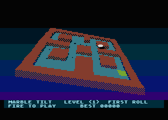
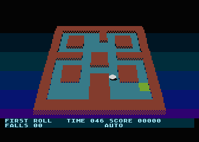
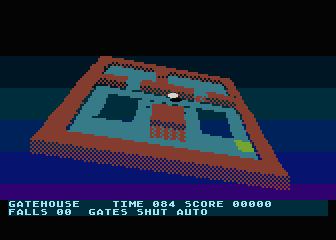
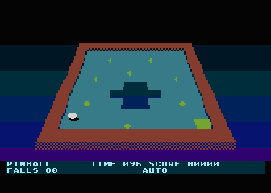
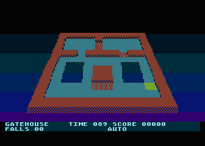

# Marble Tilt (Atari 8-bit)

Port of `amiga_mcp/examples/marble_tilt` (the Amiga original on the
amiga3d engine): tilt a floating maze board to roll a marble to the exit.
The marble keeps rolling, so you tilt back to slow it. Eight levels mix
holes, gates that open and shut, bumpers, sand and checkpoints, each against
the clock.

 
 

## Controls

| Joystick / keys | |
|---|---|
| up (W, arrow) | tilt away: the marble rolls away from you |
| down (S, arrow) | tilt towards you: it rolls nearer |
| left / right (A / D, arrows) | tilt left / right |
| START (P, RETURN) | pause |
| B | the autopilot on / off |
| ESC | back to the title |

On the title the autopilot rolls the demo; left / right (or up / down)
choose the level to start on, FIRE or START plays. The title shows the best
score.

Holes: fall in and you lose three seconds and start again from the last
checkpoint. Gates are open for three seconds, then shut for three; shut,
they are walls (a gate never shuts on the marble). Bumpers kick the marble
away; sand drags it. A level scores 100 x its number plus 10 for each
second left; the game ends when the clock runs out or after level 8.

## What's kept, what changed

Kept: the eight levels exactly (First Roll, The Moat, Zigzag, Gatehouse,
Pinball, Sand Trap, Tightrope, The Gauntlet), the rules (tilt easing over a
fifth of a second, rolling friction, sand, bounces at 40% off the nearest
point of a wall's square, bumpers as circles with a kick, gates, holes,
checkpoints, the clock and the scoring), and the original's autopilot
(breadth-first route to the exit, aims through straight runs, waits short
of a shut gate, slower beside holes) behind the title and on B.

Changed (marked `port:` in the source):

- Fixed point is 16-bit: positions in 1/64 of a board unit, velocities in
  1/256 unit a tick, the tilt in 1/256 radian (the original: 16.16). The
  marble moves in 2 steps a tick against the walls (the original: 4), and
  only the cells it can reach are tested (a wall next door only when the
  marble is within its radius of that edge). Divides by 40 and 100 are
  tables and multiplies.
- The board is not projected each frame. `tools/gen_view.py` works out the
  13 x 13 grid points (and the walls' rise) on the host for 3 x 3 tilts,
  from the original's camera, with the tilt drawn twice as big, as the
  original does (`src/view_tab.h`, 3.1K). A new board (the tilt crosses a
  step, a gate opens or shuts, a new level) is drawn into the hidden
  buffer in 18 slices, one a frame, far to near (floor in runs of a kind of
  cell, bumpers as diamonds, then the walls' tops and fronts, then the
  slab's edge), and then shown.
- The marble and its shadow are players (PMG), placed every frame on the
  shown board by interpolating its grid, so the marble moves smoothly
  while the board catches up. A falling marble drops and shrinks.
- The autopilot decides every second tick.
- Not ported: the tilt gauge, the help pages, the in-game self-test hook
  (the Atari test is `test.py`); ESC from the title does nothing (there is
  no OS to quit to).

## Atari hardware used

- ANTIC mode D (160 x 88, 4 colours) double-buffered by the a3d renderer
  (`projects/a8_3d`): floor, walls, the accent (exit, checkpoints, bumpers,
  open gates) as dithered patterns of the 3 colours.
- Two text rows (mode 2) for the HUD, with a3d's HUD DLI.
- A DLI every 8 lines (`src/dli.s`) shades the sky behind the board.
- Players 0 and 1: the marble and its shadow.
- POKEY sound effects (the SDK's `snd_sfx`): walls, bumpers, falls,
  checkpoints, gates, the exit, game over.
- Input latched in the deferred VBI (`src/vbi.s`), so short presses are
  never lost in a slow frame.

## Frame rate (PAL, measured in the emulator)

The log prints `mt: ticks5s= loops5s= boards5s=` every 5 seconds.

- The rules: **25 ticks a second**, as the original (a tick every 40 ms,
  catching up up to 4 a frame): 123-127 a 5 s.
- The marble: **18 to 43 frames a second** (loops5s 90-216): about 18
  while a new board is being drawn, 40 when it isn't.
- A new board: **about 1 a second** (18 slices). The marble moves on the
  shown board meanwhile, so it's the picture of the tilt that lags.

A tick costs ~17K cycles (2 wall steps ~4K each), the autopilot ~20K every
second tick, a board slice 30-110K, placing the marble ~8K.

Profiling (projects/a8_3d/tools/profile.py and breakpoint timing of each
function) moved, in turn: the cell lookups to stride-16 rows and `/40`
tables, the wall test to the cells in reach (8.5K -> 3.5K cycles a step),
the divides in the friction and the autopilot to multiplies, the marble's
interpolation and every `row * 13` to tables (12K -> 5K), and the gates'
divide to a countdown. The rules went from 12 ticks a second to 25 and the
marble from 7 frames a second to 18-43.

## Memory

It runs on a 64K 800XL (the test boots it on one): no 130XE banks. Its BSS
(the game state, the route, the autopilot's queue) and a3d's ylo/yhi and
multiply tables live in the SDK's `LOWRAM` ($0C00-$1FFF, only for programs
loaded without DOS: the harness and the arcade disk). `-Cl` keeps C locals
static.

| | debug build | `RELEASE=1` |
|---|---|---|
| program `$2000-` | `$8955` | `$860D` |
| free below the C stack (`$9000`) | 1.7K | 2.5K |
| LOWRAM `$0C00-` | `$19C0` (3.5K of 5K) | the same |
| screen | two buffers `$A010` / `$B010`, display lists `$AF10` / `$BF10`, text rows `$AF80` | |

## Testing

`./a8 test marble_tilt` (`test.py`): the title (the demo rolls on the
autopilot); RIGHT / LEFT choose the level, FIRE starts level 1; on the
joystick RIGHT tilts the board and the marble rolls right, DOWN rolls it
nearer, UP tilts away; the clock runs; START pauses (the clock stops) and
starts again; B: the autopilot reaches the exit (score), level 2 (The Moat);
autopilot off, the stick rolls the marble into the moat: a fall, three
seconds off, counted, back at the start; the clock set to 2 seconds runs
out: game over, FIRE, the title. And the 800XL.

## Not done yet

- A board redraws about once a second; drawing only the rows that changed
  between two tilts, or 5 x 5 tilt steps, would make the tilt read faster.
- The tilt gauge, help pages, music. NTSC: the ticks count 17 ms frames, so
  the speed is right, the colours are PAL's.
