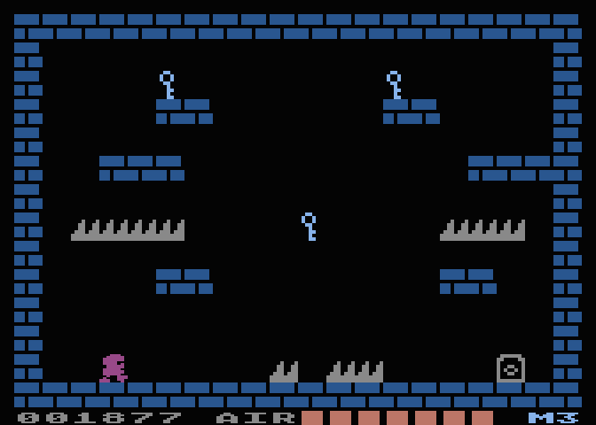
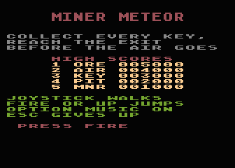

# Miner Meteor (Atari 8-bit)

Port of `amiga_mcp/examples/miner_meteor` (by way of the ZX Spectrum port),
a single-screen platformer: in each of six caverns, collect every key to
open the exit, then reach it before the air runs out. Spikes, conveyor
belts, floors that crumble under you, and guardians patrolling the ledges.
100 points a key, 1000 a cavern plus half the air left. Three lives.

 



```sh
./a8 build miner_meteor            # RELEASE=1: no harness log
./a8 run miner_meteor
./a8 test miner_meteor             # the bot, the demo (test.py)
```

## Controls

| | |
|---|---|
| walk | joystick left / right (or A / D, arrow keys) |
| jump | FIRE, SPACE or joystick up |
| start | FIRE or START on the title screen |
| OPTION | music on/off |
| give up | ESC during a game |
| initials | type three letters, or UP/DOWN + FIRE, after a high score |

Left alone, the title starts a demo that plays all six caverns.

## What was kept, what changed

`src/game.c` is the original's `game.cpp` as the ZX Spectrum port has it
(the `MinerGame` methods over one `GameState`), `src/levels.txt` its six
caverns row for row (with the original's three fixed rows) and
`src/levels.c` its guardians; `src/plat.c`/`src/tmap.c` are the Spectrum
SDK's helpers holding the original's `update_player` collision code. The
guardians, scoring, air, collapse timers, conveyors, jump edge-trigger and
side and ceiling snaps are unchanged, and the logic runs at a fixed 50 ticks a
second, as on the Amiga. The proof: the demo (`src/demo.h`, the fastest
route through each cavern found by the Spectrum port's solver over the same
`game_tick()`) plays all six caverns here without losing a life.
The original's later fixes (amiga_games #53) are in too: Hazard Bay's row 5
meets the right wall, Guardian Alley's first guardian patrols on the top
ledge (y 32, not inside it at 48), and the walk cycle shows all eight of
the sheet's frames. With the guardian on the ledge the solver's fastest
route through Guardian Alley is 259 ticks (211 before), the same count as
the original's and the ST port's checks.

The landing fix (amiga_games #55) is in too. The original snapped a landing
to the tile row of the player's old y, so landing at a y that isn't a
multiple of 16 put the player 16 pixels above the floor, where they dropped
and snapped back every few ticks (the "bob") until they jumped or walked off.
`plat_move_y` (`src/plat.c`) now lands on the floor tile itself. Every
earlier route jumped from the bob's raised spot, and without it two caverns
can't be finished, so their ledges move too (rows marked "bug in the
original: unwinnable" in `src/levels.txt`):

- Hazard Bay: the row-10 ledge (columns 5-6) is in row 9, where a jump
  reaches the row-5 ledge and so the top-left key.
- Collapsing Attic: the row-8 floor and its key move 6 columns left and the
  row-3 floor 2 columns left, each within a jump of the floor below.

The solver's fastest routes are now 271, 252, 842, 256, 209 and 305 ticks.

Port changes (marked `port:` in the Spectrum port's source and here):

- the caverns are stored as plain bytes (`tools/mklevels.py`), not zxrle
- the death flash: the original restarts the cavern on the same tick; the
  port flashes it for half a second first
- ESC gives up a game; a demo, a title tune and sound effects (the Amiga's
  sound is a stub), a high-score table with initials

## The Atari version

- **Full-size caverns in ANTIC 5.** The cavern's rows 0-13 (row 14 is a
  second wall row under the floor) are 14 ANTIC 5 character rows: a tile is
  two characters, 8 colour clocks x 16 scan lines, the original's 16 x 16
  pixels at one scan line a pixel. Walls in COLPF0, coloured by the
  cavern's `palette_variant` (which the original defines but doesn't use),
  belts and crumbling floors COLPF1, spikes and the closed exit COLPF2,
  keys and the open exit COLPF3, whose colour cycles.
- **Belts move** by rewriting their two characters (8 frames), and a
  crumbling floor sinks a line at a time (8 character pairs) as its timer
  runs down.
- **The miner is player 0, the guardians players 1-3**, at the full
  resolution (one scan line an original pixel); frames come from the
  original's tile sheet (`tools/mkart.py`).
- **Status**: an ANTIC 6 line: the cavern's name for two seconds, then
  score, the air as a bar, lives.
- **POKEY**: jump, key, death, cavern cleared, game over; the tune on the
  title and during the game (OPTION turns it off).

## Memory and speed

- Program, data and variables `$2000-$7188` (20K; the XEX is 18.4K in a
  release build). Character set `$A000`, cavern `$A400`, display lists and
  title from `$A700`; players at `$9800`.
- No 130XE banks: it runs on a 64K 800XL (the test boots it there) and on a
  48K machine with BASIC off.
- 50.0 fps in the emulator (PAL) over the demo in a release build. When a
  frame is late the logic runs twice, so the game plays at the original's
  speed. With the harness log, writing a log line can take most of a frame;
  the frame after one runs a single tick instead of catching up, so the test
  bot, which sets the keys before every tick, is never a tick behind.

## Test

`./a8 test miner_meteor`: a bot follows the solver's route
(`tools/routes.json`) through cavern 1, setting the keys for each logic
tick at a breakpoint on `game_tick()`; in cavern 2 it walks into the spikes
until the game is over, enters BOT in the high scores and is back on the
title (recorded, replayed twice with every frame hash checked). Then the
demo plays all six caverns to the win screen at 45+ fps, and the game boots
on a 64K 800XL. `.venv/bin/python projects/miner_meteor/test.py --shots`
rewrites the screenshots and the GIF. (`tools/solve.c`/`solve.sh` are the
Spectrum port's route search, kept with the routes they made;
`tools/solve.sh` also replays every route with `tools/route_check.c`,
which fails a cavern that isn't cleared, loses a life, or has the player
standing with no floor under the feet.)
