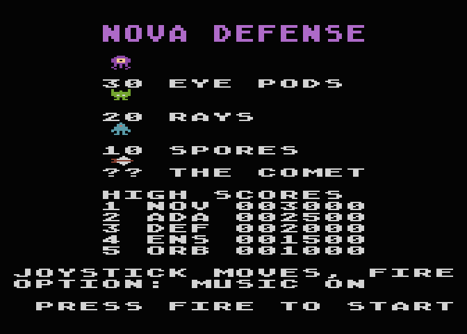
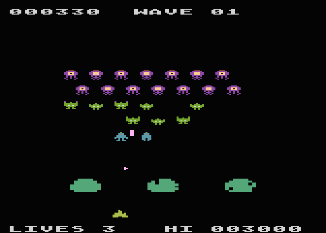
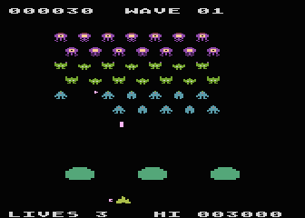

# Nova Defense (Atari 8-bit)

Port of `amiga_mcp/examples/nova_defense`: defend the base against a
staggered swarm of 48 aliens in three kinds (30 / 20 / 10 points), a bonus
comet crossing the top (50-300 points), three crystal shields that erode where
they are hit, and waves that start faster each time. The swarm marches
faster as it thins out.

 



```sh
./a8 build nova_defense            # RELEASE=1: no harness log
./a8 run nova_defense
./a8 test nova_defense             # the bot plays a game (test.py)
```

## Controls

| | |
|---|---|
| move | joystick left / right (or A / D, arrow keys) |
| fire | FIRE or SPACE (one shot on the screen at a time, as the original) |
| start | FIRE or START on the title screen |
| OPTION (title) | music on/off |
| initials | type three letters, or UP/DOWN + FIRE, after a high score |

## The Atari version

- **The swarm costs no drawing when it moves.** It is 12 ANTIC 4
  character rows (two an alien row) in a buffer where the aliens never move:
  the display list puts the block where the swarm is. Blank lines above it
  are its height (a drop adds 6), LMS + HSCROL its x, and CHBASE its
  animation frame: charsets A and B hold each alien at the 4 pixel phases of
  a character in opposite frames, so one CHBASE change animates the whole
  swarm, odd columns a frame out of step with even ones as in the original
  (`tools/mkchars.py`). A killed alien is erased, or shows an explosion, in
  its cell.
- **Display-list interrupts** (`src/display.s`, table-driven) give each alien
  type its body and accent colours, switch between the game's charset and
  the ROM font for the status lines, and set the comet row's fine scroll.
  There are two display lists, built in 6502 when the swarm drops and
  flipped in the vertical blank, which also patches the scroll positions
  and charset into the one shown every frame.
- **Players and missiles** do the rest: the three shields are players 0-2
  at double width (a bit = 4 world pixels; the game keeps the original's
  pixels, so erosion follows its rules exactly), the gun is player 3, the
  bullets are the four missiles (fifth-player colour).
- **The comet** is a fine-scrolled character row; messages (WAVE CLEAR,
  GAME OVER, initials) take its place.
- **POKEY**: the original's three-note march, shot, hits, the comet and the
  background arpeggio.
- The title screen shows the three aliens and the comet in their colours,
  beating their wings (the same DLI and charset tricks).

## What was kept, what changed

`src/game.c` is the original's logic, in its 320 x 256 coordinates (the
Atari shows x at half width and y one scan line a pixel): rules, scoring,
the march speed-up as aliens die, firing rates, the comet, shield erosion,
waves and lives. Changes are marked `port:`:

- an alien row is 16 lines (was 15): two character rows; odd rows are
  shifted 12 pixels (was 13, half a cell) so they fall on whole colour
  clocks
- the SDK's xorshift random numbers instead of the 32-bit LCG
- speed-only rewrites with the same results: alive aliens as a bit mask per
  row, the bullet tests only the rows its sweep crosses and the column under
  it, the swarm bounds from each row's first and last alien, tables instead
  of multiplies, the shields made once and copied for each wave, and the
  aliens eat the shields only when the swarm has moved (only the strip a
  step uncovered; the rest was eaten before)
- added: a high-score table with initials

## Memory and speed

- Program, data and variables `$2000-$8084` (24.1K; the XEX is 19.5K in a
  release build). Charsets `$A000`/`$A400`, the swarm `$A800`, the comet row,
  status lines and display lists to `$AFFF`, the title from `$B000`;
  players at `$9800`.
- No 130XE banks: it runs on a 64K 800XL (the test boots it there) and
  should on a 48K machine with BASIC off.
- 48-50 fps in the emulator (PAL) while a wave is played (the bot's game);
  30-50 fps while the swarm is eating the shields. The logic runs at a
  fixed 50 Hz (one step of catch-up), so the game keeps the original's
  speed.
- NTSC: the game runs per frame, so it is 20% faster at 60 Hz.

## Test

`./a8 test nova_defense`: a bot reads the swarm, the gun, the shields and
the bullets by symbol and simulates the march and its shot (as game.c
does) to move where a shot will hit, outer columns and the lowest row
first, dodging bullets; it clears wave 1, then stops dodging, so lives are
lost and the game ends. It enters BOT in the high-score table and returns
to the title. The game is recorded and replayed twice (every frame hash),
and it boots on a 64K 800XL. The test writes the screenshots and the GIF.

## Not done

- the original's mouse control
