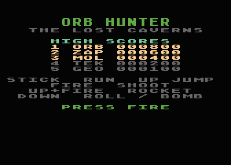
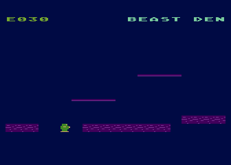
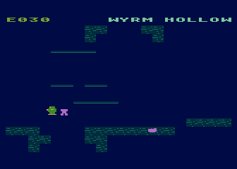
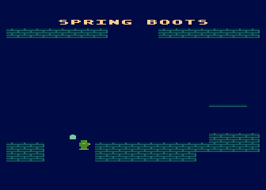

# Orb Hunter (Atari 8-bit)

Port of `amiga_mcp/examples/orb_hunter`: explore the lost caverns. Its
world is 8 x 6 rooms of 20 x 16 tiles (a screen each): caverns, magma
halls, corridors, the citadel, the dens of two bosses. Shoot the creatures
(100 points, a boss 2000), collect the power-ups (power cells, rocket
packs, the roll form and its bombs, the far shot, the frost ray, spring
boots, the spin strike, the heat suit) to reach new areas, and don't let
your energy run out. The ZX Spectrum Next port
(`spectrum_dev/projects/orb_hunter`) was the reference.

   


```sh
./a8 build orb_hunter               # build/orb_hunter.xex
./a8 run orb_hunter                 # play it in a window
./a8 test orb_hunter                # the bot plays a game (test.py)
./a8 build orb_hunter RELEASE=1     # no harness log
```

## Controls

| | joystick (port 1) | keys |
|---|---|---|
| run | left / right | A / D |
| jump (higher with the spring boots; let go early for a short one) | up | W |
| shoot | FIRE | SPACE |
| a rocket (opens barred doors; once found) | up + FIRE | W + SPACE |
| roll form (once found; up stands up again) | down | S |
| a bomb (rolled, once found) | FIRE | SPACE |
| start / leave game over | FIRE | START, RETURN |
| initials | up / down a letter, FIRE next | type the letters |

## What was kept, what changed

`src/game.c` is the original's `game.c`, its rules in its order: the
hunter's running and jumping (and the short jump when the button is let
go), gravity, one-way ledges, lava, rolling and standing up under low
ceilings, beams, rockets that open the barred doors, bombs (and the bomb
jump), the six creatures' behaviour, both bosses, the power-ups, the
scores, the moves from room to room, the energy. The world is the
original's own `levels.c` rooms (made on the host by the Spectrum port's
tools; the test checks the start room against them byte for byte).

Changed (marked `port:` in the code), for a 1.77 MHz 6502 and cc65:

- **12.4 fixed point**: the original keeps positions and speeds in 16.16
  (32-bit). Every value its rules use is a multiple of 1/16 of a pixel
  (speeds 1/2, 1/4, 1/8, gravity 1/4, a jump halved), so here they are
  12.4 in 16 bits: the same numbers, for the hunter and the creatures.
  Only the sparks' random speeds (1/512 pixels) are rounded to 1/16.
- the structs are arrays of fields and the hunter's fields globals; the
  tile tests at a pixel are one routine (`props.s`); the animation's
  `frame / 3` is a count; a room's items are found when it is entered. cc65
  makes every one of these several times faster than the original's form.
- **the world**: its 48 rooms (15,360 bytes) run-length coded in 1,541
  bytes, the current room decoded when it is entered, the doors a rocket
  opened kept in a list. No 130XE banks needed.
- at most 4 creatures a room (the original allows 12; no room has more
  than 2); the sparks' random numbers are the SDK's xorshift.
- added: a high-score table with initials; game over waits for a new press
  of fire. The item's name shows in the HUD row (the original draws a
  box), the HUD has energy, rockets and the score (not the map of rooms);
  an area's name shows there for a while when the hunter enters it.

The original's own bugs, fixed in `amiga_mcp/examples/orb_hunter` (amiga_games
#50) and here the same way: the frame counter goes up once a step, so the
hunter flickers while invulnerable and the creatures are drawn; a creature
flashes (white) for 8 frames when a shot or bomb hits it; the title and
the item's message need a new press of fire (the message also ends after
its 90 frames, game over after 180); the score shows in the HUD and with
GAME OVER; the citadel's creatures start on its floor (row 12), not inside
it (row 13).

## How it uses the Atari

| | |
|---|---|
| **display list** | the HUD (ANTIC 6, where the original's HUD covers the room's top row), then the room's rows 1-15 in ANTIC E: 160 x 180, a tile 8 x 12 (the original's 320 x 256 at x / 2, y * 3 / 4) |
| **DLIs** | one a tile row (15): each area has its rock colours (green caverns, red magma, purple beast den, blue wyrm hollow, grey citadel, tan surface) and each row its own special colour: orange lava (its highlights glowing), blue barred doors, grey metal, cyan orbs and save points |
| **players** | the hunter is players 0 and 1 (its two colours), the creatures players 2 and 3, a boss both (32 pixels wide) |
| **missiles** | the hunter's beams and rockets (the fifth player's colour) |
| **XOR points** | the bombs, the creatures' shots and the sparks (gfx.s) |
| **the room** | drawn when entered (gfx.s: the bitmap cleared unrolled, the tiles that aren't empty; ~5 frames); then only the lava's surface moving (a quarter of its tiles a frame), opened doors and taken orbs |
| **POKEY** | the original's eight effects on channels 0-2, a bass line on 3 |

## Memory

| | |
|---|---|
| `$2000-$8F74` | program: code 22.8K, data 3.9K (the world 1.6K, the tiles, the sprites), BSS |
| `$9000-$97FF` | C stack |
| `$9800-$9AD9` | the creatures, the shots, bombs, sparks, the lava list and the opened doors (the PMG area's free pages; `orb_hunter.cfg` adds the segment) |
| `$9B00-$9FFF` | players and missiles |
| `$A010-$BC2F` | the room (180 x 40); the title's rows and list while it shows |
| `$BC40`, `$BD00`, `$BE00` | the HUD row, the display list, the font |

No banks: it runs on a **64K 800XL** (checked) and a 48K 400/800.

## Speed

The rules run once for every frame that passed (the original's 50 Hz;
up to 8 a frame, so entering a room doesn't slow the game), the screen is
drawn once a loop. Measured by the test over the bot's whole game (rooms,
fights, room changes, sparks): **41 fps on average, the rules at 50 Hz**;
50 in a quiet room.

Profiled with breakpoints and cycle counts: the first version drew 14
frames a second and took 24 frames to enter a room. The tile tests in
6502, the room clear unrolled and only its non-empty tiles drawn, the
creatures' fields in statics for a step, the item checks for this room
only, and no divisions in a frame brought it here.

## PAL and NTSC

PAL first. On NTSC the rules run 20% faster (per frame, as the original)
and the colours shift.

## Test

`./a8 test orb_hunter`: boots, starts in room 2,2 (checked against the
original's world); the bot (`tools/bot.py`) runs right, down the gap into
the caverns, shoots the creatures (scoring), takes the Spring Boots in
room 3,3, goes back for the creatures (a room's creatures come back when
it is entered) and lets them wear its energy down: dead, GAME OVER, FIRE,
BOT in the high-score table, the title. Frame rate and rules rate from the
game's perf log. The pictures and the GIF: `tools/make_gif.py`.

## Not done

- the HUD's map of rooms, the original's item box and its MOD music.
- the high scores are not saved.
- the save points are drawn but do nothing (the original's don't either).
