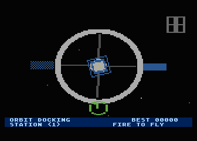
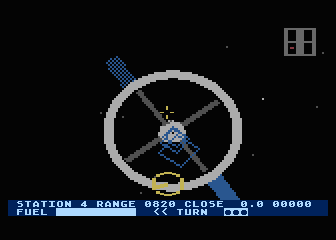
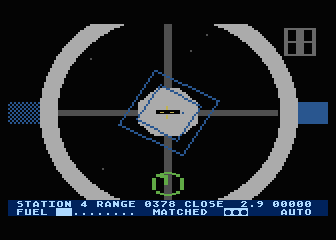
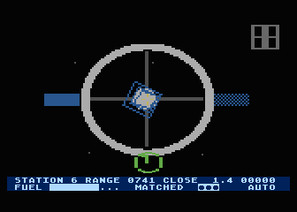
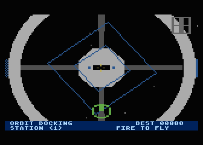

# Orbit Docking (Atari 8-bit)

Port of `amiga_mcp/examples/orbit_docking` (the Amiga original on the
amiga3d engine): a slow, tense docking simulator. A station spins about its
long axis. Its docking port is a slot at the end of its hub, on that axis,
turning with it. Fly your craft in along the axis, roll to match the slot
and turn as fast as it turns, and close in gently. There is no friction in
space: a push lasts until you push back, and fuel is limited.

 
 

## Controls

| Joystick / keys | |
|---|---|
| stick (arrow keys) | move across: the craft's own left, right, up, down |
| FIRE + up / down (W / S) | in towards the station / back out |
| FIRE + left / right (A / D) | roll |
| START (P, RETURN) | pause |
| B | the autopilot on / off |
| ESC | back to the title |

On the title the autopilot flies the demo; left / right (or up / down)
choose the station to start at, FIRE or START flies. The title shows the
best score.

At contact the craft must be within 14 units of the axis, closing at under
1.6 a tick, drifting across at under 0.8, rolled within 8 degrees of the
slot (it looks the same turned half round) and turning within 7 degrees a
second of it. Anything else is a crash, and the message says which limit
you broke. Three crashes end the game. Six stations, from a slow spin with
you on the axis to a fast spin the other way, well off the axis, with three
pieces of debris drifting across the approach. Scoring: 1000 a dock + 500 x
the station + 2 for each unit of fuel left, less a little for the time.

The instruments: range and closing rate (in inverse when you're too fast
near the port), the score, the fuel gauge, MATCHED / << TURN / TURN >>,
the lives (top row and the second row of text); the axis box at the top
right (a dot where you are against the axis: green on it, red off it); the
roll dial at the bottom (the needle up when you're lined up with the slot:
green within the limit, yellow outside it); the sight in the middle.

## What's kept, what changed

Kept: the six stations, the rules (`src/od_core.c` is the original's
`od_core.c`: the thrusters in the craft's rolled frame, the spin, the
docking limits and the crash reasons, fuel, the debris, scoring, lives),
the original's 25 ticks a second, its autopilot (it also flies behind the
title), the camera looking back down the axis and rolling with the craft
(rolled to match the slot, the station stands still), the station (the hub,
its face, the slot and its three lights, four arms, the ring, two solar
panels), the approach markers, the turning debris, the stars turning with
the roll, the instruments.

Changed (marked `port:` in the source):

- **16-bit rules.** Positions in 1/16 units with a 1/256 remainder and
  speeds in 1/256 units a tick (the original: 16.16 for both); angles as
  the original. cc65's 32-bit code is big and slow, so 32 bits are used
  only for the angles and two squared distances. `tools/host_check.sh`
  runs the port's autopilot and the original's on the host, 10 seeds a
  station: the port docks as often (stations 1-3 always, 4 always with 2
  crashes on the way to the original's 1, 5 on 9 of 10, 6 on 8 of 10) and
  as fast (459-791 ticks against 455-793).
- **The projection.** The camera never yaws or pitches, so every corner of
  the station is on a plane across its axis and is kept as (radius, angle)
  there (`tools/gen_view.py`): a frame works out each plane's scale and
  where the axis crosses it, each radius scaled once (`proj_setup`), then
  one 8 x 8 product a corner and axis (`proj_all`, a3d's quarter-square
  tables), not a camera transform a corner.
- **The ring is an elliptical annulus** drawn a line at a time (its widths
  kept until its size changes, the lines above and below the middle drawn
  together), not 16 quads alternately shaded: turned, it looks the same.
  The light details (the slot's lights) are drawn only when the station is
  near enough to show them.
- **Hidden sides culled** before they're drawn (the hub's and arms' sides
  face away from a camera near the axis), and polygons off the screen
  skipped (`draw_polys`).
- **Colours:** the station in two greys, the panels, lights and markers in
  blue, space black (ANTIC mode D's four colours and their checkers).
- **The instruments** are players and text rows, not drawn into the view;
  the help pages aren't ported (the controls are above).
- **Sound**: POKEY effects for the thrusters, a dock, a crash, running out
  of fuel and the end.

## Atari hardware used

- ANTIC mode D (160 x 88, 4 colours) double-buffered by the a3d renderer
  (`projects/a8_3d`: polygons, lines, display lists, text rows, its
  multiply tables), two text rows (mode 2) with a3d's HUD DLI.
- Player 0 the sight, player 1 (double width) the roll dial with its needle
  in 16 directions, player 2 (double width) the axis box, missile 3 the
  craft's dot in it (player 3's colour: green or red).
- POKEY sound; input latched in the deferred VBI (`src/vbi.s`: the stick,
  FIRE, the console keys, and W S A D and the arrow keys).

## Frame rate (PAL, measured in the emulator)

The log prints `od: ticks5s= frames5s= draw=` every 5 seconds.

- The rules: **25 ticks a second** (the original's), 125-131 in 5 s.
- The view: **4-5 frames a second** flying by hand (frames5s 20-24),
  **3.5-4** with the autopilot (it costs about 14K cycles a tick:
  frames5s 18-21). A frame is about 300K cycles.

Where a frame goes (cycles with ANTIC's DMA, breakpoint timing): clearing
the view 28K, the planes and radii 45K, the corners 40K, the polygons
(arms, panels, the hub's face, the slot) 80K, the ring 50-80K, the markers
35K, the stars 12K when the roll changes.

Profiling moved, in turn: the corners from four 16 x 16 products each to
one 8 x 8 a corner and axis by radius class (from 70K to 40K a frame);
the ring from 16 quads (215K) to an annulus of spans; the hidden sides
from a3d's edge walker (12 polygons drawn for nothing, 90K) to a cross
product test first; the stars from C to asm (75K to 12K); the rules from
16.16 to 16 bits (no 32-bit products: the autopilot from 19K to 14K a tick,
and 1.2K of code less).

## Memory

It runs on a 64K 800XL (the test boots it on one): no 130XE banks. The
game state, the projected corners and the tables made at start-up live in
the SDK's `LOWRAM` ($0C00-$1FFF, only for programs loaded without DOS: the
harness and the arcade disk). `-Cl` keeps C locals static, `-Ors` (no
inlining) keeps the code small.

| | debug build | `RELEASE=1` |
|---|---|---|
| program `$2000-` | `$8C68` | `$8939` |
| free below the C stack (`$9000`) | 0.9K | 1.7K |
| LOWRAM `$0C00-` | `$1D7B` (4.4K of 5K) | the same |
| zero page | `$82-$BC` | the same |
| screen | two buffers `$A010` / `$B010`, display lists `$AF10` / `$BF10`, text rows `$AF80`; PMG `$9800` | |

## Testing

`./a8 test orbit_docking` (`test.py`): the title (the demo flies on the
autopilot); RIGHT / LEFT choose the station, FIRE starts station 1; the
stick moves the craft across (fuel burnt), W pushes it in, FIRE + RIGHT
rolls it; START pauses (nothing moves) and starts again; B: the autopilot
docks at station 1 (the score) and station 2 comes up; autopilot off, W
held: the craft rams the station, a crash, a life gone; one life left,
rammed again: game over, FIRE, the title. And the 800XL.

`sh tools/host_check.sh <amiga_mcp>/examples/orbit_docking
<amiga_mcp>/examples/amiga3d`: the port's autopilot against the original's
on the host.

## Not done yet

- The frame rate: 4-5 frames a second is slow for the original's 25. The
  next steps would be clearing only what was drawn (and the stars
  individually), the planes' scales from a reciprocal table, and the arms
  as thick lines.
- The help pages, the big DOCKED / GAME OVER text, music.
- NTSC: the ticks count 17 ms frames, so the speed is right, the colours
  are PAL's.
