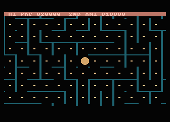
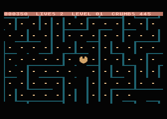
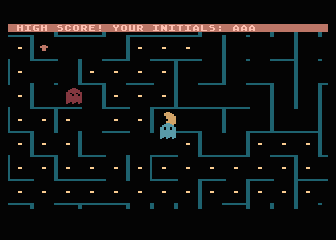
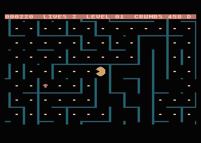

# Planet Chomp (Atari XL/XE)

Port of `amiga_mcp/examples/planet_chomp` (the 3DO and Amiga version of the
Unity game), after the Spectrum Next port: a maze chase on a tiny planet.
The maze wraps all the way round it. Eat every crumb, dodge the four
spooks (GLOOM, SPARK, MIST, MOSS), grab a golden key to turn the tables.
The Atari shows the planet's maze **unwrapped flat round the chomper**: the
cells around it laid out on the screen as you would see them from above,
following it round the planet's corners.

**Runs on a 64K 800XL** (and the 130XE: no banks needed). It switches the
OS ROM off for the RAM under it, so not on a 48K 400/800.

   



```sh
./a8 build planet_chomp RELEASE=1   # no harness log, no test probe
./a8 run planet_chomp
./a8 test planet_chomp              # a joystick bot plays a game (test.py)
```

## Controls

| | |
|---|---|
| steer | joystick, relative to the screen; a turn waits for the next junction (hold it) |
| start | START or FIRE (the attract mode starts by itself after 15 s on the title; START or FIRE leaves it) |
| pause | SELECT or P |
| initials | type them, or joystick up / down and left / right; FIRE, START or RETURN when done |

PAL first. On NTSC the rules step 30 times a second instead of 25 (they
count frames): everything runs a fifth faster.

## What's kept, what changed

Kept from the original:

- **The rules** (`src/game.c`, from the original's `game.c`: GameDirector,
  Ghost, Chomper, Mover): the rail movement, the buffered screen-relative
  steering, the four spooks' targeting (chaser, ambusher, flanker, drifter),
  scatter and chase phases, frightened spooks and combo scores, keys, lives,
  the extra life at 10000, the level speeds, the autopilot of the attract
  demo.
- **The mazes**: `tools/gen_maze.c` runs the original's `maze.c` on the
  host (its algorithm and random numbers) and writes every level's maze
  and the planet's cell graph (`src/maze_data.c`, `src/maze_levels.c`).
- The sprites' shapes after the original's `sprites.c` (`tools/gen_gfx.py`),
  the spooks' colours, the sounds' events.

Changed (marked `port:` in the code):

- **The view.** The original (and the Spectrum port) draws the planet in
  perspective 3D. Here the maze round the chomper is unwrapped onto a flat
  15 x 9 cell grid (`src/unwrap.s`, the C it follows in `src/view.c`): along
  the middle row out from the centre, then up and down each column; each
  step carries the cell's orientation across the planet's faces. The view
  turns with the chomper as it crosses a face's edge (the original's camera
  "up" travels with it the same way). The screen scrolls finely up and down
  and by characters left and right to follow it.
- **The step: 25 a second.** The rules step at 25 Hz instead of the
  original's 50: every time halved, every step distance doubled, worked
  out once a level instead of every tick.
- **16-bit maths.** Directions are Q7 bytes instead of Q14 longs;
  the products that pass 16 bits are 24-bit, in asm (`src/fastmath.s`).
- No planet silhouette, starfield, radar, power bar or score popups; the
  HUD is one text row (score, lives, level, crumbs left).
- A stick held through a life's start steers (the original wants a new
  press).
- High scores (five, with initials) are new.

## How it is drawn

- **ANTIC mode 4** characters (4 colours): a cell is 3 x 3 characters
  (12 x 24 pixels, square on screen): four corners, four edges and the
  middle (nothing, a crumb, a key, the nest), 29 characters in all.
- Two maps (48 x 27 characters), **double-buffered**: when the chomper
  reaches a new cell the hidden map is rebuilt round it and shown from the
  next frame (the display list's LMS per row, VSCROL from the VBI).
- **The chomper is the four missiles** side by side (the fifth player,
  GPRIOR), the spooks players 0-3; frightened spooks flash, eaten ones are
  eyes.
- A DLI after the HUD row switches the font; the HUD uses the ROM's font
  (copied to RAM).
- **POKEY**: the crumbs' plink, the key, eating a spook, death, the level's
  end, the extra life, the start jingle, and the siren (higher when the
  chomper is powered).

## Memory

| | |
|---|---|
| `$0C00-$1EA4` | the game's state (`Game g`), the maps' cell places, the cell contents |
| `$2000-$88CA` | code, data (the C runtime and the SDK) |
| `$9000-$97FF` | C stack |
| `$9800-$9FFF` | players / missiles (and at load, the levels' and the maze's data) |
| `$A000-$A3FF` | the maze's font |
| `$A400-$AFFF` | the two maps |
| `$B000-$B2FF` | two display lists, the HUD row |
| `$B400-$B7FF` | the ROM font's copy (the HUD) |
| `$C000-$CF2F` (under the ROM) | the 16 levels' passages |
| `$D800-$EB07` (under the ROM) | the planet's cell graph |
| `$EB08-$F851` (under the ROM) | the autopilot's work arrays |

## Speed (measured with `tools/profile.py`)

- **In play, 23-25 of the 25 steps a second** (the test measures 23.2 with
  its bot running the chomper non-stop); the display is drawn after each
  step (25 frames a second; nothing moves between steps).
- **The attract mode: 17-22**, as the original's autopilot runs a
  breadth-first search through the maze every step.
- What it took (from 12-14): the unwrap in asm (~150 000 cycles, about 5 frames
  with mode 4's DMA, once a cell); the HUD's
  numbers by subtraction in asm (cc65's 32-bit divide took 14 000 cycles a
  number) and only when they change; the dot products and the lerp in asm;
  no multiplies in the view's per-frame code; the display drawn once a step.
- A cc65 trap found on the way: `(b ? MAP1 : MAP0)[i]` with constant
  pointers compiled to `b + i`, writing into the 6502's stack page.

## Not done

- The 3D view, the planet's silhouette, the starfield, the radar, the score
  popups, the view spin and the whole-planet view.
- The autopilot (attract mode) runs slower than real time.

## Test

`./a8 test planet_chomp` (`test.py`), on a 130XE and a 64K 800XL: the
title; the attract mode scores; START leaves it, START plays; a joystick
bot (it reads the open ways and the crumbs next to the chomper from the
game's `pc_probe`, not in the RELEASE build) eats crumbs; the steps a
second (at least 20); the test sets the crumbs left to 1 and the bot eats
the last: level 2; then it lets go and the spooks catch the chomper: game
over, the initials BOT, back to the title.
