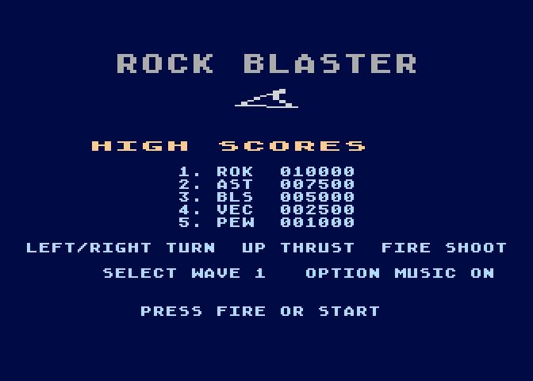
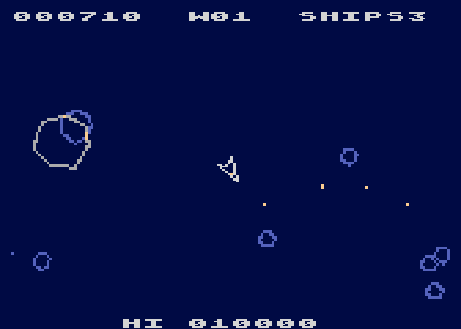
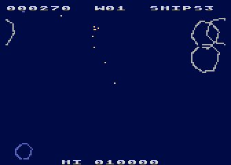

# Rock Blaster (Atari 8-bit)

Port of `amiga_mcp/examples/rock_blaster`: a vector rock shooter. Turn,
thrust and fire; large rocks split into two medium ones, medium into two
small (20 / 50 / 100 points); clear the screen and the next wave brings two
more large rocks. Three lives, 100 frames of safety after each respawn,
everything wraps around the screen. The original's tune ("rock storm")
plays on two POKEY channels.

 



```sh
./a8 build rock_blaster            # RELEASE=1: no harness log
./a8 run rock_blaster
./a8 test rock_blaster             # the bot plays a game (test.py)
```

## Controls

| | |
|---|---|
| turn | joystick left / right (or A / D, arrow keys) |
| thrust | joystick up (W, up arrow) |
| fire | FIRE or SPACE: one shot every 8 frames while held, as the original |
| start | FIRE or START on the title screen |
| SELECT (title) | starting wave 1-5 |
| OPTION (title) | music on/off |
| initials | type three letters, or UP/DOWN + FIRE, after a high score |

## The Atari version

- **The world** is the original's 320 pixels across, 216 high (the
  original's 256 cut to fit one scan line a pixel), shown on 160 colour
  clocks: every shape keeps the original's proportions on the TV.
- **Rocks** are XOR outlines in a 160 x 108 ANTIC D bitmap (4 colours,
  rows of 2 scan lines): large rocks in light grey, medium and small in
  blue-grey, as the original colours them by size. Drawing an outline again
  takes it off, so a rock that moved is erased and redrawn in one
  top-to-bottom sweep (`src/draw.s`) and nothing else is touched. Outlines
  are pixel lists made from the original's polygons by `tools/mkshapes.py`
  (every pixel once, so XOR leaves no holes at the corners).
- **The ship** is players 0+1 (16 colour clocks wide), its flame players
  2+3 in orange, at the full one-line resolution; the outline is drawn into
  the players from the original's 5 corners rotated to 64 angles.
- **Bullets and explosion particles** are bitmap pixels.
- **Status** lines are ANTIC 6 text (score, wave, ships; high score and
  messages).
- **Sound**: a small player in the vertical blank (`src/snd.s`) plays the
  original's MOD lead and bass (`tools/mkmusic.py` turns
  `tools/rock_blaster.mod` into note lists) on POKEY channels 3 and 4, and
  the shot, explosion and death effects on 1 and 2.

## What was kept, what changed

`src/game.c` is the original's logic, by way of the ZX Spectrum port's
16-bit sums: the ship's thrust (0.20), drag (253/256 a frame), speed limit
and 16.16 position; bullets at 4 px a frame for 40 frames; rock speeds
(0.4-0.8 px a frame, x1.5 medium, x2 small); circle collisions with the
original's radii; the scoring, the waves (4 + 2 per level), three lives,
the respawn and game-over timers, and the order of the update. Changes are
marked `port:`:

- the world is 320 x 216 (was 256 high)
- rocks, bullets and particles move in 16-bit 1/128-pixel units;
  collisions compare whole pixels (at most 1 px from the original)
- the SDK's xorshift random numbers instead of the 32-bit LCG
- a particle's velocity is one of 64 made at start-up the original's way
  (random direction, random speed 0-3 px), picked at random: making each
  one with two multiplies cost more than moving all of them
- particles that leave the screen are gone (the original kept moving them,
  invisible)
- game over goes to the high-score table and the title instead of starting
  a new game at once; SELECT starts at a later wave

The logic runs at a fixed 50 Hz: when a frame takes longer, the next one
catches up (at most one extra step), so the game plays at the original's
speed. The per-frame loops are 6502 (`src/objs.s`: moving rocks, bullets
and particles, the collision tests; `src/phys.s`: the ship's drag and the
multiplies; `src/draw.s`: all drawing).

## Memory and speed

- Program, data and variables `$2000-$856D` (25.9K; the XEX is 19.6K in a
  release build). Bitmap `$A010-$B0EF`, display list `$9800`, players at
  `$9800-$9FFF`.
- No 130XE banks: it runs on a 64K 800XL (the test boots it there) and
  should on a 48K machine with BASIC off.
- Frame rate in the emulator (PAL, release build): 50 fps with the first
  wave's four large rocks, 36-40 fps while shooting with 5-8 rocks and
  explosions; the test's bot sees 30-46 fps (with the harness log). The
  ship, bullets and particles are drawn every frame; rocks are redrawn in
  the time that is left (`rocks_sync`: each one is only started when its
  cost fits before the vertical blank), so in a busy frame some rocks move
  a frame or two late instead of the whole game slowing down. ANTIC D was
  chosen over a 216-line ANTIC E bitmap for this: half the screen DMA and
  under half the pixels per rock (a large rock's outline is 69 pixels
  instead of 96).
- NTSC: the game runs per frame, so it is 20% faster at 60 Hz.

## Test

`./a8 test rock_blaster`: a bot reads the game's state by symbol
(`ship_px`, `ship_angle`, `rk_active`, `rk_px`...), turns to the nearest
rock and fires; after wave 1 is cleared it thrusts into the rocks, so lives
are lost and the game ends. It enters BOT in the high-score table and
returns to the title. Checks: scoring (including small rocks' 100), wave 2,
a life lost, game over, at least 20 fps, the high-score entry; the game is
recorded and replayed twice (every frame hash), and it boots on a 64K
800XL. The test writes the screenshots and the GIF.

## Not done

- the MOD's drum and counter-melody channels (POKEY has four channels:
  two are for the effects)
- a thrust sound
