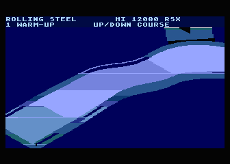
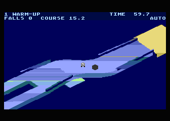
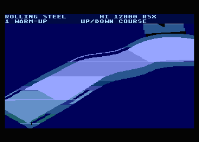

# Rolling Steel (Atari 130XE edition)

Port of `amiga_mcp/examples/rolling_steel`, an isometric roll-a-marble-downhill
game in the spirit of the 1984 Atari cabinet (the 3DO version's C, rebuilt
from the Unity game [geekychris/rolling_steel](https://github.com/geekychris/rolling_steel),
MIT, `tools/orig/LICENSE.original`), after the Spectrum Next port. Six
floating courses and one clock that carries over between them, no jump and
no brakes. Ice slides, sand bites, acid dissolves; fans push; steel chasers
roll at you and green blobs eat you.

This is an **Atari edition**: the courses, the clock, the rules and the
feel of the original, cut down to fit a 1.79 MHz 6502. **The physics is a
2.5D approximation** of the original's (see below), and some of the
course furniture is gone.

**It needs a 130XE**: the six courses fill its four banks, and the game
uses the RAM under the OS ROM. On a 64K 800XL it says so.

 



```sh
./a8 build rolling_steel            # RELEASE=1: no harness log
./a8 run rolling_steel
./a8 test rolling_steel             # a game played with the joystick (test.py)
python3 projects/rolling_steel/tools/gen_course.py [--preview]   # the courses -> gfx/bank0-3.bin, src/course_dir.c
```

## Controls

| | |
|---|---|
| roll the marble | joystick: up rolls it up the screen (away from you), right to the right |
| title | up / down (or SELECT) choose the course to start from (1 is the full run), FIRE or START rolls |
| autopilot | B: the original's demo driver takes over (and plays the attract mode after 25 s on the title) |
| initials | type them, or up / down and left / right, FIRE when done |

PAL first. On NTSC the game runs a fifth faster (it steps by frames), the
clock with it.

## What's kept

- **The six courses**, drawn from the original's own geometry, lighting and
  fog, through its camera at its default angle (yaw 0, pitch 35 degrees),
  by `tools/gen_course.py` (the Next port's `course_pic.py` and `rsview.py`).
- **The clock and the run**: each course's time added to what's left,
  three seconds off for a fall, back on behind where you last had the deck
  (the original's safe route points), medals (gold, silver, bronze from
  the original's times), best times, the course order.
- **The marble's forces**, the original's constants per 1/50 s: the push
  of 34 m/s^2 (30% in the air), gravity of 9.81 + 12 m/s^2, the flat speed
  cap of 13 m/s, bounces from PhysX's materials (rails .35, deck .12) with
  nothing bouncing below 2 m/s, falls of 12 units.
- **Surfaces**: deck rolls, ice slides (all of the push and the slope's
  pull, no drag), sand drags; acid pools dissolve you; fans and boost
  strips push; posts (pillars) and rails stand in your way.
- **Enemies**: steel chasers (mass 3) roll at you when you're within their
  range and knock you; blobs swing to and fro and eat you.
- The title flying along the course, the attract mode's autopilot, the
  HUD's course, clock (flashing in its last 10 seconds), falls, course time
  and best time, the banners (FELL OFF, DISSOLVED, EATEN, -3 SECONDS,
  COURSE CLEAR with the medal, OUT OF TIME, ALL CLEAR).
- High scores (as the Spectrum port's): 1000 times the course number for
  each course finished, 500 / 300 / 100 for a gold / silver / bronze medal,
  plus the clock left in tenths at the end. Initials, a table of five.

## What the Atari edition leaves out

- **The physics is 2.5D.** The original rolls a spinning sphere against the
  courses' triangles (PhysX's model). Here a course is a grid of half-unit
  cells, each with one deck height and a surface (`tools/gen_course.py`
  samples the original's collision triangles): a ball on the deck is pulled
  down the grid's slope (bilinear between the cell centres) and pushed by
  the stick, 5/7 of each while it rolls (a solid sphere's share) and all of
  it on ice; off an edge it flies until it lands or falls. A cell standing
  a quarter unit above the ball's foot is a wall, felt ahead of it. There
  is no spin (so arriving on sand spinning for ice costs nothing), no
  rolling under or over another deck (the grid keeps the top one), and the
  marble's path through bends, kerbs and jumps differs in detail from the
  original's. The steps are two of the original's at a time (25 a second,
  every per-step amount doubled, as the Next port's play mode).
- **Sweepers, crushers and crumbling tiles are gone**: the tiles are solid
  deck, drawn in the picture.
- **The view is fixed** (the original turns, zooms and tilts it), and
  zoomed out from the original's 10.5 to 15 units so more of the course is
  on the small screen. The marble is 4 x 8 pixels.
- No two-player split screen, no ghost of your best run, no slow-motion
  wipeout, debris or camera shake (a fall flashes the HUD's bar), no music
  (POKEY sound effects and the rolling rumble only). The floating scenery
  holds still (it's in the picture).
- Steel chasers sleep at home until you come within their range (the
  original wakes them within 40 units); a chaser and a blob at a time
  are shown (two players for them).
- Best times and high scores last the session.
- The autopilot steers the route with the joystick's eight directions.
  Route points that lie in an acid pool are moved out of it for it; with
  acid within a second of it, it creeps (2.5 u/s) and keeps closer to the
  route. It can't get past everything: course 6's steel chaser guards the
  gap between two pools, so when the autopilot is put back at the same
  place a second time, it goes on from three safe route points further.
  With that it finishes all six courses (the attract mode gives up after
  five falls).

## How it works

- **The picture**: each course is drawn once on the host into one big
  picture and made ANTIC mode 4 (4 colours, 160 pixels across): 4 x 8
  pixel characters, each character row with its own font (up to 128 tiles)
  and its own four colours. The screen is two text rows (the HUD) and 23
  rows of the course, scrolled both ways by the hardware (LMS per row,
  HSCROL, VSCROL), and a display list interrupt at each row sets the next
  row's font and colours from tables made when the course loads
  (`src/disp.s`). The DLI is short and keeps its registers on the stack:
  a one-line first row's DLI comes while the HUD's is still running.
- **Sprites**: the marble is player 1 with player 0 as its shine, its
  shadow on the deck is the missiles as a fifth player, chasers and blobs
  players 2 and 3, all single-line PMG. They're placed against the view the
  next vertical blank puts on screen.
- **The banks**: each course is three packed streams (`tools/lz.py`,
  `src/unlz.s`): the picture (fonts, map, row colours), the grid (heights
  as their miss from the plane through the left, upper and upper-left
  cells: `src/gdec.s` decodes it), and the numbers (spawn, clock, medals,
  route, trigger boxes as cell rows, enemies). They fill 64,967 of the
  banks' 65,520 bytes; a course loads in about 2.7 seconds.
- **The physics** (`src/phys.c`, the hot parts in asm: `src/maths.s`'s
  cell and deck lookups, `src/move.s`'s move through walls and onto the
  deck).

## Memory

The OS ROM is switched off (`src/os.s` stands in for the parts the game
uses), for the RAM under it.

| | |
|---|---|
| $0400-$0BFF | the course's numbers |
| $0C00-$0FFF | the ROM font's copy (the HUD) |
| $1000-$143F | display list, HUD rows, the grid's row index |
| $1440-$1CFF | code loaded low (the course loader and grid decoder) |
| $1D00-$1FFF | the C stack |
| $2000-$7A17 | the program (22.5K) |
| $8000-$C5C8 | the course's picture (up to 17.9K) |
| $C800-$CAFF | the DLI's per-row tables |
| $CB00-$CFFF | players and missiles |
| $D800-$FE4B | the course's grid (up to 9.8K) |
| banks 0-3 | the six courses, packed (64,967 bytes) |

## Speed

Measured in the emulator (PAL, frames drawn and 1/50 s steps a second,
with the autopilot rolling, which costs a little itself): course 1 about
24 frames a second with the physics at 49 of 50 steps (real time is 50);
the courses with more going on 13 to 20 frames a second, the physics 46 to
47 steps a second (the clock runs with the game, so a run isn't cut
short). The marble's forces and trigger boxes (`src/force.s`), its move
(`src/move.s`), the deck and grid lookups and `speed_of` (`src/maths.s`)
are assembly; a course row with the font and colours of the row above
gets no display interrupt.

## Not done

- Sweepers, crushers, crumbling tiles and music, as above.
- The physics in C still costs the busier courses a few frames a second.
