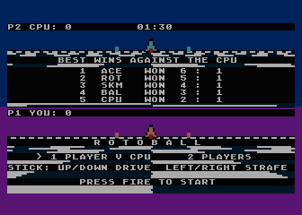
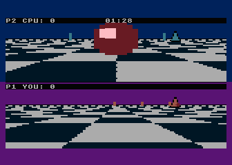
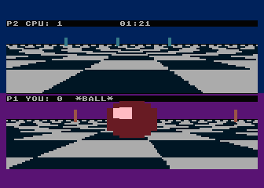

# Rotoball (Atari 8-bit)

Port of `amiga_mcp/examples/rotoball`: a split-screen futuristic ball
sport. Two skimmers hover over a chequered pitch; grab the ball and carry
it over the other goal line before the 90 seconds run out. The top half of
the screen is P2's (or the CPU's) view, the bottom half P1's. The ZX
Spectrum Next port (`spectrum_dev/projects/rotoball`) was the reference.

  


```sh
./a8 build rotoball                 # build/rotoball.xex
./a8 run rotoball                   # play it in a window
./a8 test rotoball                  # the bot plays a match (test.py)
./a8 build rotoball RELEASE=1       # no harness log
.venv/bin/python projects/rotoball/tools/make_gif.py   # the pictures and the GIF
```

## Controls

| | P1 (bottom view) | P2 (top view, two players) |
|---|---|---|
| drive forward / back | joystick 1 up / down, or W / S | joystick 2 up / down |
| strafe left / right | joystick 1 left / right, or A / D | joystick 2 left / right |
| title: one player v the CPU or two | up / down (or 1 / 2), FIRE or START starts | |
| full time | FIRE | |
| initials (a best win) | up / down a letter, FIRE next; or type them | |

The skimmers always face the other goal, as in the original: "right" is
right on your own half of the screen.

## What was kept, what changed

`src/game.c` (with `rules.s`) is the original's rules from its `main.c`:
the 90-second match, the kick-off places, carrying the ball 2 units ahead,
picking it up within 3 units (ties go to P1), tackles on contact with the
60-step cooldown and the tackle lock, the kicks after a tackle, goals with
the 1/2/3-point ladder (measured, as in the original, where the carrier is
when the ball crosses the line: a goal is worth 1), the physics in its
order (acceleration, friction 15/16, the speed cap, the pitch's bounds, the
bump and impulse between skimmers) and the CPU (chase the ball, carry it to
P1's goal, a unit's deadband). The views are its `pitch.c`: focal length
180, the horizon a third of the way down a pane, the 5-unit checker, the
three posts of the goal ahead in its colour, the other skimmer (a triangle
with a dark outline and skirt), the shaded ball, positions clamped to the
pane, the HUD ("P2 CPU: n *BALL*", the clock, "P1 YOU: n").

Changed (marked `port:` in the code), for a 1.79 MHz 6502:

- **8.8 fixed point** in 16 bits where the original has 16.16. Its rules
  work in 1/256 anyway (every product is `(a >> 8) * (b >> 8)`), so the
  accelerations are exactly its truncated ones (12 forward, -13 back: the
  CPU's quirk of being a little faster backwards is kept). The friction's
  truncation drops the original's lower 8 bits; the collision's push and
  bounce are products scaled to 16 bits.
- **The floor is pointed at, not drawn.** The original computes every
  floor pixel of both views each frame. Seen from a skimmer (always facing
  along the pitch) each floor row is the same stripes at any camera
  position, only shifted; so the rows are built once (`floor.c`: 31 rows,
  4 copies a pixel apart, 8.5K) and each frame `floor.s` points every
  display list line at the right byte of the right copy for its camera,
  adding half a period where the row's cell along the pitch is odd. The
  original's integer row distances and whole-unit camera make its stripes
  step; here they slide (exact distances, 1/256 of a period).
- the projection: 1 / depth from a table and quarter-square multiplies
  (`mathx.s`), not 32-bit divisions; a skimmer too tall for its pane is cut
  at the pane's top (the original shortens it).
- the clock counts steps (50 a second); the original also steps once a
  1/50 s frame.
- **Two players** (P2 on joystick 2) besides P1 against the CPU; the
  original's kick-off screen is the title with the choice and the **best
  wins** against the CPU (goal difference, with initials), new. Full time
  goes back to the title (the original starts the next match).
- sound: the original's CLANG (a goal) as two beating POKEY tones, its PING
  (a pickup or tackle) a short high one, three notes at full time.

## How it uses the Atari

| | |
|---|---|
| **display list** | per pane: blank lines for the sky (no DMA), the HUD row (ANTIC 2 on black, as the original's text boxes), a black horizon line, 31 floor rows in ANTIC D (two scan lines each, 160 pixels, half the DMA of ANTIC E), each with its own LMS; two lists, one shown while the next is made (the VBI swaps them) |
| **LMS per line** | the floor's movement: the camera's sideways place is which byte of which copy a row starts at, its place down the pitch half a period more or less |
| **DLI** | between the panes: the players and missiles move to the bottom pane (positions, widths), the other skimmer's colour, the posts' colour, the sky |
| **players** | the ball: players 0 + 1 OR'd (the red body and its highlight), the other skimmer players 2 + 3 (the body over its dark outline and skirt), shapes for each size made on the host from the original's drawing code (`tools/gen_gfx.py`), widths 1, 2 or 4 |
| **missiles** | the three posts of the goal ahead (the fifth player: its colour per pane) |
| **POKEY** | the effects on channels 0-2 |

## Memory

| | |
|---|---|
| `$0C00-$1FFF` | floor rows (LOWRAM: loads without DOS, as the harness and the arcade disk do) |
| `$2000-$8AA4` | program: code 15K, data 9.3K (the shapes 5.4K, the quarter squares 2K), BSS 1.6K |
| `$9000-$97FF` | C stack |
| `$9B00-$9FFF` | players and missiles |
| `$A000-$A65F` | the two display lists, the text rows, the black row |
| `$A660-$BFFF` | floor rows |

No banks: it runs on a **64K 800XL** and a 48K 800 (both checked: the bot
plays a match on each).

## Speed

The rules run once for every frame that passed (the original's 50 Hz; up
to 4 a frame), the picture is made once a loop. Over the test's whole
match: **26 fps, the rules at 50 Hz** (a picture takes ~51,000 cycles, a
step ~5,100; the game's perf log times both with VCOUNT).

Profiled with breakpoints and cycle counts (with the screen's DMA on and
off: ANTIC takes a third of the cycles while the floor shows). The first
version made a picture in 243,000 cycles (7 frames: 32-bit divisions in the
projections, 10,000 cycles each) and a step took 100,000 while the
skimmers touched (a 32-bit square root). Now in 6502: the floor (`floor.s`),
the projections (`mathx.s`), the players' copies and clipping (`pm.s`), the
skimmers' physics and the CPU (`rules.s`); the collision in 16 bits; the
floor in ANTIC D.

## PAL and NTSC

PAL first. On NTSC the rules run 20% faster (per frame, as the original),
the pictures a little slower (~19 fps) and the colours shift.

## Test

`./a8 test rotoball`: boots, FIRE starts a match: the kick-off places, and
both views' floor checked pixel by pixel against the original's
`draw_checker_floor` (with exact distances; also in play). The bot
(`tools/bot.py`, the Spectrum port's tactic) lets the CPU score, then
waits beside the CPU's path so the CPU runs into it and the tackle takes
the ball, carries it into the CPU's goal, and so on for 90 seconds (it
wins 9-5 to 12-2). Checks the pickups, tackles, goals (the score is the
goals logged), full time after 4500 steps, the frame rate and the rules'
rate; FIRE, BOT in the best wins, the title; then a two-player match where
joystick 2 drives P2 alone.

## Not done

- the best wins are not saved.
- the far floor rows (the first few lines below the horizon) are within a
  pixel or two of the original's, not exact; a row right at a cell edge
  along the pitch may be the next cell's.
