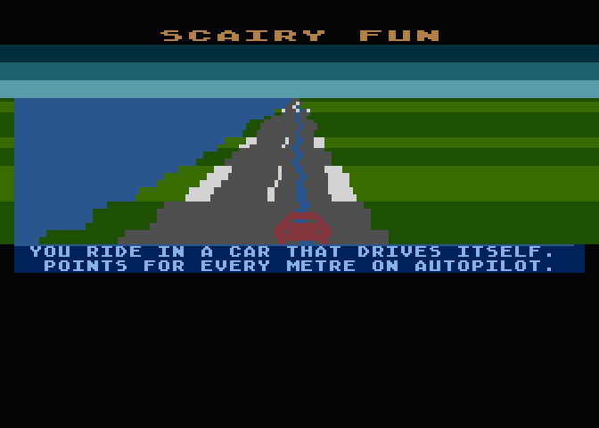
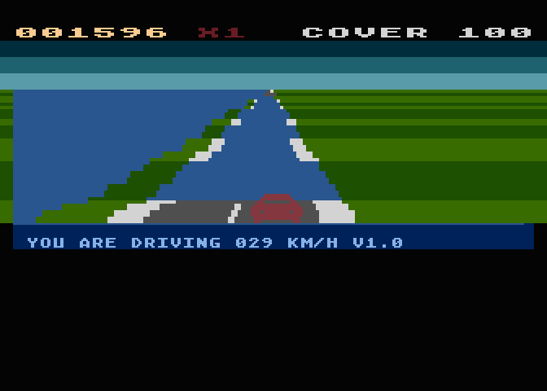
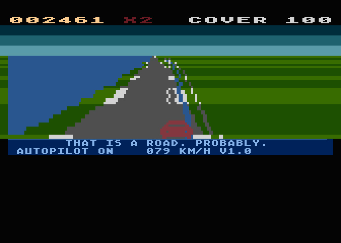
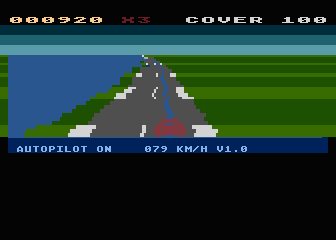

# ScAIry Fun (Atari 8-bit edition)

Port of `amiga_mcp/examples/scairy_fun`, the self-driving car game. You
ride in a car that drives itself. Points come from the distance it drives
**on autopilot**, times how long it has stayed on (up to x8). The autopilot
has blind spots, and the game is learning them: take the wheel just before
it gets something wrong, get through, hand it back (a **good catch**,
+500). Take over when it was right all along and it tells you "I had
that." Four routes (Levee Road, Rush Hour, Mountain Pass, Flooded Town),
each with a newer autopilot and new blind spots; damage comes off your
insurance cover, and at zero the policy is cancelled.

This is an **Atari edition**: the original's simulation is ~38K of 32-bit
code and its renderer a polygon engine, far beyond a 1.77 MHz 6502, so both
are cut down (below). It plays the same game at about 5.5 frames a second.

 
 



```sh
./a8 build scairy_fun            # RELEASE=1: no harness log
./a8 run scairy_fun
./a8 test scairy_fun             # the bot (test.py)
```

## Controls

| | |
|---|---|
| autopilot on / off | FIRE (SPACE); on only near a lane centre |
| steer | stick left / right (takes over) |
| brake | stick down (takes over) |
| accelerate | stick up (when driving yourself) |
| pause | START (RETURN) |
| music | OPTION |
| back to the title | ESC |
| start | FIRE or START on the title |
| initials | type three letters, or UP/DOWN + FIRE, after a high score |

There are no warnings: read the road (water over it, two sets of lane
lines, an overpass's shadow, cones, the low sun) and the autopilot's path
(the blue line on the road). The title runs the autopilot's demo with the
rules and the high scores below it.

## What was kept, what changed

**Kept from the original** (`src/track.c`, `src/world.c`): the four routes
section for section (bends, hills, levee and river, freeway and median,
rock wall and cliff, town and canal) and their hazards in the same places;
the car's handling (steering, the bends' pull growing with speed squared,
aquaplaning above 50 km/h, 30 in the town; what lies beside the road: a
guardrail or wall scrapes, the river or the drop means the tow truck);
the autopilot's plan, steering and speed, and its blind spots: it follows
**old lane lines** over the edge, keeps its speed into **floods**, brakes
hard for an **overpass shadow** (the truck behind doesn't), drives into
**cones**, goes straight on when the **low sun** blinds it, ignores
**debris**, won't move over for an **ambulance**; and the bait it gets right
(deer, a cyclist, a slow tractor, a merging truck, goats, pedestrians).
Takeovers judged as good catches or needless, the multiplier, cover and
damage (2 a cone ... 40 for the river), the arrival bonus (autopilot % x 50
+ good catches x 500), the software updates, game over.

**Changed** (the simulation is a rewrite in 16 bits of the same rules):

- **12.5 steps a second, not 25.** A step costs ~35,000 cycles; at the
  original's 25 Hz the simulation alone would take half the CPU and the
  road would draw at 3-4 frames a second. Each step is twice the
  original's (positions move twice as far, accelerations and steering
  rates are doubled, timers halved; speeds keep the original's units, so
  km/h and the autopilot's rules are unchanged), and collisions are swept
  (their window grows with the closing speed) so nothing is jumped over.
  The takeover judging keeps its real-time meaning: whether a takeover
  is a good catch depends on a failing hazard being within 24 segments
  ahead (a distance, so the same at any step rate), and the catch is
  judged when the car is 2 segments past it; the timers (the phantom
  brake, the messages, the ambulance's patience, the end screens) are
  halved in steps, the same in seconds. The host check
  (`tools/simtest.c`) at 12.5 Hz fails in the same places as at 25: left
  alone, the v1.0 autopilot aquaplanes at segment 108 and goes into the
  river at 109 (the first flood), the tow truck brings the car back to
  98; the perfect autopilot arrives at the marina and the office.
- **10 objects, not 40**; traffic density scaled to them. Oncoming cars stop
  for the car in their way and pull over after a while, rather than
  queueing at a detour.
- The autopilot's lane changes: overtake something slow, keep right. The
  perfect autopilot (the title's demo) doesn't change lane for cones or
  swerve round debris.
- No AI detection list or top-down "what it sees" box, no cockpit view, no
  voice: its lines are text under the road.
- A 16-bit xorshift for the traffic (the original's 32-bit LCG).
- Additions: high scores with initials, pause, ESC, OPTION for the music.

## The Atari version

- **The road** is pseudo-3D in ANTIC D (160 x 56 rows of 2 scan lines;
  from row 22 down, pairs of rows show one, as the Spectrum Next port
  doubles its lines). The segment boundaries ahead (every one to 6 out,
  every 2nd to 12, every 4th to 28) are projected (`src/project.s`; a
  quarter-squares multiply, `src/mathx.s`), and each pair makes a band of
  rows. **The bitmap holds only the road's shape**: ground, rumble strips,
  road, lines, water, the path. **The stripes, the lane-line dashes, the
  flood water and the overpass's shadow are colours**, set for each band
  by a display-list interrupt (`src/display.s`, from a table made each
  frame by `src/colours.s`): moving along a straight road changes no
  pixels at all. `src/rows.s` steps each band's centre line, lane width,
  old-line offset and path offset row by row (16.8 fixed point), makes
  each row's description (edges, side colours, marks) and redraws a row
  only when it moved by more than a pixel. The low sun washes the colours
  out (more luminance), the sky is a three-step gradient.
- **Player/missile graphics**: the car (players 2 and 3), the two nearest
  vehicles, animals or people ahead (players 0 and 1, an 8 x 8 silhouette
  sampled to their size and stretched with SIZEP), the nearest four cones
  (missiles, the fifth player's colour).
- **14K more RAM**: the game switches the OS ROM off (`src/os.s`, from
  boing_twist's: its own NMI/IRQ handlers, the shadows, the joystick, the
  keyboard, and a latch of the presses between frames). The code that
  runs under the ROM is loaded in three chunks into the screen area, and an
  INIT entry after each (`src/stage.s`) copies it under the ROM while the
  program loads (`scairy_fun.cfg`).
- **POKEY**: the original's music ("Autopilot Lounge", `tools/scairy.mod`:
  lead and bass, `tools/mkmusic.py`) and effects for the events (the
  chimes, the splash, crashes, the ticket, the phantom brake).
- **NTSC**: the simulation keeps 12.5 steps a second (5 in 24 frames).

## Memory and speed

| | |
|---|---|
| `$0C00-$1F5B` | the routes' segment arrays, the shoulder table (LOWRAM) |
| `$2000-$93AD` | program: the simulation, the front end, the SDK (29.6K; the XEX is 38.5K in a release build) |
| `$9500-$97FF` | the C stack (768 bytes: most locals are static) |
| `$9800-$9FFF` | player/missile graphics |
| `$A000-$AB6F` | the road's bitmap, two display lists, the text rows |
| `$AC00-$B3E3` | the renderer's and the sprites' variables |
| `$B800-$BBFF` | the ROM font (the ROM is off) |
| `$C000-$CB91` | under the OS ROM: the routes |
| `$D800-$FF95` | under the OS ROM: the renderer, the sprites, the tables |

- Runs on a 64K 800XL (the test boots it there); needs an XL/XE (the RAM
  under the OS ROM). No 130XE banks.
- **About 5.5 frames a second** (PAL; 5.3 in the loop's own timing), the
  simulation at 12.5 steps a second, measured over the Levee Road with
  the autopilot driving. A loop is ~280,000 cycles: the simulation's
  2.5 steps ~100,000, the road's bands ~100,000, the projection ~34,000,
  the camera ~15,000, the colours and sprites ~10,000 each, the HUD
  5,000. Profiled with run_to sampling; the first working version drew
  3.6 frames a second with the simulation falling behind (11 steps a
  second at 25 wanted). What got it here: the projection, the colour
  table and the rows in asm, a quarter-squares multiply (a 32-bit C
  multiply took ~1,000 cycles), the stripes as colours instead of pixels,
  rows redrawn only when they move, line doubling in the near half,
  16-bit maths in the simulation (cc65's 32-bit divisions were a third of
  a step), the 12.5 Hz steps, the autopilot's plan made again only when
  it can change, and the HUD's numbers by subtraction.
- **The screen's lower third is empty** on purpose: every row of road
  costs drawing time (~1,000-3,000 cycles), so the view is 56 rows; a
  taller road would be slower.

## Test

`./a8 test scairy_fun`: a bot reads the game's probe (`sc_probe`) and
plays the Levee Road like the original's test drivers: it takes the wheel
before the first flood, crosses it slowly and hands back (a good catch),
pauses and resumes, leaves the old lane lines to the autopilot (over the
drop: the tow truck), drives them by hand after the tow, leaves the second
flood to it (the river), arrives at the marina (the bonus, the software
update), and on Rush Hour lets the autopilot's blind spots cancel the
policy: game over, initials BOT, the title. The speed is measured on the
levee. The game is recorded and replayed twice with every frame hash
checked; then a 64K 800XL boots it and on NTSC the simulation must keep
12.5 steps a second. `.venv/bin/python projects/scairy_fun/test.py --shots`
rewrites the screenshots and the GIF; `tools/simtest.c` runs the
simulation on the host (`cc -Isrc tools/simtest.c src/world.c src/track.c`).

## Not done

- The frame rate: ~5.5 fps is playable for a game of watching and taking
  over, but choppy; the next steps would be the simulation in asm and
  fewer bands near the horizon.
- The original's 3D models (here silhouettes), its painted skyline, the
  cockpit view, the AI's voice and its top-down view.
- The perfect autopilot's lane changes for cones and ambulances (only the
  title's demo and tests use it; the demo drives the Levee Road).
