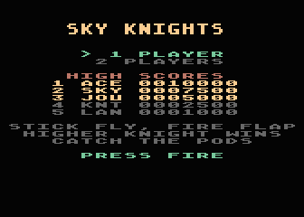
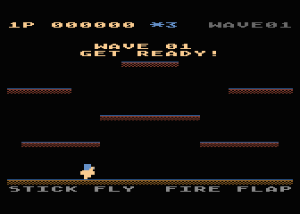
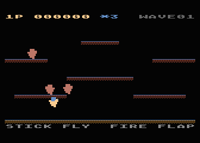
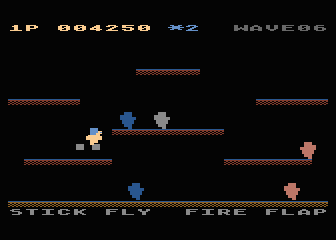

# Sky Knights (Atari 8-bit)

Port of `amiga_mcp/examples/sky_knights`: joust on flying mounts. Flap to
climb and meet the enemy knights from above: the higher knight wins (level,
both bounce off). A downed enemy drops a pod; catch it before it hatches
into a stronger enemy. Swoopers wander, raiders and wraiths hunt the
nearest knight, and each wave brings one more of them (eight from wave 6).
One or two players, three lives each. The ZX Spectrum port
(`spectrum_dev/projects/sky_knights`) was the reference.

   


```sh
./a8 build sky_knights               # build/sky_knights.xex
./a8 run sky_knights                 # play it in a window
./a8 test sky_knights                # the bot plays a game (test.py)
./a8 build sky_knights RELEASE=1     # no harness log
.venv/bin/python projects/sky_knights/tools/make_gif.py   # the pictures and the GIF
```

## Controls

| | joystick | keys (one player) |
|---|---|---|
| fly left / right | left / right | A / D |
| flap (hold to climb) | FIRE or up | W, SPACE |
| player 2 (two-player game) | joystick in port 2 | |
| title: one or two players | up / down, FIRE starts | 1 / 2, START, RETURN |
| initials | up / down a letter, FIRE next | type the letters |

Scoring is the original's: swooper 500, raider 750, wraith 1000, a pod 250,
a cleared wave 1000 to each knight still flying.

## What was kept, what changed

`src/game.c` is the original's `game.c`: the ledges, the flap physics
(impulse, gravity, top speeds, friction), wrapping at the sides, the
ceiling, the ledge undersides, the jousting rule, pods and hatching, each
wave's enemy mix, the flap timers and the hunting, scores and lives. The
rules run in the original's 320 x 256 world, so every distance and speed is
the original's; only the drawing is scaled (x / 2, y * 3 / 4). Changes,
marked `port:` in the source:

- positions and speeds are 16-bit with 1/64 pixel (16.16 in 32 bits is far
  too slow on a 6502); every constant is exact except gravity, 0.3 =
  19.2/64: 19 four frames in five, 20 the fifth (as the Spectrum port)
- the structs are arrays of fields; players and enemies share the body
  arrays, so one physics routine does both
- random numbers: the SDK's xorshift where the original draws rarely (the
  spawn places), an 8-bit LFSR for the per-frame dice (a swooper's turn,
  the flap delays) - the original's LCG needs a 32-bit multiply
- the lance and the mount's head point the way the knight flies (as the
  Spectrum port; the original draws them on the left for facing right)
- an enemy at the ceiling is drawn 2 lines low (its rules position is the
  original's)
- with more than five enemies (wave 4 on) half of them are redrawn each
  time, in turn: the rules stay at 50 Hz and the knights move every frame
- added: the title's one / two player choice, a high-score table with
  initials, game over waits for FIRE (or the original's 4 seconds)

## How it uses the Atari

| | |
|---|---|
| **display list** | the HUD row (ANTIC 6) on top, the field in ANTIC E (160 x 176, 4 colours), the HUD row below; a second list puts the wave / game over message (two ANTIC 6 rows) into the field |
| **DLIs** | a pair at each ledge: brown ledges and the tan ground in a colour of their own, the enemies' three colours everywhere else; the top and bottom HUD colours |
| **players** | the knights: player 1 is players 0 + 2 (yellow mount, blue rider), player 2 players 1 + 3 (cyan, red), 17 lines, the shape copied only when it changes |
| **XOR bitmap** | the enemies (swoopers pink, raiders grey, wraiths blue) and the pods, XORed into the field: drawn and rubbed out without saving the background, redrawn only when they moved |
| **POKEY** | a wing beat while flapping on channel 0, the joust, the pod, a lost knight and the wave fanfare on channel 1 |

## Memory

| | |
|---|---|
| `$2000-$8BBE` | program: code 19.3K, data 6.9K (the unrolled blits' tables 3.7K, the shapes), BSS 1K |
| `$9000-$97FF` | C stack |
| `$9B00-$9FFF` | players and missiles |
| `$A010-$BB8F` | the field (176 x 40); the title's rows and list while it shows |
| `$BB90`, `$BC00`, `$BE00`, `$BF00` | the HUD and message rows, the font, the game's two display lists |

No banks: it runs on a **64K 800XL** and a 48K 800 (both checked: the
bot plays to wave 3 on each).

## Speed

The rules run once for every frame that passed (the original's 50 Hz; up
to 8 a frame), the screen is drawn once a loop. Measured by the test and a
whole bot game (the game's perf log times the drawing and the rules with
VCOUNT):

| | fps | the rules |
|---|---|---|
| waves 1-3 (3-5 enemies), one knight | **45-48** | 50 Hz |
| waves 6-7 (8 enemies), one knight | 35-43 | 50 Hz |
| wave 6, two knights | 26 | 50 Hz |

ANTIC E's 176 lines take about half the CPU's cycles while the field is
drawn (a routine of 560 cycles in the vertical blank takes 1,000-1,600 in
the field), so the work had to shrink. Profiled with breakpoints and
cycle counts, the first version drew 10 frames a second with 3 enemies.
Now in 6502:

- `xspr.s`: the XOR blits, unrolled and generated by `tools/gen_gfx.py`
  with the images transposed (a table for each byte of the shape, indexed
  by image and colour, a routine for each x & 3 that skips the bytes empty
  in all its frames): 17 cycles a byte, an enemy ~700; the general
  clipping blit for the edges; `ob_set` (redraw only what moved),
  the enemies' screen places, the knights' player copies
- `physics.s`: `body_step` (one table lookup finds the ledges at a line,
  ~300 cycles a body, 3-6K in C), the enemies' loop, the joust overlap
  tests (y first, in a byte), `rnd8`

The C that calls them works on whole-pixel positions the physics keeps
(`b_px`, `b_py`), not on shifts of the fixed point.

## PAL and NTSC

PAL first. On NTSC the rules run 20% faster (per frame, as the original),
the colours shift (the ledges look green) and the perf log's times are off.

## Test

`./a8 test sky_knights`: boots, FIRE starts one player at wave 1 with
three swoopers and its message; the bot (`tools/bot.py`) takes the pods and
drops onto the enemies from above (the first kill is a swooper's 500, a
pod 250 more), clears wave 1, and at 5000 points gives up: it flies in
level with the enemies until it has lost its three lives. GAME OVER, FIRE,
BOT in the high-score table, the title; DOWN and FIRE start a two-player
game, wave 6 is poked in and its eight enemies timed with both knights.
Frame rate and rules rate from the game's perf log.

## Not done

- the original's MOD music and its Paula samples (the effects are POKEY's)
- the high scores are not saved
