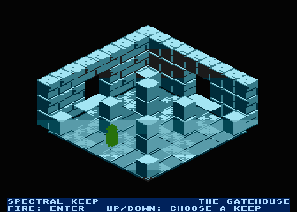
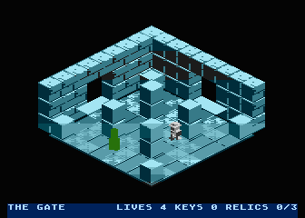
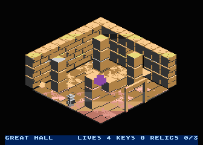

# Spectral Keep (Atari 130XE, "Atari edition")

Port of `amiga_mcp/examples/spectral_keep`, an isometric flip-screen
adventure in the style of Knight Lore and Head over Heels. It has three keeps
and 24 rooms. Find the relics and carry them to the throne. Keys open the red
gates and potions are extra lives. Guards, hounds, ghosts, bouncers and
spikes kill. The ZX Spectrum Next port (`spectrum_dev/projects/spectral_keep`)
was the reference. This port builds on a8-big's parked work (its cc65 port of
the Next's 16-bit logic, the asm maths and gather, and the room pictures from
pieces).

  


```sh
./a8 build spectral_keep                # build/spectral_keep.xex (needs a 130XE)
./a8 run spectral_keep                  # play it in a window
./a8 test spectral_keep                 # the bot plays (test.py)
./a8 build spectral_keep RELEASE=1      # no harness log, no test probe
python3 projects/spectral_keep/tools/make_gif.py      # the pictures and the GIF
python3 projects/spectral_keep/tools/profile.py 100 100 UP armoury   # where the time goes
make -C projects/spectral_keep build/host/sim && python3 projects/spectral_keep/tools/bot.py
```

## Controls

| | |
|---|---|
| walk | joystick (or the arrow keys / W A S D), relative to the screen |
| jump | FIRE (SPACE) |
| pause | OPTION |
| title | up / down chooses a keep, FIRE (START) starts |

## The Atari edition: what's kept, what's left out

**Kept** (the original's C via the Next port, `src/game.c`, `room.c`,
`world.c`, `levels.c`):

- Every keep, room, cell and actor.
- The rules: lives, keys, relics, potions, gates, the throne, the messages,
  death and respawn, the next keep, victory.
- The physics: crates you push, lifts carrying riders, jumps with coyote time
  and a jump buffer.
- The actors: guards' patrols, hounds, ghosts, bouncers, the sages' talk.
- The title's keep choice with its preview room.
- The isometric view at the original's projection (x halved).
- The original's draw order for the room's pieces.

**Changed or left out** (marked `port:` in the code):

- **The logic steps 12.5 times a second**, not 50 (`keep.h`: `STEP` 4).
  - Timers count the original's ticks, 4 a step.
  - Speeds are ×4 and gravity ×16.
  - The jump and the bouncers' hop speeds are chosen so the arcs keep the
    original's heights: 1.17 and 0.81 tiles.
  - The characters still move every frame: the VBI slides each player between
    its places at the last two steps (`sprites.s`). Walk cycles change at the
    step rate.
- **4 colours a band of 8 lines.** ANTIC E has 160 × 208 pixels with four
  colours a line. A DLI changes the three colours where the next band's
  differ. `tools/gen_gfx.py` picks each band's colours from the room's own
  picture, and the background is black.
- **Characters are single-colour players**, except the explorer, which is two
  overlapped players in three greys. A room has at most two other characters,
  as players 2 and 3, in their original colours.
  No multiplexing is needed. A census of all 24 rooms (`room_build` on the
  host) finds at most two characters besides the explorer in any room, sages
  included: the tomb has two ghosts, the belfry two bouncers, and the
  bonepit, kitchen, gallery, observatory and crossing two of different kinds.
  view.c gives players 2 and 3 to the first two characters it finds and
  would leave out any more.
- **Nothing hides behind scenery.** Everything moving is drawn in front of the
  room (players, and crates, lifts and pickups drawn into the bitmap). Pillars
  and the front arches don't cover the explorer.
- **No shadows.**
- **Pickups don't spin or bob.** Each is drawn with its first frame.
- **Music:** a short lead and bass loop for the title and each keep
  (`src/tunes.c`), not the original's composer. The effects follow the
  original's table, as POKEY sweeps.
- **No room tour on the title.** The original's L+R (Q+E) shows every room
  in turn; this port drops it.
- **Entering a room takes about 0.7 s** (35 frames) while its ~120 pieces
  are drawn, with the screen off.
- **Needs a 130XE.** On a 64K machine it says so and stops.

## How it uses the Atari

| | |
|---|---|
| **130XE banks** | bank 0 the rules and the rooms (15.2K of cc65 code); bank 1 the 24 rooms' draw lists; bank 2 the pieces, the band colours, the characters' frames (96), the bitmap sprites (crate, lift, pistons, pickups) and the blitter's shift tables; bank 3 the load images of the physics and the keeps, then the bare room's picture to restore behind what moves |
| **OS ROM off** | `os.s` (from boing_pinball): its own NMI/IRQ, shadows and latched joystick; the physics (9.1K) and the keeps' data run from the RAM under the ROM |
| **ANTIC E + DLIs** | the room, 160 × 208, a DLI where the colours change (11-20 a room) |
| **players** | the explorer (P0 + P1 multicolour), the room's two other characters (P2, P3; double width for the wide ones), moved every frame in the VBI |
| **ANTIC 2** | the HUD: room, lives, keys, relics, the messages |
| **POKEY** | the tunes and effects, ticked in the VBI |

**Rooms.** A room is drawn as it is entered, from its pieces (34 distinct,
4K), in the original's order (`draw.s`). The blitter shifts each piece to any
pixel through tables in bank 2. It copies the result to bank 3. Lifts,
crates and pickups that move are restored from bank 3 and drawn again, along
with whatever overlaps them.

## Memory

| | |
|---|---|
| `$0C00-$1F12` | the room's state, the bodies, the physics' candidates and grid (BSS) |
| `$2000-$3F0C` | start-up, the banks' trampolines, the C runtime and SDK, the game's state |
| `$4000-$66CF` | the front end (loop, view, HUD, sound), main memory |
| `$8010-$A09F` | the screen (208 × 40) |
| `$A100-$A3CE` | line tables, the projection (asm) |
| `$A400`, `$A500` | the display list, the HUD |
| `$A580-$A7DE` | the sprites' and DLIs' tables |
| `$A800-$AFFF` | C stack |
| `$B000-$B2D2` | the sprites' VBI and the DLI |
| `$B300-$B7FF` | missiles and players |
| `$B800-$BBFF` | the ROM font (copied) |
| `$BC00-$BEF0` | the blitters |
| `$C000-$CD83` | under the ROM: the keeps (2.5K), the game's state |
| `$D800-$FB6D` | under the ROM: the physics, the maths, `box_*` in asm |
| banks 0-3 | 15.2K, 12.4K, 11.9K, the room's picture (8.1K) |

## Speed

**The characters move at 50 fps.** Below is the logic's rate with the
display on, measured in the emulator (debug build, `sk: perf` lines). The
release build is a little faster: it doesn't fill the test probe.

| room | frames a step | logic steps a second |
|---|---|---|
| the gate room (a sage) | 3.3 | 12.5 (the target: it waits) |
| the Great Hall (the ghost) | 4.2-4.6 | 11-12 |
| the throne room (a bouncer, gates) | 5.0 | 10 |
| the yard (a guard) | 5.3 | 9.4 |
| the armoury (3 crates on a lift, a guard) | 9.2 | 5.4 |

Below 12.5 steps a second the game runs that much slower: the armoury plays
at about 40% speed.

The mode E screen's DMA and the DLIs take about half of the CPU's time. With
the display off, a step in the gate room cost 2.6 frames.

The speed work was guided by `tools/profile.py`, which samples the PC by bank.
Starting points: 4.3 frames a step for the logic alone, 18 frames a step
once the display was on, and 95 frames to draw a room. What brought them
down:

- One candidate gather per move instead of one per axis and another for the
  ground. `tools/trace.py` checked it plays exactly the same: probe hashes over
  10 seeds of 8,000 steps on the host sim.
- The box set-up, `box_overlap` and `box_shrink80` in asm.
- 16-bit `pose`/`octant`.
- An 8-round multiply when one factor fits a byte.
- Resting crates skip their physics step (checked the same way).
- The projection and the frame copies in asm, with frames copied only when
  they change.
- DLIs only where the colours change.
- A table-driven blitter: room drawing went from 95 frames to 35.
- Only the bitmap movers that changed are redrawn.

## PAL and NTSC

PAL first. The display is 240 lines: 16 blank, 208 for the room and 16 for
the HUD. On NTSC the HUD falls off the bottom of the picture, the logic runs
20% faster, and the colours shift.

## Test

`./a8 test spectral_keep`:

- It boots to the title, with the gate room drawn and the title tune on POKEY
  channels 1 and 2.
- It checks the gate room's bare picture (bank 3) pixel for pixel against the
  host's own composition (`tools/gen_gfx.py`, from `tools/export.c`: the
  original's renderer, which the test builds if it's missing).
- The Spectrum port's bot (`tools/bot.py`) then plays with the joystick,
  reading `keep_probe` at each logic step:
  - FIRE starts The Gatehouse.
  - It goes north into the Great Hall, round its west side to the relic, then
    stands while the ghost takes all four lives.
  - Game over, then back to the title.
- Checks along the way: the explorer and the ghost are players in the hall,
  and the logic's rate there is at least 9 steps a second.
- Then a 64K 800XL says it needs a 130XE.

On the host, `make build/host/sim && python3 tools/bot.py` plays the same
game on the C logic. `tools/trace.py` compares two builds of the logic.

## Not done

- The armoury (crates riding a lift) runs at about 5 steps a second; the
  physics' moves are still C (only gather, scan and the boxes are asm).
- Sprites in front of everything, no shadows, no pickup animation.
- The original's composed music.
- The test plays The Gatehouse only. The Crypt and the Tower are drawn on
  the title and use the same rules.
