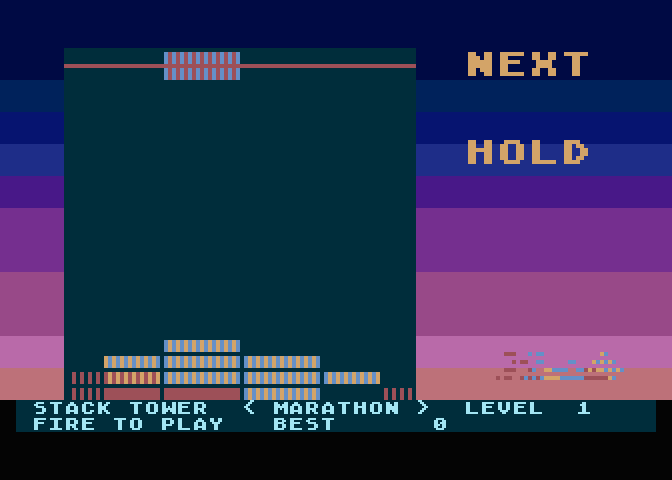
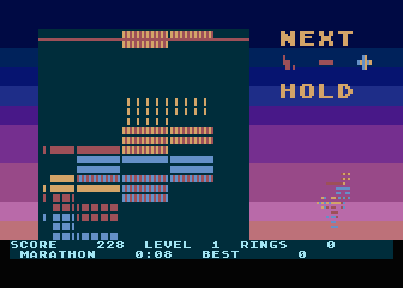
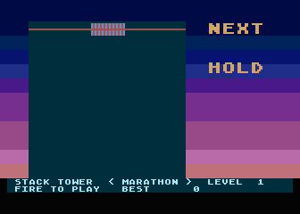

# Stack Tower (Atari 8-bit)

Port of `amiga_mcp/examples/stack_tower` (the Amiga original on the
amiga3d engine, itself the browser game in C) to the Atari XL/XE. It is a
falling-block puzzle wrapped round a tower. The well is sixteen columns
that go all the way round, so there are no side walls: moving a piece
left or right turns the tower under it, and a ring only clears when the
back of the tower is full too. The pieces are the browser's eight: a
three-square rod and elbow, and six five-square shapes.

 

## Controls

| Joystick / keys | | |
|---|---|---|
| left / right (A / D, arrows) | turn the tower | held: repeats after 0.28 s |
| up (W) | rotate clockwise | |
| OPTION (Z) | rotate anticlockwise | |
| down (S) | soft drop | |
| FIRE (SPACE) | hard drop | |
| SELECT (C) | hold the piece | |
| START (P) | pause | |
| G | ghost on / off | |
| ESC | back to the title | |

On the title the original's demo game plays behind the tower. Left and
right choose the mode, up and down the starting level (1-10), FIRE or
START plays. **Marathon** speeds up every 10 rings; in **Rising** a ring
of rubble with a gap or two pushes up from below every few seconds;
**Dig** is ten rings of rubble to clear. The best score of each mode is
on the title and the game's HUD.

## What's kept, what changed

Kept from the original:

- **The rules** (`src/st_core.c`, `src/st_fast.s`): the original's
  `st_core.c` with the mulberry32 generator and the seeded bag (a seed
  deals the same pieces as the Amiga and the browser), the rotation
  kicks, gravity (0.9 s a row at level 1, x0.82 a level), the lock delay
  and its 15 resets, soft and hard drop, hold, the three modes, the
  rubble, and the scoring (100, 300, 600, 1000, 1500 x level, the combo
  bonus, 2 a row for a hard drop, 1 for a soft one). Debug builds run the
  browser's four scripted games (`src/vectors.h`, the original's test
  vectors) at start-up; each must end with the browser's pieces, score,
  board, queue and held piece.
- **The shell**: the 40 ms steps (every second PAL frame) whatever the
  drawing takes, the turn's auto-repeat, the view turning a third of the
  way to the piece each step the short way round, the title's demo (the
  original's placement rule), the flash words (RING!, DOUBLE!, LEVEL UP),
  game over.
- **The view**: the original's camera (640 from the axis, core radius
  140) gives each column's edges, so the side columns narrow towards the
  limbs; the limbs are dimmer.
- **The panel**: the next three pieces, the held one, the whole tower
  unrolled (16 columns x 20 rings), score, level, rings (or rubble left),
  mode and time.

Changed (marked `port:` in the code):

- **No vertical perspective**: rings are horizontal bands of 4 mode D lines
  (a gap line where the core shows, and 3 lines of bricks); bricks are flat
  faces, not blocks sticking out. The view turns in sixteenths of a column.
- **Colours**: the eight pieces, rubble and the ghost are told apart by
  three playfield colours and their stripe mixes (red, gold, blue,
  red/gold, gold/blue, red/blue, and darker red and blue), not the
  original's 16 shades.
- **The title's demo** finds where a placement lands from the columns'
  heights (the original drops each candidate a row at a time, which costs
  ~2M cycles a piece here); the ghost row likewise scans each cell's
  column (the same row the original finds).
- **Rules data** in 8-bit fields and one global game (cc65 code half the
  size); the 64-bit multiply of `rand_below` done exactly in 32 bits; the
  seed key built without `sprintf`.
- No music module: a short POKEY tune on the title and POKEY effects for
  moving, turning, dropping, locking, holding, rubble, rings, levels and
  game over.
- High scores: the best of each mode (no initials table).

## Atari hardware used

| | for |
|---|---|
| ANTIC mode D, two display lists (projects/a8_3d) | the tower and panel, double buffered: the next frame is drawn while this one shows |
| three quad-width players behind the playfield (`PRIOR` 4) | the tower's core: pixel 0 shows the player colour, so all three playfield colours are free for the bricks |
| DLIs (stateless, by `VCOUNT`) | the twilight sky behind the tower in 10 bands, and the text rows' colours |
| ANTIC 2 text rows | the HUD, shared by both buffers |
| deferred VBI | the joystick, console keys and held keys latched every frame, so a short press is never lost in a slow frame |
| ROM font | NEXT / HOLD in the bitmap |
| POKEY | effects on channels 0-1, the title tune on 2-3 |

## Frame rate (PAL, measured in the emulator)

The rules always run 25 steps a second. A frame redraws only the rings
that changed (each buffer keeps a list of the rings it still has to
draw), so:

- a falling piece (no turn): a few rings, **48 fps**;
- soft drop (a ring a frame or two): **24 fps**;
- the tower turning (every ring redrawn, about 1,800 cycles a ring):
  **12-13 fps** while a turn is held (`test.py` measures it and requires
  10);
- the title's demo: a piece placed every 6 steps (~20K cycles).

Profiling (projects/a8_3d/tools/profile.py) moved the rules' innermost
primitives (a piece's cells, collision, the ghost row) to asm: in C,
cc65's runtime multiply and shift helpers made them two thirds of a
turning frame.

## Memory

Runs on a 64K 800XL (`./a8 log stack_tower --machine 800xl`): no 130XE
banks.

| | debug build | `RELEASE=1` |
|---|---|---|
| program (code, data, BSS) `$2000-` | `$8B3F` (27.4K) | `$7AAF` (22.9K) |
| free below the C stack (`$9000`) | 1.2K | 5.4K |
| screen | `$A010-$BFFF`: two 3.8K buffers, the display lists, the text rows | |
| players | `$9800` (the core) | |

## Testing

`./a8 test stack_tower` (`test.py`):

1. the browser's four scripted games, played by the Atari's rules;
2. the title (the demo builds a tower), mode and level on the joystick,
   FIRE starts marathon level 1 with seed 1;
3. UP and OPTION rotate, START pauses (the piece stays) and resumes,
   SELECT holds;
4. the frame rate while a turn is held (display-list switches counted
   frame by frame);
5. a bot plays through the joystick only: it reads the board and the
   piece from memory, picks a placement (Dellacherie's features for a
   well that wraps round) and steers the piece there with UP, LEFT/RIGHT
   and FIRE. It plays until rings clear and the level goes up (about 60
   pieces, 10 rings), then drops pieces where they are until the tower
   tops out: game over, FIRE, back to the title.

## Not done yet

- NTSC: the rules keep their 40 ms steps (17 ms frames counted), the
  colours are chosen for PAL.
- The original's help pages and its music (Tower Climb, a MOD).
