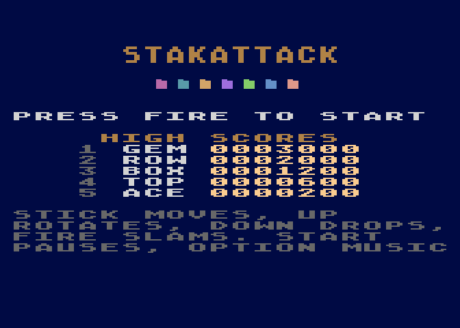
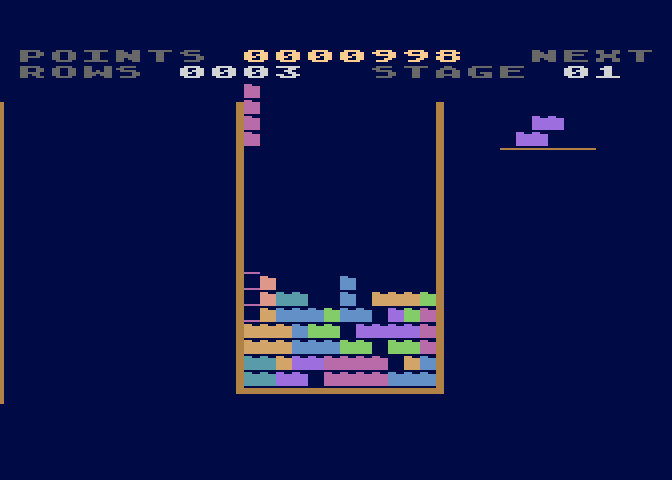
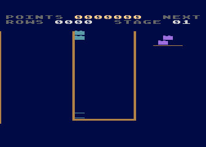

# StakAttack (Atari 8-bit)

Port of `amiga_mcp/examples/stakattack` (by way of the ZX Spectrum port):
seven gem pieces fall into a 12 x 19 well; turn and slide them to complete
rows. 100/300/500/800 points times the stage for 1-4 rows, 1 a row for a
soft drop, 2 a row for a slam; every 10 rows the stage goes up and the
pieces fall faster. The game ends when a new piece can't enter the well.

 



```sh
./a8 build stakattack            # RELEASE=1: no harness log
./a8 run stakattack
./a8 test stakattack             # the bot (test.py)
```

## Controls

| | |
|---|---|
| move | joystick left / right (or A / D, arrow keys); held: auto-repeat after 10 frames, as the original |
| turn | joystick up (W) |
| soft drop | joystick down (S) |
| slam | FIRE (SPACE) |
| pause | START, RETURN or P |
| start | FIRE or START on the title |
| music | OPTION, on or off |
| give up | ESC |
| initials | type three letters, or UP/DOWN + FIRE, after a high score |

## What was kept, what changed

`src/game.c` is the original's `game.c`: pieces, rotation with wall kicks,
delayed auto-shift, lock delay, the line-clear pause, scoring, stages, the
LCG for the piece sequence, all at the original's 50 updates a second.
Port changes are marked `port:`, with the original kept under `#if 0`:

- **The collision test works on bitmasks.** Each well row is 12 bits
  (`fm_lo`/`fm_hi`), each piece row 4 bits shifted to the piece's x (from a
  table), and `pm_fits_y` (`src/fits.s`) ANDs the four rows: ~70 cycles,
  where the original's 16 cell lookups took cc65 ~3,000. The landing marks
  search up to 19 rows with it. Full rows are found from the masks too,
  and the masks move down with the rows.
- `lock_piece`, `check_lines` and `remove_lines` use byte indexes, a table
  of the pieces' four cells and `memmove` instead of 2-D `int` indexing
  (cc65 multiplies for every `field[y][x]`).

Additions: a high-score table on the title with initials entry, ESC to give
up, OPTION for the music. The pause and game-over messages cover rows 8-11
of the well, as the original's box covers its middle.

## The Atari version

- **The well is in GTIA mode 10**: ANTIC 2 characters whose bytes are two
  4-bit pixels, so it shows nine colours. That's the original's palette
  as the well needs it: the seven gem colours (rose, teal, ochre,
  lavender, jade, sky, coral) on COLPM1-3 and COLPF0-3, the copper walls
  on COLPM0, and the dark background. A cell is one character (4 colour
  clocks x 8 scan lines, two GTIA pixels across): a gem with its top
  right corner cut and a dark line under it, so cells read as gems; the
  landing marks are a line in the piece's colour. Only changed characters
  are written: the falling piece and its marks are at most 16 bytes a
  frame, a line clear redraws the well with `src/well.s`. The rows being
  cleared blink in copper.
- **The text is ANTIC 6/7 in the normal mode**: score, rows, stage and the
  next piece's label above the well, the title, the high scores, and the
  pause / game-over / initials band. **Display-list interrupts**
  (`src/display.s`) switch GTIA mode 10 on and off between them and set the
  gem colours. A switch can land a scan line early or late, and in GTIA 10
  a blank line (and the border) shows colour 0, so colour 0 is the
  background around each switch and every switch is next to blank lines.
  The cycle has four kinds of DLI: on, walls' copper, background, off.
- **A wide playfield** (48 characters), because in GTIA 10 the border
  shows COLPM0: the band covers it with background pixels, except one
  colour clock at the far left (GTIA 10's pixel delay), deep in the
  overscan.
- In the screenshots, the thin copper line at the far left of the well's
  rows is GTIA 10's border (it shows COLPM0, the walls' colour; the mode's
  one-colour-clock delay uncovers 2 colour clocks of it), deep in the
  overscan a TV crops; all nine GTIA 10 colours are in use, so there is no
  spare to hide it with. The short lines in a column are the landing marks
  of the falling piece, in its own colour.
- No player/missile graphics: everything is characters, and the GTIA
  colours the players would use are the gems'.
- **POKEY**: the original's MOD (`tools/stakattack.mod`, its lead and bass
  channels, `tools/mkmusic.py` -> `src/music.c`) on channels 2-3; slam,
  lock, row clear, stage and game-over effects on 0-1.
- **NTSC**: the logic runs 5 frames in 6, so the game keeps the original's
  speed, and the gem colours come from an NTSC table (the hues sit a step
  later than on PAL).

## Memory and speed

- Program, data and variables `$2000-$71EA` (20.5K; the XEX is 19.3K in a
  release build). Character set `$A000` (the ROM font's first 64
  characters, then the tiles), the well `$A400`, text `$A800-$AAAF`,
  display lists `$AC00-$ADCA`. C stack at `$9000`.
- No 130XE banks: it runs on a 64K 800XL (the test boots it there) and on a
  48K 400/800 with BASIC off, but needs a GTIA (not the earliest CTIA
  machines).
- **50.0 fps** in the emulator (PAL), release build, while the test's bot
  plays as fast as it can (a slam every ~13 frames): 1 late frame in 861.
  The harness build (with the log) runs at 49.8 fps: 5 late frames in
  1145. Profiled with run_to sampling: the lock frames were 75,000 cycles
  (2 frames) before the bitmasks, the cell tables and the asm well copy;
  the score's 32-bit decimal conversion (HUD and log) went to `src/dec.s`
  (24-bit repeated subtraction, ~1,500 cycles, against ~15,000 in C).

## Test

`./a8 test stakattack`: a bot reads `gs` from memory and places each piece
with a classic stacking heuristic (holes, height, bumpiness, rows),
steering with the joystick one press at a time. It clears 10+ rows (stage
2), pauses and resumes once, then slams pieces into the middle until the
stack tops out (the original has no lives: topping out is the only way to
lose). It enters BOT in the high-score table and is back on the title. The
game is recorded and replayed twice with every frame hash checked; then a
64K 800XL boots it, and on NTSC the logic must run 5 frames in 6.
`.venv/bin/python projects/stakattack/test.py --shots` rewrites the
screenshots and the GIF; `--debug` prints the bot's plans.

## Not done

- The original's sound effects are sampled; these are POKEY tones in the
  same places. The MOD's drum and counter-melody channels are left out (the
  effects need two channels).
