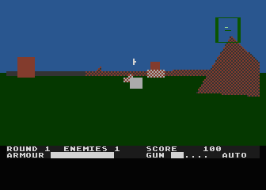
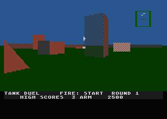

# Tank Duel (Atari 8-bit, "Atari edition")

Port of `amiga_mcp/examples/tank_duel`: a tank fight in a walled arena,
seen from the turret. Destroy every enemy tank. **Scouts** circle and
snipe, **mortars** lob shells where you will be, **bulwarks** carry a
shield across their front that shots glance off. Shells bounce once off the
walls, so a shot can be banked round cover, and crates break. There are
eight rounds, and you get +30 armour between them. The Spectrum Next port
(`spectrum_dev/projects/tank_duel`) was the reference.

  



```sh
./a8 build tank_duel                # build/tank_duel.xex (XL/XE, 64K)
./a8 run tank_duel
./a8 test tank_duel
./a8 build tank_duel RELEASE=1      # no harness log
python3 projects/tank_duel/tools/make_gif.py
```

## Controls

| | |
|---|---|
| forward / back | joystick up / down |
| turn | joystick left / right |
| fire | FIRE |
| pause | OPTION |
| autopilot on / off | SELECT (it also fights behind the title) |
| back to the title | ESC |
| title: the round to start at | up / down; FIRE starts |

## The Atari edition: what's kept, what changed

**Kept:** the original's rules (`src/td_core.c`, `src/td_ai.c`, from its
`td_core.c` via the Next port):

- driving and collisions;
- shells banked once off the walls, crates that break, the bulwark's
  shield with glances, mortar lobs and their splash;
- the three enemies' minds, the eight rounds and their line-ups;
- the scoring (100, 200 or 300 a tank, 20 a crate, 500 × the round for
  clearing it, 5 a point of armour left);
- the autopilot.

**Changed (`port:` in the code):**

- **16 bits.** The original works in 16.16 fixed point, which is 32-bit
  arithmetic and library calls in cc65.
  - Positions here are 1/16 of a unit in int16.
  - Sines are Q8, lengths are alpha-max-beta-min (within 4%), and angles
    come from a table (no division).
- **12.5 ticks a second.** Each tick is two of the original's: speeds,
  turns and shell steps are doubled, and the timers count half as many
  ticks.
- **Enemies think every other tick** (half of them each tick) and drive
  on their last decision in between. So they decide 6.25 times a second
  and fire on those ticks.
- `tools/run_orig.c` / `tools/run_port.c` play the autopilot over 20
  seeds on the host, original against port. The fights end up alike but
  not bit for bit: the port reaches round 3.3 on average (2.6 in the
  original) with 6.8 kills (5.2).
- **High scores:** five, with initials. The original keeps the best score
  only.

## What the look gives up

- **Colours.** Three colours and their dithers for everything, plus the
  sky and floor as background colours (a DLI at the horizon). The
  original has 32 pens: the enemy types differ there by colour, here only
  by shape and shade.
- **No floor grid.** Pillars are square, not 8-sided.
- **Simplified shapes:**
  - A scout is a hull and a turret, a mortar a box and a tube, a bulwark
    a hull, a turret and its shield.
  - There are no barrels, and turrets are dropped beyond 450 units.
  - Objects beyond 350 units are one polygon: the outline between their
    outer edges, in one shade.
- **Draw limits:** nothing beyond 1100 units, and at most 7 objects drawn
  (the nearest). The radar still shows every tank.
- **Mortar rings** are blinking marks on the radar, not rings on the
  ground.
- **Small effects:** explosions are flashing squares, and shells and
  mortar rounds are dots.
- **No help pages.**

## How it uses the Atari

| | |
|---|---|
| **a8_3d** (projects/a8_3d) | ANTIC D, 160 × 80, double buffered, flat and dithered polygons. Everything standing is a vertical prism or a pyramid: footprints are turned in 2D (asm), a3d projects them, faces are culled by comparing the camera's place with the box (no products), and faces go straight to `a3d_poly` when nothing is behind the near plane. Walls are clipped to the view in camera space first, so they reach a3d as on-screen trapezoids. |
| **DLI** | the floor's colour from the horizon, the HUD's colours |
| **players / missiles** | the radar (players 2 and 3, double width; missile 3 the mortar marks), the sight (missile 0) |
| **ANTIC 2** | the HUD: round, enemies, score, the armour and gun bars |
| **POKEY** | effects: shots, explosions, lobs, glances, hits, a round won, defeat |
| **RAM under the OS ROM** | the OS ROM is switched off (`os.s`), so a **64K 800XL** runs it |

## Memory (64K XL/XE; no 130XE needed)

| | |
|---|---|
| `$0C00-$1B22` | a8_3d's tables and work arrays, the game state, the view's arrays |
| `$1C00-$1FB8` | asm: the tank's drive, the shells' flight (loaded there: no DOS) |
| `$2000-$9221` | the program: a8_3d, the view, the front end, the maths, the SDK |
| `$9600-$97FF` | C stack |
| `$9800-$99FF` | the font's capitals and digits (copied from the ROM) |
| `$9B00-$9FFF` | players and missiles |
| `$A000-$BFFF` | a8_3d's two buffers, display lists, text rows |
| `$C000-$CFBE` | under the ROM: the minds and the autopilot (`td_ai.c`), the radar |
| `$D800-$FE32` | under the ROM: the rules (`td_core.c`) |

The XEX loads the code for under the ROM at `$9800`, a part at a time. A
routine at `$0600`, run by INITAD, switches the ROM off and copies each
part up (`xload.s`).

## Speed

Measured in the emulator (PAL), with the `td: fps10=` lines:

| | |
|---|---|
| **frame rate** | **3 to 4.6 fps** in play with 2–3 enemies; about 3 on average over the test's autopilot game |
| a tick of the rules | 35–43K cycles in play (the autopilot adds about 15K); 12.5 a second |
| a picture | 200–350K cycles: walls ~80K, ~30K an object near by |

That is below the 5+ fps target.

The rules went from 60–150K cycles a tick to 35–43K, by profiling with
`projects/a8_3d/tools/profile.py` and timing each part of a tick:

- an asm obstacle query over an 8 × 8 grid of the arena;
- asm atan2 and length;
- the shells' flight in asm: it stops only at a step where something may
  happen;
- the tanks' drive and the fast path of their push-out in asm;
- byte counters instead of modulos;
- the minds every other tick.

The picture went from 450–750K to 200–350K, by:

- clipping the walls in 2D;
- testing faces by comparisons;
- turning each object's centre once;
- level of detail and the draw caps.

**Still to come:** a8_3d is getting a fast asm path for convex prisms and
boxes (one call an object, no per-face C round trips). Moving to it is the
remaining step towards 5 fps.

## Test

`./a8 test tank_duel`:

- the title shows the arena, and UP and DOWN choose the round;
- FIRE starts round 1;
- UP drives the tank ahead and LEFT turns it, read from the game state;
- the arena has content;
- SELECT hands over to the autopilot: it kills (100 a scout), takes hits
  and clears round 1, and round 2 begins;
- then the armour is set to 1 so the next hit ends the game: game over,
  ACE goes in the high scores, and it's back to the title;
- the frame rate is logged;
- then the same XEX boots on a 64K 800XL and its demo fights.

## Not done

- 5+ fps (see Speed).
- The high scores are not saved.
- PAL only measured. On NTSC the rules' 12.5 ticks a second come from 4
  frames of 60, so they run 20% fast.
