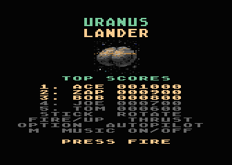
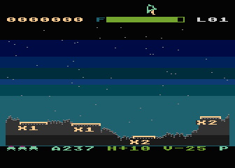
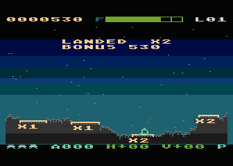

# Uranus Lander (Atari 8-bit)

Port of `amiga_mcp/examples/uranus_lander`: land on the pads of Uranus.
Rotate, thrust gently against the gravity and touch down upright and slowly
on a pad before the fuel runs out; narrow pads pay more (x1, x2, x3, x5).
Each level has rougher ground, stronger gravity and less fuel. Press OPTION
and the autopilot flies for you. The ZX Spectrum port
(`spectrum_dev/projects/uranus_lander`) was the reference for the cuts.

  


```sh
./a8 build uranus_lander               # build/uranus_lander.xex
./a8 run uranus_lander                 # play it in a window
./a8 test uranus_lander                # the autopilot plays (test.py)
./a8 build uranus_lander RELEASE=1     # no harness log
```

## Controls

| | joystick (port 1) | keys |
|---|---|---|
| rotate | left / right | A / D |
| thrust | FIRE or up | SPACE, W |
| autopilot on / off (while flying) | | OPTION, Z |
| music on / off | | M |
| start | FIRE on the title | START, RETURN |
| initials (high score) | up / down a letter, FIRE next | type the letters |

## What was kept, what changed

`src/game.c` is the original game, with the changes marked `port:`:

- **the same levels**: the terrain generator with its random numbers and
  seeds, so every level's ground and pads are the Amiga's (the test checks
  levels 1-3 against a Python copy of the original's generator), the
  320 x 256 world, the pads and their multipliers per level
- **the same physics**: 16.16 fixed point, gravity, thrust, the fuel, the
  landing rules (on a pad, falling no faster than 55000/65536 px a frame,
  sideways less than 35000, within 14/256 of a turn of upright), the bonus
  (multiplier x 50 + the fuel left), lives, the respawn grace, the sparks,
  the difficulty per level
- the thrust is the original's own `(sin_tab[a] * 3200) >> 16` for every
  angle, worked out from its sine table into `tables.c`
  (`tools/gen_tables.py`), so no 32-bit multiply a frame; the ship's step
  (`physics.s`), the random numbers (`rng.s`: the same LCG by table
  multiplication) and the sparks (`fx.s`) are the same arithmetic in 6502
- the stars are the original's 60 (its seed 777777), worked out beforehand;
  all three parallax layers are drawn in one colour
- the high-score table (5 entries, the original's top five defaults) and
  the autopilot (the Spectrum port's, from the Atari ST port's bot) are
  added
- the ship is drawn in 32 directions (the logic keeps 256)

## How it uses the Atari

| | |
|---|---|
| **display list** | the HUD (ANTIC 6, 20 columns in four colours), the world in ANTIC E (160 x 176, 4 colours), the bottom HUD (ANTIC 6). World x / 2, y x 3 / 4 |
| **DLIs** | 23 a frame: every 8 lines the background turns from black to Uranus's blue at the horizon and the ground darkens in strata; the bottom HUD gets green / yellow / red for the speeds |
| **two display lists** | the messages (LANDED, CRASHED, GAME OVER, the initials) are two ANTIC 6 rows that a second display list shows over 16 lines of sky: the picture under them is never touched |
| **the title's planet** | the original's 16-colour picture of Uranus as 54 lines of ANTIC E with three colours of their own on every line: one DLI runs a WSYNC loop down the picture (`tools/gen_planet.py` picks each line's colours from the Atari palette) |
| **players** | the lander (player 0, 32 directions from the original's polygon) and its flickering flame (player 1, two sizes) |
| **XOR points** | the stars (over open sky only) and the crash's sparks, in 6502: moving one never needs what is under it |
| **POKEY** | the thrust rumble (noise), the crash, the landing sweep, the low-fuel beep, and a slow arpeggio in place of the original's MOD |

## Memory

| | |
|---|---|
| `$2000-$8E5C` | program: code 18.6K, tables 6.4K (thrust, ship shapes, the LCG's tables, the planet), data and BSS |
| `$9000-$97FF` | C stack |
| `$9800-$9FFF` | players and missiles |
| `$A010-$BB8F` | the world (176 x 40); the title's rows, list and planet while the title shows |
| `$BB90-$BBDF` | HUD and message rows |
| `$BC00-$BDFF` | the font (the OS's first 64 glyphs, the gauge and the lives) |
| `$BE00`, `$BF00` | the display lists (with and without the message rows) |

No 130XE banks: it runs on a **64K 800XL** and a **48K 400/800** (BASIC
out); both were checked landing level 1.

## Speed

The logic runs once for every frame that passed (fixed 50 Hz, as the
Amiga's), the screen is drawn once a loop. Measured by the test while
flying: **49.7 fps**, logic 50 Hz. A crash costs a few frames (32 sparks
spawned and drawn); a new level takes ~0.7 s to make and draw while the
game waits (the whole game: 45.7 fps, logic 47 Hz).

Profiled with breakpoints and cycle counts: the C version of the loop took
74,000 machine cycles a frame (two frames); the autopilot in 16-bit, the
physics, the random numbers, the stars and sparks in 6502, the HUD's
numbers by subtraction instead of division, and half the stars redrawn a
frame brought it to ~26,000 (of 35,568).

## PAL and NTSC

PAL first. On NTSC the game runs 20% faster (the logic is per frame, as
the original's) and the colours shift.

## Test

`./a8 test uranus_lander`: boots, starts; checks levels 1-3's terrain and
pads against the original's generator and the difficulty (gravity, fuel);
the autopilot (OPTION) lands on levels 1 and 2 (the bonus rule and the
score checked); off on level 3, the ship falls and crashes three times;
GAME OVER, FIRE, BOT goes in the high-score table, back to the title. The
frame rate and the logic rate from the game's perf log. The pictures and
the GIF: `tools/make_gif.py`.

## Not done

- the high scores are not saved.
- a new level stops the game for ~0.7 s while it is made and drawn.
- NTSC isn't slowed to the PAL speed.
