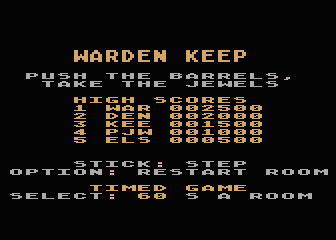
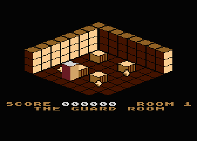
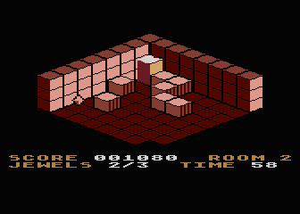
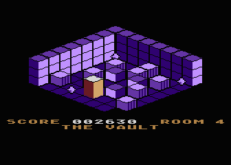

# Warden Keep (Atari 8-bit)

Port of `amiga_mcp/examples/warden_keep`: a Filmation-style isometric keep
in the manner of Knight Lore and Fairlight. Walk the stone floor one tile
at a time, push the barrels out of the way and take every jewel, room by
room, before the clock runs out. The ZX Spectrum Next port
(`spectrum_dev/projects/warden_keep`, with its `ORIGINAL_BUGS.md`) was
the reference.

   


```sh
./a8 build warden_keep                # build/warden_keep.xex
./a8 run warden_keep                  # play it in a window
./a8 test warden_keep                 # the scripted play-through (test.py)
./a8 build warden_keep RELEASE=1      # no harness log
python3 projects/warden_keep/tools/make_gif.py   # the pictures and the GIF
python3 projects/warden_keep/tools/rooms.py      # check the rooms: shortest routes, src/rooms.c
python3 projects/warden_keep/tools/gen_gfx.py    # the shapes: src/gfx.c, src/gfx.h
```

## Controls

| | |
|---|---|
| step | joystick (or the arrow keys, W / A / S / D): up is north (up-right on the screen), down south, left west, right east. One tile a press; held, it repeats after 12 frames and then every 6 (the original's) |
| begin; leave the end screens | FIRE (SPACE, START, RETURN) |
| timed or relaxed game | SELECT on the title |
| restart the room | OPTION (the clock keeps running) |
| back to the title | ESC |
| initials (a high score) | type the letters, or up / down a letter and FIRE |

## What was kept, what changed

Kept from the original (`src/game.c` is its `game.cpp`):

- **The rules**: an 8 x 8 floor, the north and west walls, the door
  marker at the front corner; movement is tile-locked and facing changes
  even when a step fails; a barrel is pushed if the tile beyond is inside
  and free (a barrel can be pushed onto a jewel and then hides it, as in
  the original); walking over a jewel takes it (100 points); every jewel
  taken wins the room. Room 1 is the original's `load_room` (four barrels,
  three jewels, the start at 3,6).
- **The input**: one step a press, the original's auto-repeat.
- **The picture**: its projection (`sx = (wx - wy) * 16 + 160`,
  `sy = (wx + wy) * 8 - wz * 16 + 96`) at the Atari's x / 2, y * 3 / 4: a
  tile 16 x 12, a cube 12 lines; its shapes (top, south and east faces,
  outline), walls three cubes high, the warden two cubes high with a notch
  for its facing, the door tile; its painter's order (`wx + wy`).
- the win screen's "EVERY JEWEL CLAIMED" and its 200 frames before FIRE
  returns.

Changed (marked `port:` in the code):

- **Four rooms.** The original has one (its README lists more rooms as
  follow-up work); rooms 2-4 (the store, the crypt, the vault) use the same
  pieces plus stone blocks in the crypt and the vault. Every room is
  checked solvable by `tools/rooms.py` (a breadth-first search with the
  original's rules), which writes `src/rooms.c` and the shortest routes the
  test walks (`tools/routes.txt`).
- **A clock** (the Spectrum port's): 60 seconds a room; running out ends
  the game (TIME UP), a won room adds 10 points for each second left. The
  clock is in the HUD, red in its last 10 seconds, ticking. SELECT on the
  title picks the **relaxed** game: the original's, no clock and no bonus;
  relaxed games don't go in the high-score table.
- **OPTION restarts the room** (its score back to the room's start, the
  clock running on). The original can softlock: four barrels pushed into a
  2 x 2 block never move again, and if that covers a jewel the room can't
  be won (the Spectrum port's `ORIGINAL_BUGS.md`, its `tools/softlock.c`).
- **Shapes drawn at the Atari's size** (`tools/gen_gfx.py`): a pixel is in
  a tile's diamond when its centre is, so tiles meet exactly; the outlines
  are the silhouettes' edges. The fill is a diamond, not the original's
  hourglass (`ORIGINAL_BUGS.md`). The jewel is a cut gem about twice the
  original's 6 x 4 speck so it reads at 160 pixels; the barrels have
  staves, the walls courses of stone.
- **Colours**: black outlines and three shades a room (the original's
  yellow ramp in the guard room; browns, green, purple in the others); the
  warden red, yellow and white; the door blue.
- **Sound** (the original has none): a slow tune in A minor on the title;
  POKEY effects for a step, a push, a bump, a jewel, a room won, the last
  ten seconds and time up.
- added: high scores with initials (timed games); the room's name in the
  HUD as it's entered.

## How it uses the Atari

| | |
|---|---|
| **ANTIC E** | the room, 160 x 140, four colours. The floor and the walls are drawn once a room and copied to `bg` (5.6K); the barrels, jewels and blocks are drawn over them, through masks (`blit.s`) |
| **players 0-3** | the warden: its red and yellow faces and the white top's two halves, so a step never redraws the room. Whatever is in front of it in the painter's order masks it out of the players line by line (precomputed 1-bit masks), so a barrel in front hides its foot as the original's painter does |
| **missiles** | the door's blue diamond: missiles 0-3 side by side as a fifth player (COLOR3) |
| **DLI** | the HUD's colours (white, the clock's white or red, gold) under the room's |
| **ANTIC 6 / 7** | the HUD, the title and the end screens |
| **POKEY** | the tune (the SDK's music player) and the effects |

When a barrel moves or a jewel goes, only its old and new places are
restored from `bg`, then every object overlapping that area is redrawn
back to front, the area growing by each one (so what's in front of a
redrawn object is redrawn too).

## Memory

| | |
|---|---|
| `$2000-$7969` | program: code 13.0K, data 3.2K, BSS 6.3K (the background copy 5.6K); RELEASE=1 ends at `$70EA` |
| `$9000-$97FF` | C stack |
| `$9B00-$9FFF` | players and missiles |
| `$A010-$B5EF` | the room (140 x 40); the text screens' rows while they show |
| `$BC40`, `$BD00`, `$BE00` | the HUD, the display lists |

No 130XE banks: it runs on a **64K 800XL** (the test wins room 1 on one).

## Speed

**50 fps** (49.8 over the test's games: a picture every frame). The rules
run once for every frame that passed.

Profiled with breakpoints and cycle counts (`emu.break_at`, the machine's
cycle counter) and the game's own `warden: perf` log (VCOUNT): standing
costs about 3,000 cycles a frame; a step 17,000-20,000 (the warden's
players remade and masked: within its frame); a push or a jewel taken
50,000 cycles in the guard room up to 125,000 in the vault with its blocks
(2-4 frames, once). The first version took 410,000 for a push and 72,000
every frame: the masks were worked out bit by bit in C each frame, the
restore was a `memcpy` a line, the positions multiplied (a call in cc65)
and the score went through a 32-bit `ultoa`. Now: the masked blit and the
restore in 6502 (`blit.s`), 1-bit masks made by `gen_gfx.py`, each
object's box cached when it moves, tables for the projection, a 16-bit
score, and the warden remade only when something changed.

## PAL and NTSC

PAL first. On NTSC the clock counts 60 ticks a second (the same 60
seconds), the room and HUD fit the shorter screen, and the colours shift
(the guard room's gold turns greener).

## Test

`./a8 test warden_keep` (`test.py`):

- Game 1 (timed): FIRE begins; the warden is whole with nothing in front
  of it. The shortest routes (`tools/routes.txt`) win all four rooms with
  joystick taps: jewels 100 each, the time bonus (10 a second left),
  barrels pushed, the rooms' changes; the win; the initials ACE in the
  table; back to the title.
- Game 2: a jewel, then the clock runs out: TIME UP (the game lost); 100
  doesn't make the table; back to the title.
- Game 3: SELECT picks the relaxed game; a barrel pushed (3,5 to 3,4); at
  4,4 the barrel at 5,5 hides the warden's foot (its players' bits fewer
  than its picture's); DOWN held 30 frames steps 3 times (the original's
  auto-repeat) then bumps the edge; OPTION restarts the room; 65 seconds
  with no time up; ESC back to the title.
- The frame rate (a picture every frame).
- Then room 1 won on a 64K 800XL.

## Not done

- The high scores are not saved.
- The original's softlock is kept (four barrels in a block); OPTION
  restarts the room.
- No stairs, lifts or guards (the original's follow-up list).
